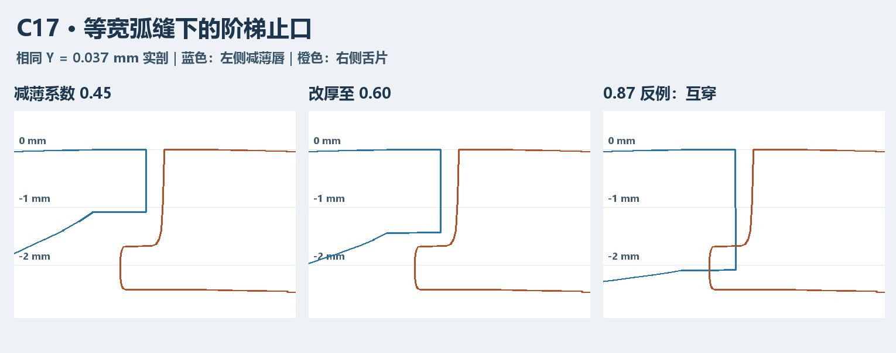
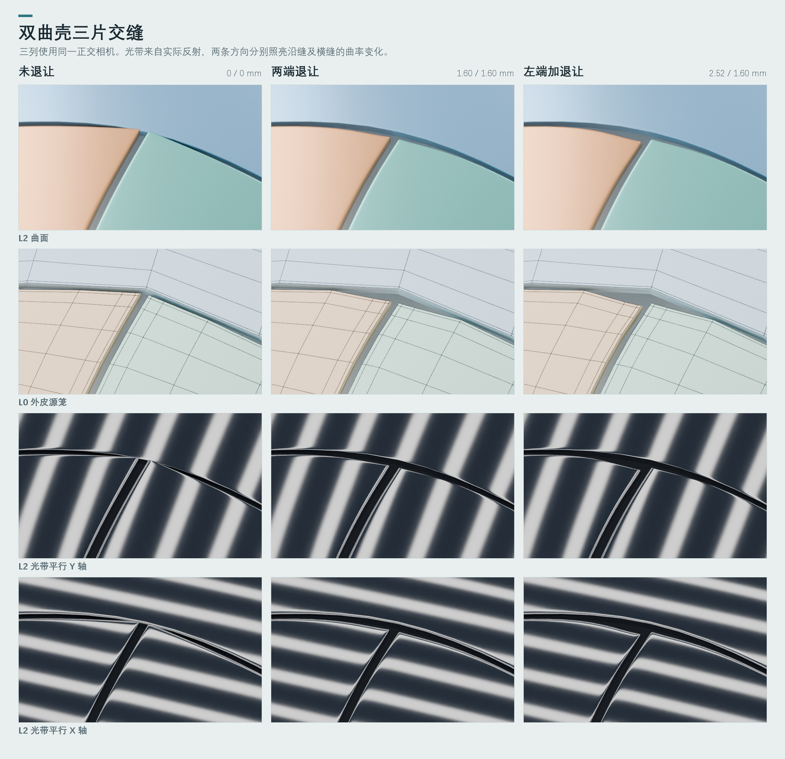
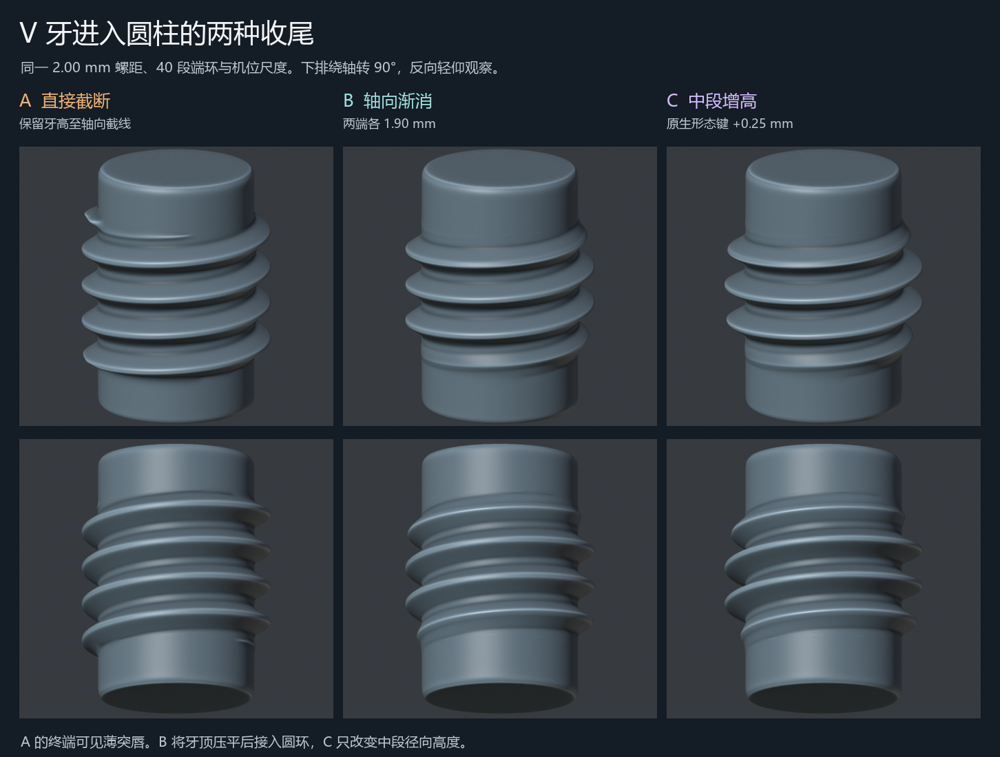

# 跨件装配与结构接口

单个零件画得再顺，装在一起透空、穿插、高光断层，整件资产一样过不了近景审看。把分缝结构、装配间隙、活动行程和常见成型接口按真实工业逻辑搭稳，整机白模才站得住脚。

## 一、三类外壳分缝与隐藏止口

产品外壳的分缝看起来只是一条黑线，切开剖面完全是三种不同结构，建模前按用途选定一种：

| 分缝类型 | 剖面结构 | 适用部位 | 关键做法 |
|---|---|---|---|
| **藏唇止口缝（Stepped Seam / Rabbet）** | 外皮之间留等宽可见缝，一侧内壁伸出隐藏舌片（止口）搭在另一侧内唇底下，既遮光又定位 | 消费电子上下壳、电池盖、汽车门缝、头盔检修盖 | 可见缝宽与隐藏舌片轴向净空分开建；舌片厚度留足余量，防止加厚后表面缝看似正常、内部早已穿插 |
| **实翻边对缝（Returned Flange Seam）** | 两片外板各自向内挤出深翻边并倒圆口唇，中间用独立内衬/底盘遮光 | 汽车钣金（翼子板/机盖/前后保）、家电大壳、飞机蒙皮 | 先做连续母面再分件，近缝留等距支撑带；内翻深度足够挡住斜视漏光（汽车钣金常见 20–60 mm，小家电 3–8 mm） |
| **装饰浅槽（Material / Panel Groove）** | 同一件外皮向内插一圈窄槽，有槽壁和槽底，视觉分块但物理一体 | 机身腰线装饰槽、同材质一体壳假缝 | 跨折面周槽分段沿局部法向入槽，槽底保留连续四边面与足够残壁 |

### 1. 常用物理缝宽与装配间隙参考

在真实米制尺度下按产品体量设缝宽，确保中近景高光与阴影一眼真实：

- **一级消费电子 / 精密仪器**：外观分缝 `0.15–0.40 mm`，按钮与窗框侧隙 `0.20–0.50 mm`，透明屏幕与凹底防重面闪烁（Z-fighting）净距 `0.05–0.15 mm`。
- **二三级家电与手持工具**：外观分型缝 `0.40–0.80 mm`，活动键与磁吸可拆件侧隙 `0.30–0.60 mm`。
- **五六级汽车与航空器**：车身钣金分缝 `2.0–4.0 mm`（对应外唇倒角半径 `2.0–3.0 mm`），天幕/风挡藏缝 `4.0–6.0 mm`，外贴玻璃防 Z-fighting 偏移 `0.5 mm`（投影前提高玻璃细分密度，防止大跨度三角弦吃掉偏移净距）。

### 2. 三片弧缝交会与跨缝肩线对齐

- **三片弧缝端角退让**：两道支缝接入一条主缝时，三片各自的翻边在细分 L2 下最容易在尖角处互相顶穿。在支缝端角给翻边预留退让量，按站位顺序把翻边和回脚整体接出，并在 L0、L1、L2 三档全检跨件相交。
- **跨缝浅肩三点配对**：独立盖片跨过主壳浅肩时，在每处交界固定「低侧支撑 + 肩脊中线 + 高侧支撑」三个同名点，壳体和盖片同步维护这三点站位，让高光越过分缝不断裂。
- **盖底与固定承座拆开看**：从共用母面提取按键帽或盖板后，马上清理固定母壳上盖底下方残余的表皮，建出真实的承台凹座并沿按压方向留出键程。

## 二、活动机构、枢轴与全行程净空

凡是有开合、旋转、滑移或俯仰关系的装配，把运动结构直接做成可验证的装配层级：

1. **分轴设枢轴，锁定单一自由度**：把整机位移、总成姿态和单件运动分层挂在父级空物体下（例如汽车 `CAR → ALL_BODY + 4 WHEEL`，前轮空物体控转向、轮毂子件控滚动；飞机全机挂总控线框，活动舵面、起落架与螺旋桨逐件设铰链原点并锁定非工作轴）。
2. **静止位过关后查两端与中段行程**：沿真实转轴或滑轨测试起点、终点和最窄中间姿态（如铰链开合 `0°–25°`、车轮转向 `±25°`、翻盖 `0°–85°`），确认壳体边缘、轮窝挡板和内翻边在运动中全程留有正净空。
3. **错位搭接铰链与同轴多耳**：老虎钳这类半厚错位铰链，两个盘在铰链区各占轴厚相反的半层，盘外肩留一段错层过渡后再恢复全厚，避免销孔合拍而盘肩互穿；多耳同轴结构逐站核对轴向耳面间隙。
4. **包容关系用实剖检查**：一个小件完全落在大壳空腔内部时，两张表面没有交叉也会发生实体侵入。用装配轴向剖面或 `geometry-audit` 的世界毫米测线读取材料占据区间，分清合法贴座、有效间隙和实体重叠。

## 三、常见工业成形接口的建模要点

遇到以下典型工业结构时，按真实工艺特征建全四边源笼：

- **卡扣与悬臂扣臂**：从自由边向根部切两条平行释放槽，明确槽根到安装带的连续材料带；在剖面上留清钩齿搭接量与弹性让位空间。
- **钣金齐平搭接（Jog Overlap）**：需要两块板外露面齐平而在内部错层搭接时，在截面画出上下两道反向弯与斜腹，留出下层搭边长度与斜肩避让间隙。
- **薄壁活铰链与长筋防缩**：活铰链保留完整薄壁过渡段与两端开合止挡；外观面背侧的长加强筋在根部向两侧渐薄收顺，避免厚料聚堆。
- **双向拔模与侧抽倒扣**：有明确开模方向的壳体先锁定分型轮廓环，上下两侧各自按脱模轴给正拔模斜度（常见 `1°–3°`）；带侧向盲腔或扣位的结构确认侧抽退出顺序与净空。
- **真螺纹与螺旋牙收尾**：螺纹件先按配合螺母的边数定周向步数（如六角螺母配 18 或 24 段），沿右手标架建牙型；起牙与出牙段在半圈至一圈内沿轴向逐渐把牙高降回芯径，平滑汇入端环，消除硬截断造成的薄突唇和反射破口。

- **闭端冲压百叶与多层散热通路**：百叶在长边一侧分离抬起唇和平唇，两端接回同一对端点保持板皮连续；双层格栅或护网总成按实际流向贯穿所有层检查重叠净宽，确认外层开口没有被内层框架或轮辋挡死。
- **防漏光与灯组分层**：复杂壳体（尤其是汽车车底与轮窝、设备机箱）用独立封闭内衬或底盘封死通向腔内的缝隙；精密灯组把外罩设为线框安全笼，内部按固定深度分层布置反射碗、透镜、遮罩与镀铬饰条，确保各层零穿插。
