# 带图的布线案例

按正在做的部位选一例。每幅图来自本项目 Blender 5.2.1 LTS 的源笼、求值边线、实测截面或反射渲染。数值对应图里的特定试件。把工序迁移到新件时，保留边界条件，重新确定尺寸。

开槽扣臂、冲压开口和带螺旋的转接按各自连通条件查[成形件与接合部位的带图案例](formed-interface-cases.md)。

| 遇到的问题 | 优先读 |
|---|---|
| 转圆宽度失控，或桥接后肩部塌下 | [卡线距离和台阶](#卡线距离和台阶) |
| 同一条棱从宽到窄时亮带折返 | [分站调整圆角宽度](#同一条棱从宽到窄) |
| 补片封住了洞，但反射出现闭合圈 | [补洞的角点对应](#补洞的角点对应) |
| 两口段数不同，固定分区后仍无法全四边铺面 | [异段转接先数每一区](#异段转接先数每一区) |
| 空间弯管的顶轨在靠近安装口时转到侧面 | [空间急弯的截面相位](#空间急弯的截面相位) |
| 高密区的两条线需要结束 | [三价点、五价点与减线位置](#三价点五价点与减线位置) |
| 圆孔所在板面会卷成恒定半径 | [恒曲率板的贯穿孔](#恒曲率板的贯穿孔) |
| 双曲母面长缝的圆端拖出尖齿 | [双曲壳长缝的端圈](#双曲壳长缝的端圈) |
| 外轮廓渐窄，端头布线收成一束 | [嵌片的狭窄端弧](#嵌片的狭窄端弧) |
| 夹耳根的转肩反射牵到相邻螺孔 | [夹耳肩带与螺孔](#夹耳肩带与螺孔) |
| 短硬棱进入双弯大面时亮带突然断开 | [双弯面的渐消硬棱](#双弯面的渐消硬棱) |
| 三个不同方向的圆口要接成同一张皮 | [异径三通的开放半环](#异径三通的开放半环) |
| 球形端盖进入直圆筒时出现环凹 | [四边球的半球端盖](#四边球的半球端盖) |
| 薄壳减线后仍要贴合底座 | [开放壳的底部返边](#开放壳的底部返边) |
| 起厚后内角折回，或两条返边相撞 | [返边的内偏移净空](#返边的内偏移净空) |
| 重复齿形需要一次改完一圈 | [单扇区建整盘](#单扇区建整盘) |
| 圆环插一列后，源轮廓相同而细分变鼓 | [圆环的单跨插线](#圆环的单跨插线) |
| 独立盖在相对两处跨同一浅肩 | [左右跨肩的源笼配对](#独立盖在两处跨过浅肩) |

## 卡线距离和台阶

先关闭细分，沿一条需要成圆的棱找出棱本身和截面两侧的支撑线。若轮廓正确，先移支撑线再重看原位置。方块试件把支撑距从 0.8 改成 2.8 mm，源笼始终 54 面，原尖角到 L2 截面的退让量从 0.189 增至 0.660 mm。观察三条棱交会处的转圆宽度和直边亮带。退让量用于比较这两版的形状，实际圆角半径需单独测定。`方块工程`

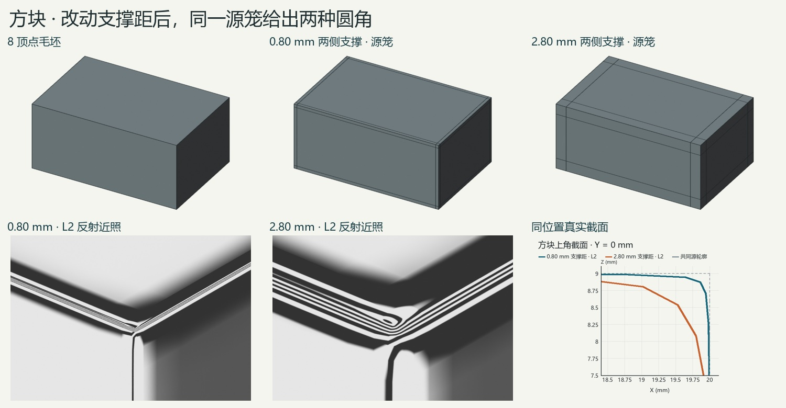

套筒先把内孔、台阶和外圈的尺寸定下来。标记两环上同一物理方位，核对 16 个站位一一对应，再 Bridge。滑移一圈支撑线，把它到台阶的距离由 5.70 缩至 1.54 mm，源笼保持 240 面，L2 外壁的收缩移近台阶。遇到反射横穿成螺旋时先复查两环起点。`套筒工程` · `相邻截面实测`

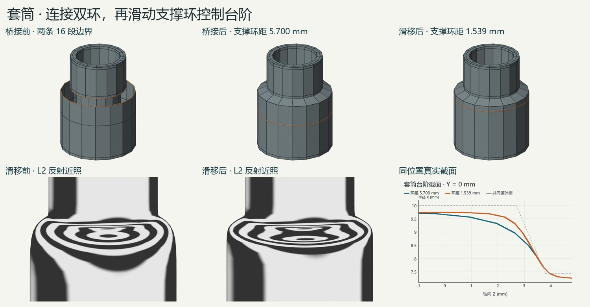

### 同一条棱从宽到窄

先在两端分别定好圆角中线、两边的切线行及支撑行。将截面上的同名点逐站相接，让五行一起随宽度变化。从直棱上的宽段进入窄段时，先保留足够的过渡长度。用同一灯位查看亮带弯折，再沿棱逐站切测。在 128 mm 长棱的试件里，相同 360 源面下，把宽度变化从中央 4 mm 分摊到 68 mm，每 1 mm 测站间的 L2 最大退让变化由 0.352 降到 0.056 mm，中央的套圈反射消退。

只改一端时，先记录旧过渡在保护边界的宽度和切线方向，再从那里接到新的端宽。直接叠加窄端位移曾使途中先变窄再回宽，X 向条光多出第二块暗斑。重做过渡后，窄端实测退让由 1.018 增到 1.666 mm，宽端仍为 3.072 mm，保护区 2,648 个 L2 点保持原位。用实际斜剖的退让比较变宽速度，圆角半径另行量取。`宽窄倒圆工程、实切与失败改型`

## 补洞的角点对应

找到两组对边和四处应续接的角。在这块 24 边缺口上，长边各 8 段，短边各 4 段。固定同一活动顶点，Span 8 的两版都补了 32 张四边面。Offset 4 让行列接回原来的面带，Offset 2 把最小面内角挤到约 7°，二级细分仍出现两个回折。开新件时用实际边界的活动点重新找 Offset。沿补片内外各追一条线，再抬高内点试改；边界应留在原位。`填补前后工程`

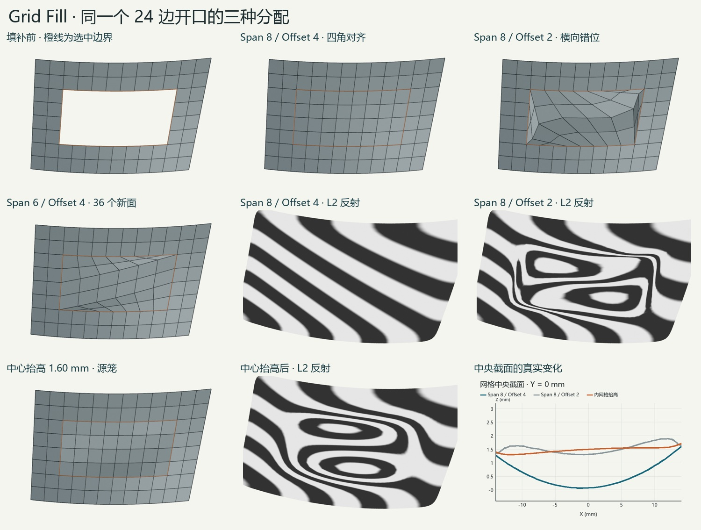

## 异段转接先数每一区

定两端安装面，在各自坐标系标出配对地标。若四对地标都必须保住，就按实际纵界把转接分成四区。这个错位斜口为 16 段接 12 段。全部选两段纵界时，每区共有 11 条边，四次原生 Grid Fill 都新增了零面。按 2／3／2／3 相间安排纵界后，每区为 12 边，可手配八个四边面。局部轴增宽中截面 L2 实测 137.113→147.991 mm，两个端环同级位置保持。极点带仍会挤弯反射，安装口绝对尺寸以交付细分级别重测。`实际隔离改型与两向掠射` · [全四边边界的偶数条件](https://air.unimi.it/bitstream/2434/869863/2/2021-Reliable-feature-driven_compressed.pdf#page=10)

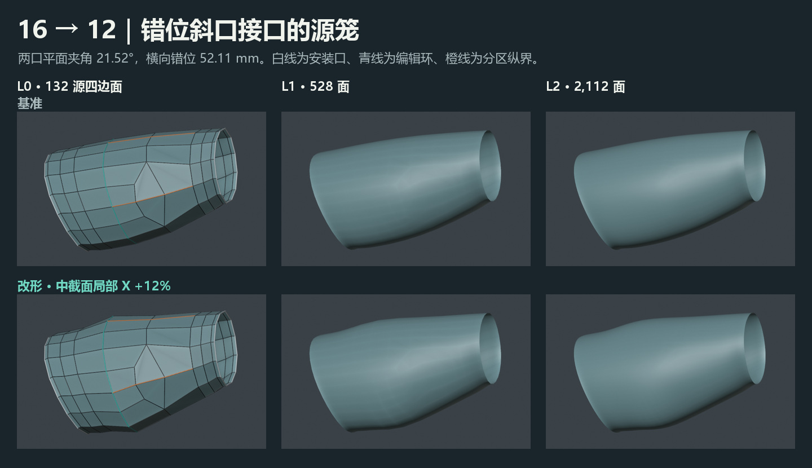

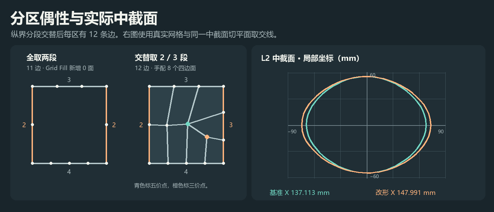

## 空间急弯的截面相位

把安装口的朝向和站位相位都标出来，每道截面分别找顶、左、右，再连同名点。若只从入口运送最小转动，累积偏角可能在固定出口一次追回去，产生一圈收腰。教材的默认输运在出口前跳转 95.51°，那一跨纵边的中点最小半径约 10.09 mm。逐环按设计顶定向后，该跨回到 15.00 mm，出口附近的反射闭环也消退。可沿截面平面投影指定顶向。临近切线与指定顶同向的位置，另设截面导向或连续约束，避免投影退化。改半径后再查两安装口和中间纵轨。`源笼、两向反射与改径实测` · [Ariel Tan 的原例](https://discourse.mcneel.com/t/untwisting-twisted-subd-edge-loops-in-a-multipipe-with-no-branching/168326/5)

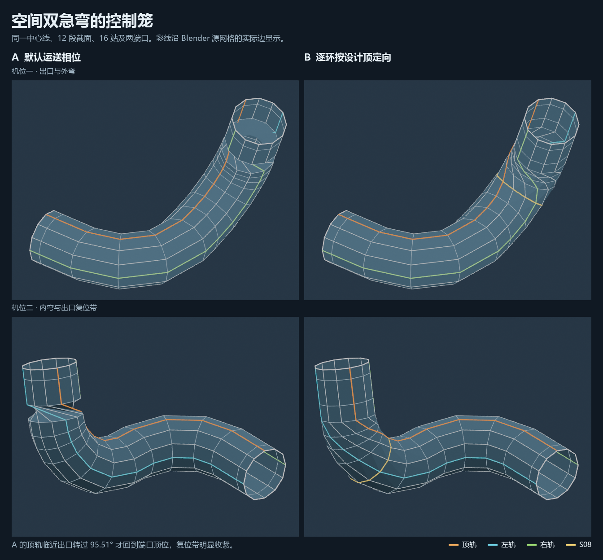

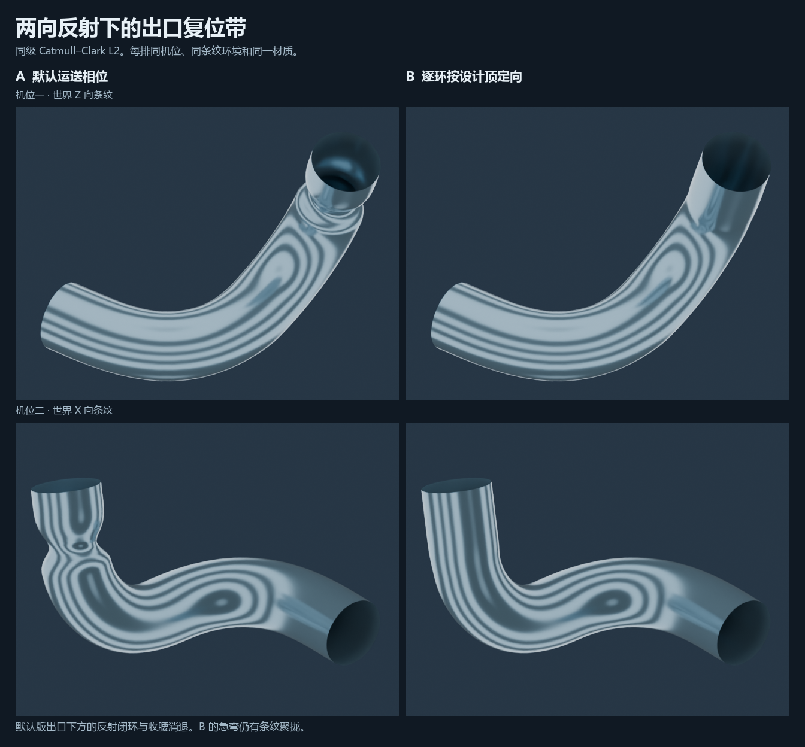

## 三价点、五价点与减线位置

确定必须贯通的轮廓线和需要结束的附加线。在七点横截面向五点横截面过渡时，用中央菱形四边面和相邻两张四边面收掉中间两条线。在工作副本上把同一转向依次放到冠面、紧邻平面及更远的平段。冠面方案最省面，却出现孤立闭环高光。保留一站普通截面后再减线的版本，反射接近全长通线版，源面只省 3 个。若下次要连续选中整条纵线，保留全长通线也有用。`四种可编辑笼`

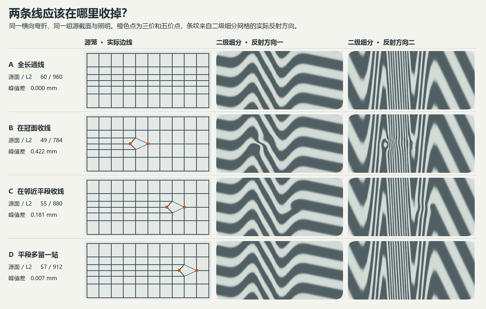

## 恒曲率板的贯穿孔

先把可沿单轴展开的板定为平面，在源笼上留孔口、内壁和固定外缘。依次求值 Catmull–Clark 和 Simple Deform Bend。每种修改器顺序各保留一件无孔母面，以相同机位观察孔肩两方向的反射。需要让固定轴上的圆柱穿过时，先给平板孔环预留弯曲方向的展开量，再测实际圆柱通路。图里两种有孔件同为 638 源面，先平后弯的孔肩更连贯。双曲率或可变半径模型另从实际截面建笼。`平板工程、预留量和改孔试验`

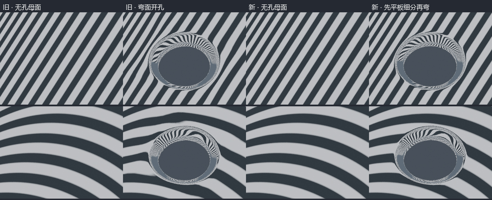

## 双曲壳长缝的端圈

留一件连续母面作反射基准。实际接好长缝的开口、唇口与翻边，再比较只改端部外侧过渡圈的两版。若过渡圈紧贴唇口，下一带的长瘦面会把反射拉到缝外。让过渡圈在长边到圆端之间逐站放开，外界边线、开口与唇口仍可固定。两版同为 256 源四边面，张开后的左端反射折回消退，两端尖齿变浅。进一步单独加深右端翻边 7.00 mm，复验另一端、开口与外皮。这里的间距按该试片的尺寸成立，贴唇附近仍有转折。`试件与改深验证` · [原作者圆头长缝](https://blenderartists.org/t/how-to-make-a-nice-curved-slit-segment-on-a-mesh-with-subd/1371141)

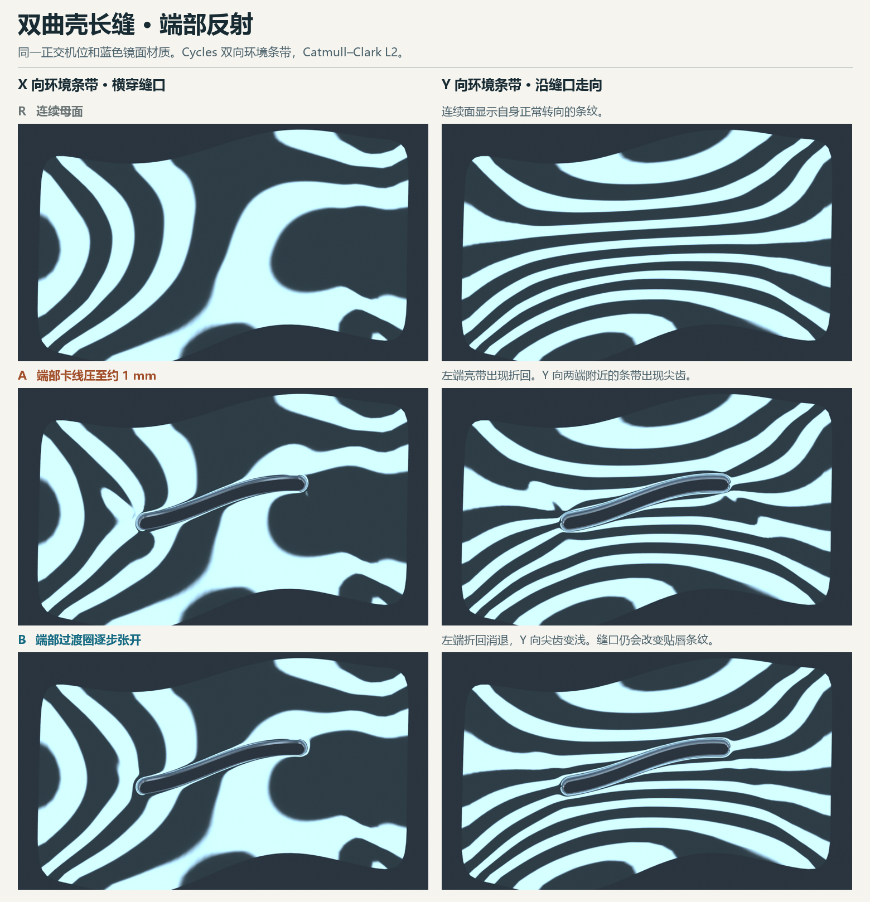

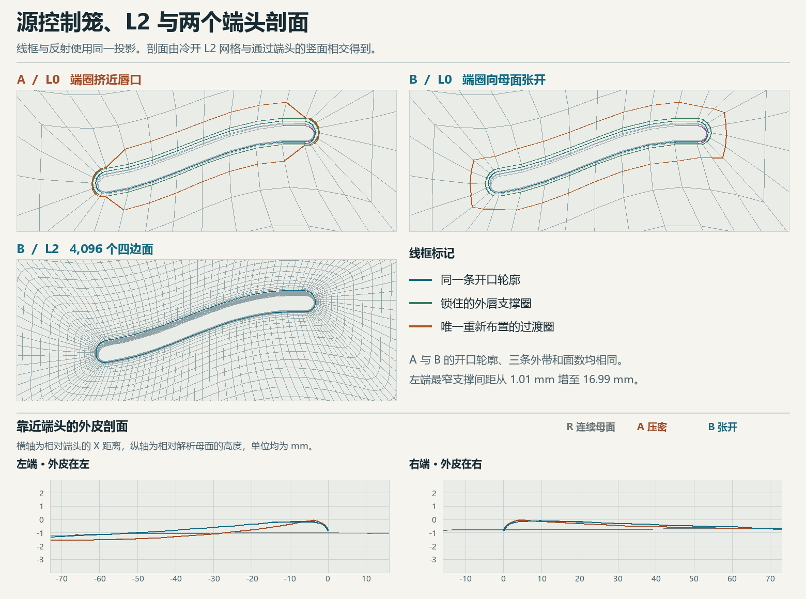

## 嵌片的狭窄端弧

沿上侧壁固定外轮廓，再向冠面铺支撑带。删一圈支撑后先看俯视源笼。若向内等距收边把几排线挤成一束，为端弧分别定截面宽度与四个对应点，再逐排接回长边。案例中两版均为 162 源面，内圈短边由 0.224 变为 1.509 mm。沿冠环选通 20 边并抬高 0.4 mm，复验原装配测点与全局净空。两向反射带有可见展开，极端处的回钩仍限制镜面近景。`工程、剖面和改型数据`

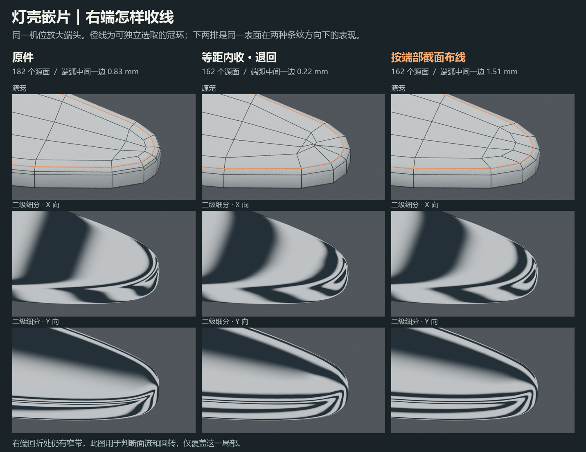

## 夹耳肩带与螺孔

同时查看弧形母体朝夹耳转折的位置和螺孔卡线。旧笼用一圈面从方形外边直连圆孔，两种转向挤在一带。只旋转孔外支撑环可校正方位，根部折钩仍在。将同一圈拆成连续的窄肩带和再转向螺孔的面带，20 个额外源面使根部的 X 向折钩缩短。肩带若经过齿盘承面，整圈抬高会撞件。试着只横移七个根部点，再复测导杆孔、螺孔轴、夹紧缝和齿盘配合。新件在这些范围通过实测，前缘的小聚拢仍可见。`夹耳工程、完整纵剖和配合记录`

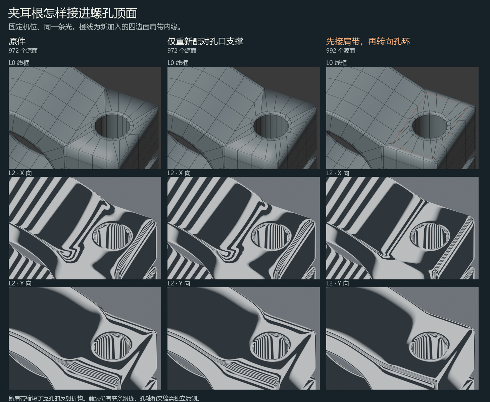

## 双弯面的渐消硬棱

保留外轮廓和邻接线。先在同一源笼比较满权重突然归零与沿数段逐边减小 Edge Crease。横向条纹扫到停止点时，骤停版有孤立亮斑，逐级降权版该亮斑消退。若使用两条支撑线，就沿锐段靠拢，并逐站往大面张开。支撑线版仍可见 V 形尖端，但给了独立编辑脊线和两侧过渡的入口。三版都是 88 个源面。改线后重查端头两向反射、剖面和固定邻接线，案例改线附近出现的新回弯仍待处理。`Blender 工程和改线复验` · [Piker 的硬棱渐消原图](https://discourse.mcneel.com/t/wish-add-please-creasedivision-tangencyhandles-to-crease-control/98171/18)

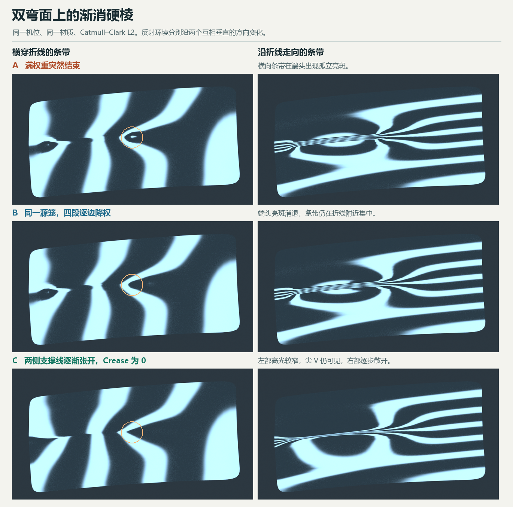

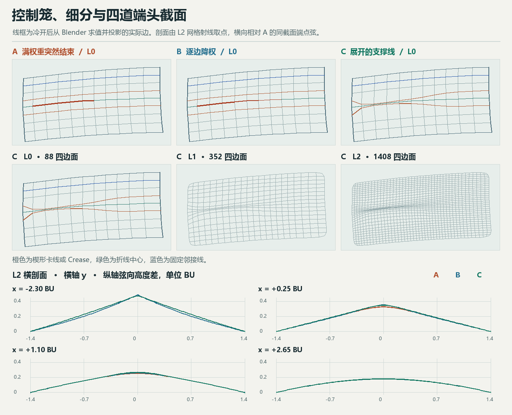

## 异径三通的开放半环

给每个根部圆环画出朝相邻两支的开放半环。先逐对连接三个四边面带，再用短跨中线将上下缺口各分成三片；中线和桥接带端边都是后续放置冠点的参照。图中三件均为 120 个源面，整块压低补片会在 Y 向反射留下新黑斑。按三个管口冠点定斜面后，中心不再出现该黑斑，窄角叉根仍有聚拢。编辑一次冠部并逐条检查未动的端环。此图覆盖单层外皮，正式管件需要实壁、下料直径和净空验证。`三个可编辑版本和端口复测` · [Phil Cook 的三通原例](https://rhino3d.co.uk/rhino-for-windows/an-introduction-to-subd-subdivision-surface-modelling-in-rhino3d-v7/#:~:text=A%20simple%20example%20of%20this%20is%20the%20Y%20branch)

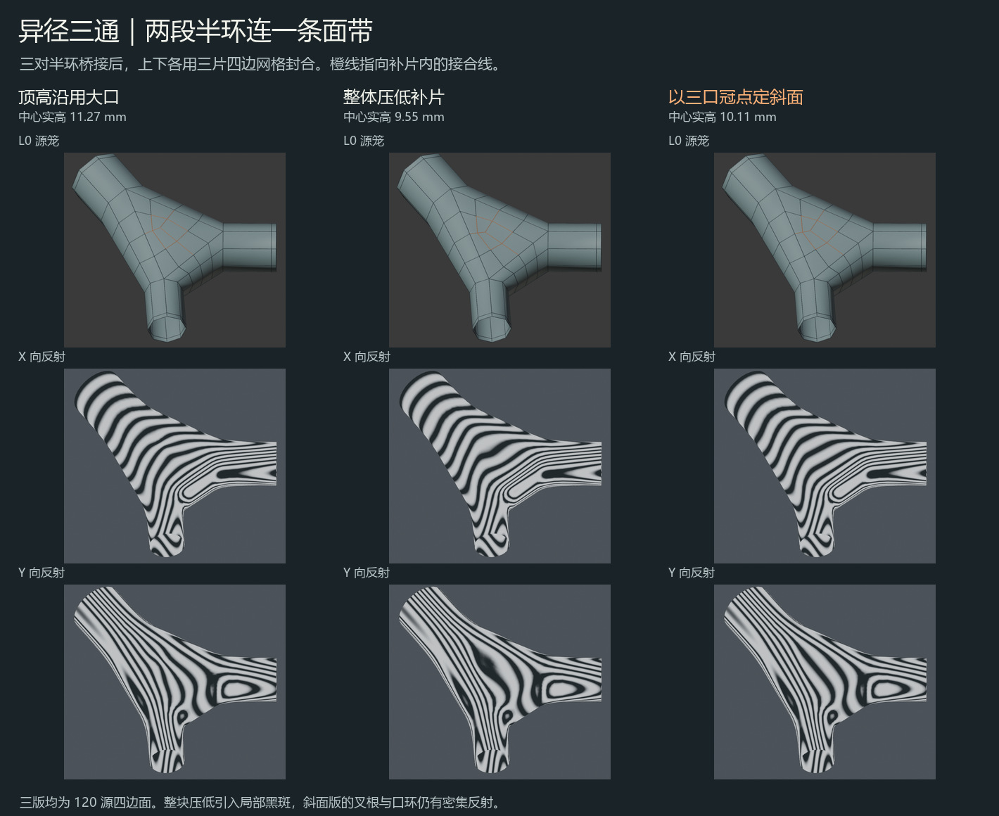

## 四边球的半球端盖

沿四边球的规则赤道留下半球，按同段环接出直筒。若现有筒端靠连续缩环与盘状补面收尾，先比较条纹是否在补面边界突然转折。在试件上，半球笼有 96 源面，缩环加原生 Grid Fill 有 112 源面，后者端冠的平补边一带能看到反射拐折。保持赤道与安装口固定，轴向压缩半球的端冠顶点。试验中源端长 25→18 mm，固定口沿和四个轴向截面保持原位。大幅压缩后仍应检查两向条纹和边缘渐变。`三版工程与实测` · [kosh3d 原作者对照](https://polycount.com/discussion/237599/wip-subd-topology-maya-best-way-to-close-rounded-bottle-test-tube-end#Comment_2802827)

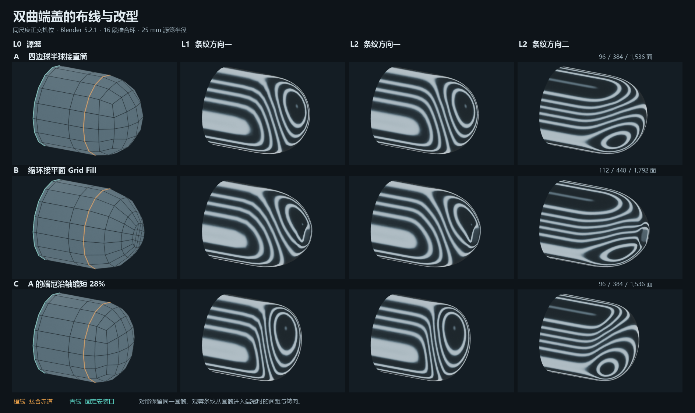

## 开放壳的底部返边

明确哪些翻边负责遮光，哪些承担定位。删线试验同时取外轮廓、功能孔口和底边的真实剖面。双开口罩壳把侧窗多余排线在肩以下结束，精简底部返边并去掉一条内肩环。源面由 1,772 降至 1,400，两个开口仍可单独改大，底部两处截面偏移达到 0.503 mm。外观练习可用低面版，原底边作为贴合基准。`整壳线框、孔口改型与测量`

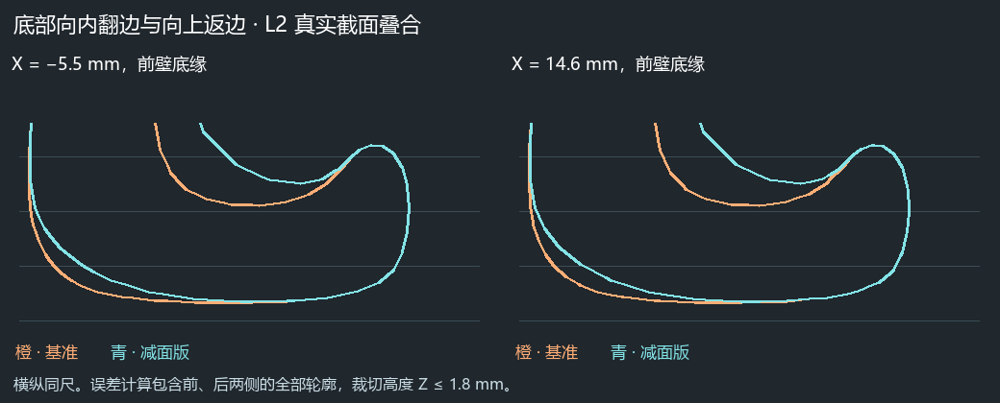

## 返边的内偏移净空

内偏移先看两个地方。沿单条圆转的实测截面，圆弧在理想偏移后剩下 `R − t`。等于零处是塌缩点，小于零时按可能折返检查。面对面的两条平行内壁则另看 `g − 2t`，其中 `g` 是两条外皮直段间距。在固定 Solidify 厚度 1.30 mm 的试件上，增大单角半径消除折回，拉开两条返边则消除相互穿越。两项各检查三个切面。弯曲区真实最薄处和其他方向的干涉仍需实测。`开放试片、剖切坐标及工程` · [Normand 的原始偏移诊断](https://discourse.mcneel.com/t/offset-subd/144228/10)

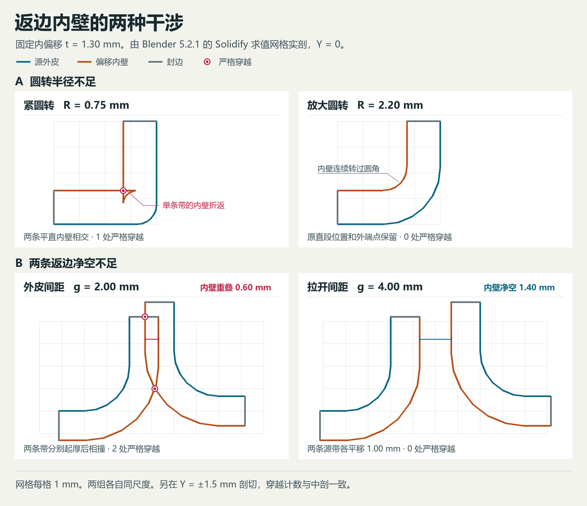

## 单扇区建整盘

先把一个扇区的首尾截面放到同半径、同高度，再按轴心复制。齿盘用 68 面的 15° 扇区定义一齿，Array 使用同轴 Empty 旋转，开启相邻及首末合并，Catmull–Clark 放在合缝后。确认整件单一连通，再只抬高本地六个齿峰源点，复查 24 齿一起变化。完整建模和单扇区建模的 L2 都是 26,112 面，选点维护成本按 68 源面计算，消费端几何预算按整盘计算。`扇区工程和完整运行数据`

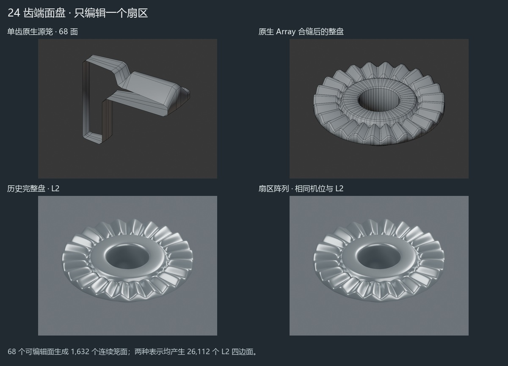

## 独立盖在两处跨过浅肩

按同一组实际截面给盖与壳各自布点。在两处盖缝分别配对低侧支撑、肩带中线和高侧支撑。先从外壳跟到盖内，再追到另一边；如果角部过紧，在缝外给孔框另留一圈过渡。右端加长时同步移动盖端、近端卡线和壳口右端，复查左端的肩站与固定安装孔。以下图的橙线取自保存工程的实际边，同一条肩线在缝两侧的两端均有编号。`工程、白模及面数`

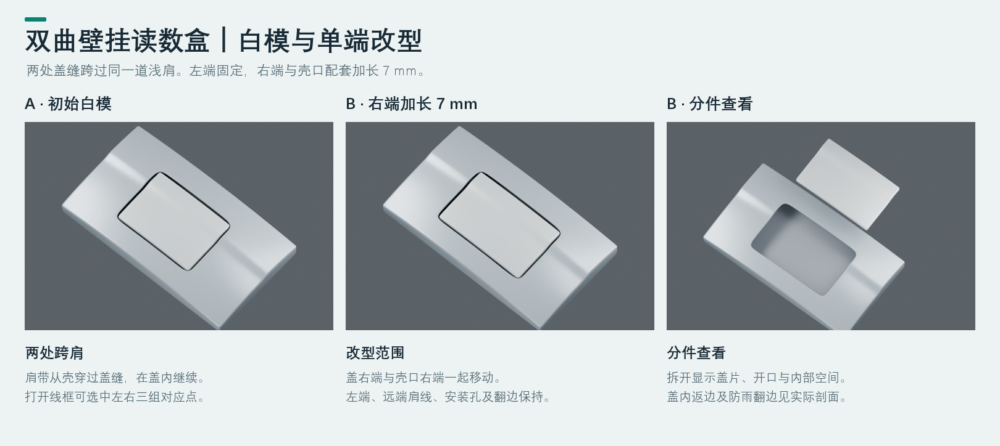

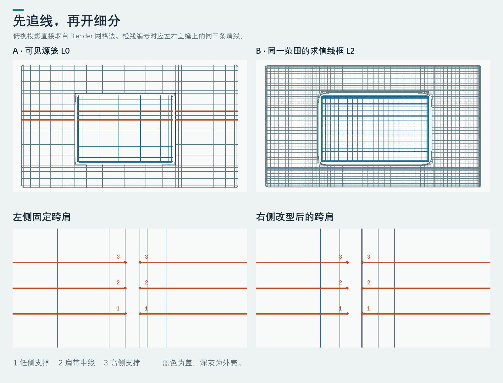

在同机位换两个方向的条光。Y 向照出肩线连贯程度，X 向有助于察看盖角和壳右端的高光集中。此试件右端和近盖角有轻微聚拢。源笼沿整壳铺框宽，方便追线，进入面数优化时可研究把部分开口列收在孔框附近。盖底靠近邻边时需要同坐标实切与整件检查。[短侧翻边实证](formed-interface-cases.md#盖端与固定防雨翻边共用短侧空间)

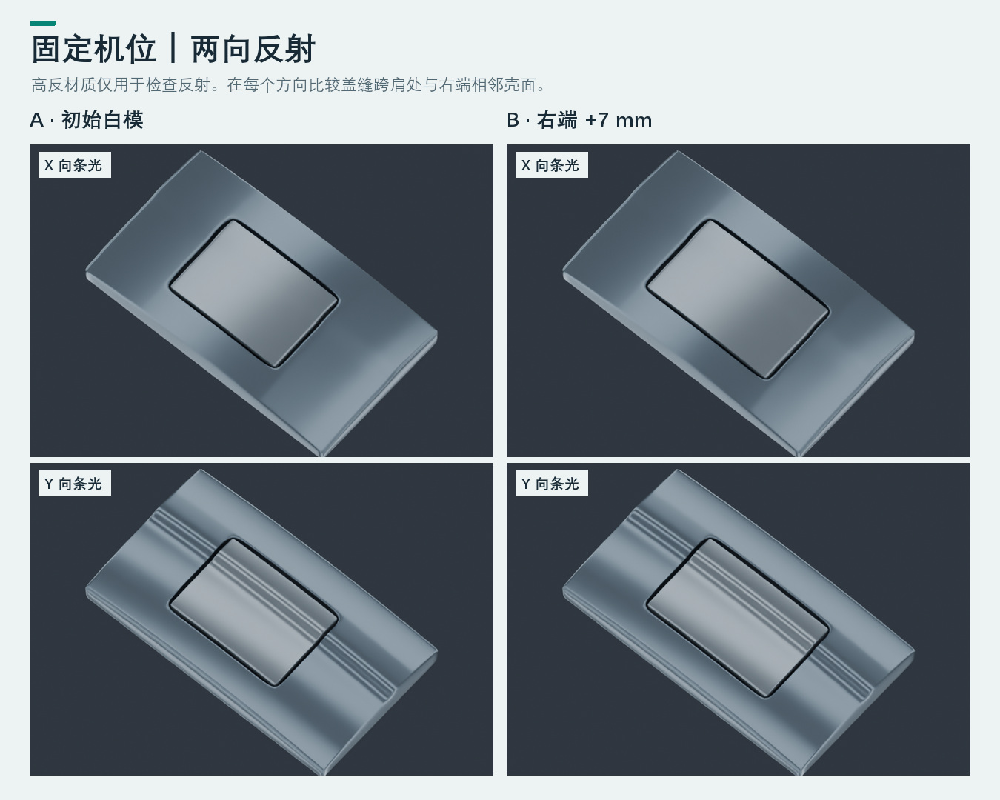

## 圆环的单跨插线

在低密圆环的同一条弦中点加一列时，源轮廓仍然重合，细分权重已变。用轴视对照，再量实际 L2 半径。试件的八段规则管环插线后，外壁截面半径极差由 0.178 增到 1.288 mm。将九列按等角重排并补偿规则细分的径向缩量后为 0.136 mm。安装孔或缝位锁定时，先画保护点再决定能否重排；本次 C 版允许其余角度重分布。`三版工程、原作者与实测`

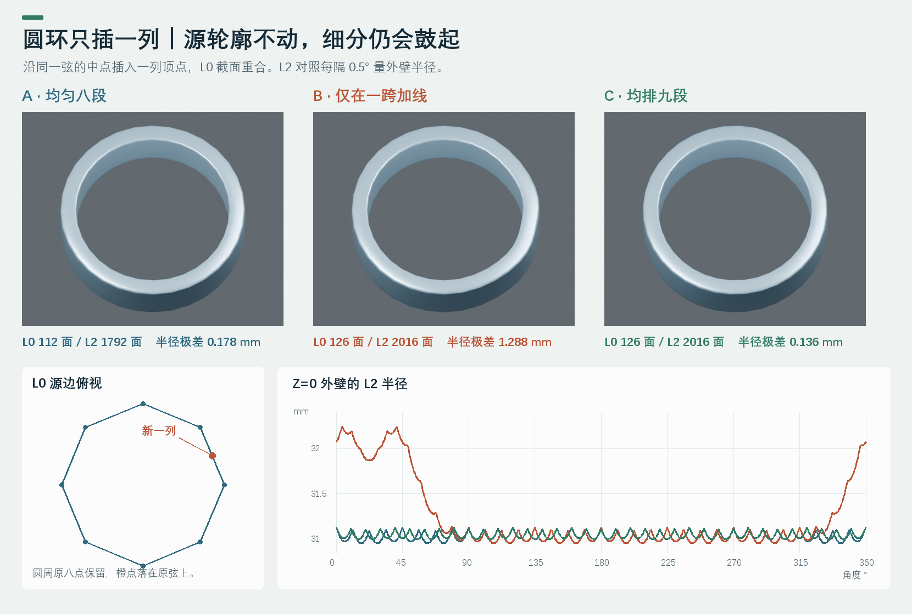

### 直边插线也要看被切边的邻跨

优先在连续的平直段为新增特征或接边补截面。先追到最近的弧或折肩，再决定新增截面落在哪一跨。原边线保持原位时，插环仍会改变 Catmull–Clark 在邻跨的插值。圆角框上，同样在一跨中点插 13 个点，直段中部的所测圆角无变化。靠切点的最后一跨虽为直边，L2 圆角仍偏 0.063 mm。直接拆分一条弧弦则偏 0.114 mm。发现亮纹偏移时先重看切点附近的跨长和弧段相位。需要改半径时，移动切点并一起重排整段弧，固定用于安装或对位的直段站，再量求值后的圆角和直边。`五态可编辑工程、线框、两向条光与实剖`

## 支管短侧的边流去向

大重叠时先查母筒与支管在短侧还剩多少原圆周。整圈同时收紧会把两条支撑挤到一处。保持远侧绕行，在受挤的一侧把部分母线转入支管根，再留足一个独立的出口整环用于保持圆口。大重叠试件同面数时的 L0 最短边由 0.665 增至 1.300 mm。斜支管倾角改大后仍重查短侧实剖、主筒背面和端口圆度。等径 Wye 可以先配对三条共享半环，减少需要编辑的面。六价点附近有明显反射聚拢时，比较分块冠面。实证中共享弧版 144 面，分块版 216 面。分块冠区较宽，可单独抬冠，代价是增加面带。`两种三通原型、改型和双向条光`

## 角度、偏心和段差各有独立支撑

倾轴凸台的孔轴和远处母筒先锁定。用随局部轴转动的配对顶环、根环和外接环接出凸台。在根带的短侧留出消化倾斜高差的宽度，再分别试增高和增径。扩径后若短侧亮纹仍聚拢，按实际视距再决定根带取舍。异段平环盖先定整圈开口和外肩，再把段差留在平环中间。样件把 24→16 的转接挪进外肩后，所测截面极差从 0.0097 增到 0.1064 mm。`凸台、异段环盖及保外裙改孔`

## 相邻角先算短棱净跨

在同一条短棱上，从两端按实际切线站量出占用长度。相减后若仍有正长，可为中段保留两个可独立改动的截面。净跨为零时可将两端共接一个真实截面。净跨为负时，先减退让量，或取消独立中段并重接；已有的两圈不能继续按反向站位桥合。10 mm 壳体保留两端各 7 mm 的试件，在 L0 的严格相交检测为零，L2 却有 280 对穿插。减到各 4 mm 或共用中央截面后，L0/L1/L2 均未检出严格相交。共截面会改变原独立短棱的过渡外形。`短棱净跨和中心实剖`

急角补片从固定的三侧面带取边界，先看连线能否追到原切向面带。在 41° 板角，六边界点与中心不动，比较三角扇和三张四边片，后者的边流更易追到相邻两侧。两种补片在掠射角仍有局部亮圈。三道固定界线还可比较圆滑、混合、斜切补片，结果以实剖和目标高光判断。`41° 急角` · `固定边界三种端角`

## 固定口缘并分开处理角部坡度

同一平面中的两条固定直边给平滑角点限定切平面。两侧都要求陡入时，先决定是否允许靠角变缓。必须立即变陡的造型要考虑保留明确折线，或改动口缘几何。50 mm 方口的缓入版保持口缘和远侧截面，近角两侧同点法线差由 70.96° 降到 19.15°，反射的集中转折展开。该读数来自选定邻点，用于判断局部变化。`方口固定与缓入对照`

## 独立处理连续肩线、洞壁和镜像邻行

开放轮拱先定孔口和顶部转接位置，肩线沿拱边切向接回前后面带。渐消端同时调高度和支撑行宽，给两行分别留真实站位。弯翼窗口先做共用口沿，外皮两级下沉，嵌片继承口形后独立保持缝。在前缘进气处把外皮向下向外铺，把内壁向下向内铺，两端按同相位接回，并在改内壁后复测实际喉口。椭圆凹坑限组贴合应保护坑壁、坑底及紧贴唇线；开启全网投射的对照会把坑压平。镜像处让第一排点留在镜面上，第二排沿镜面法向对齐。改近缝一处时成对调两排，复查同位置的面角法线和未碰的远端。样件贴镜面对齐后，指定对称点面角差由 13.403° 降至 0.526°。`七组实物、三级线框和光带`

尖角槽的坡流与底部回折要分别检查。先固定要求保持的尖角和远处母面站，用原母线承接平行段，为斜向段单独安排支撑。底部需要就地转向时，核对合点后的真实面连接。专项试件同为 56 个源四边面，焊合两对端点并以菱形面改接后，实际对边轨迹由三跨减到一跨。沿循环实选复查，同时确认同位两向高光的变化。单独改深 0.80 mm 后再核对尖角 XY、远区和剖面。`合点与菱形转向的真实边流`
