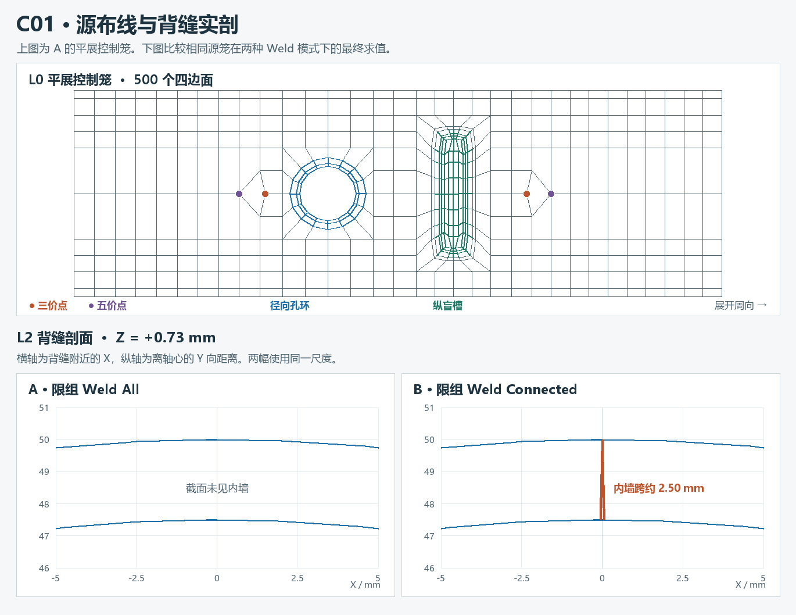
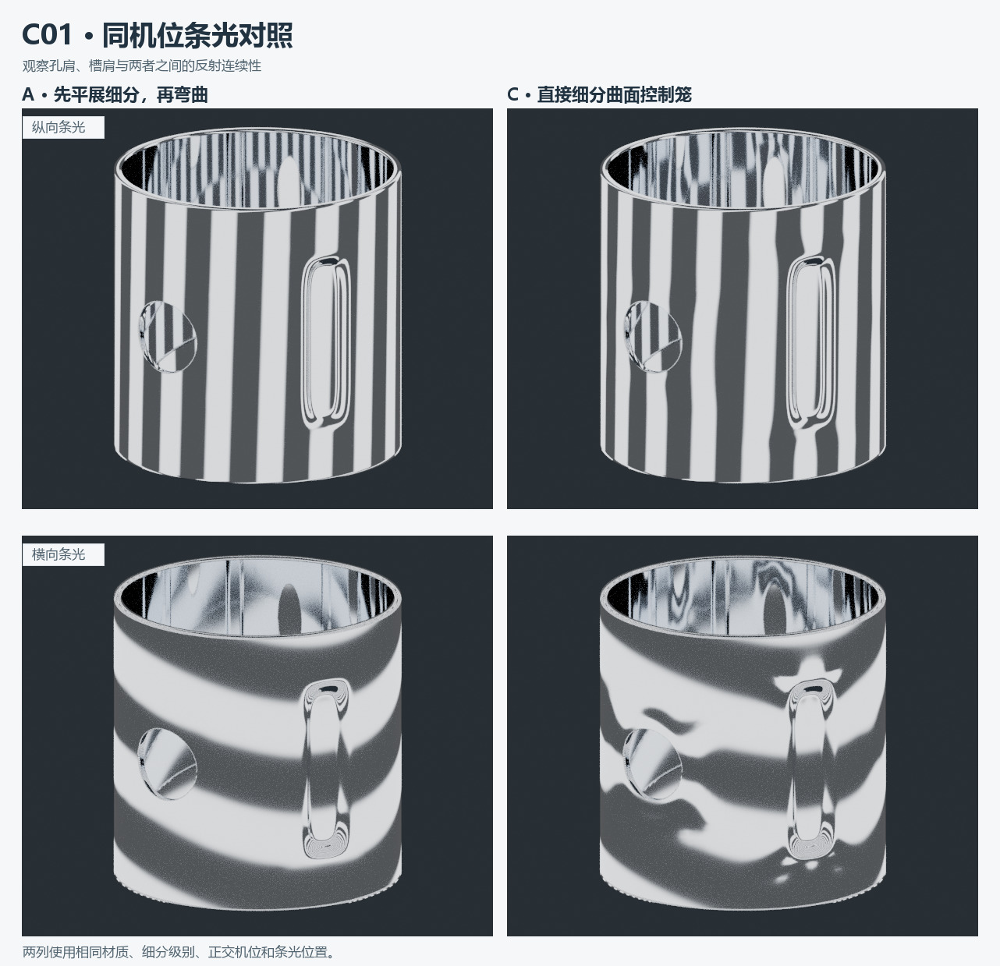
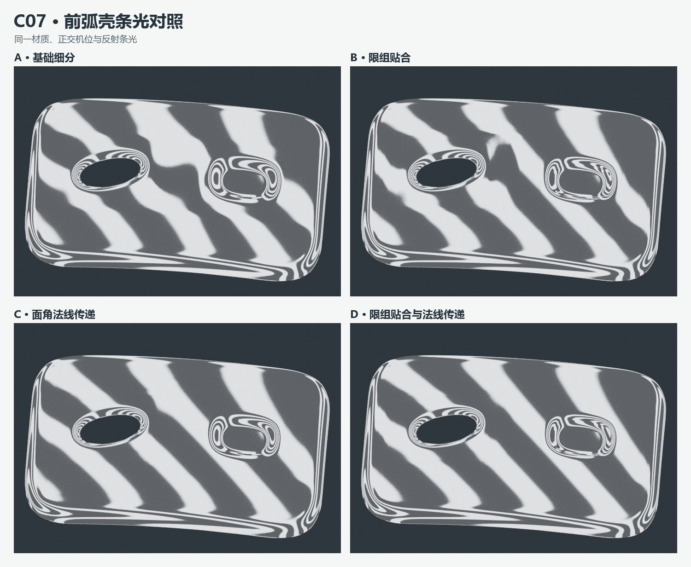
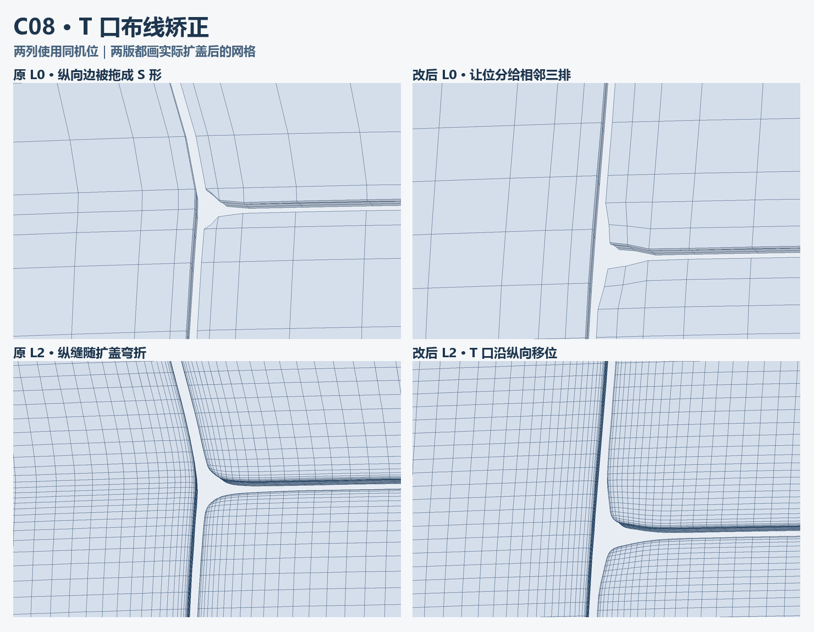
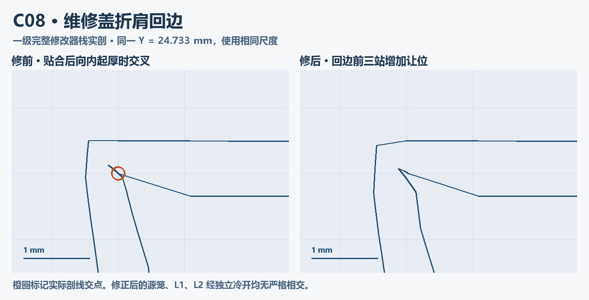
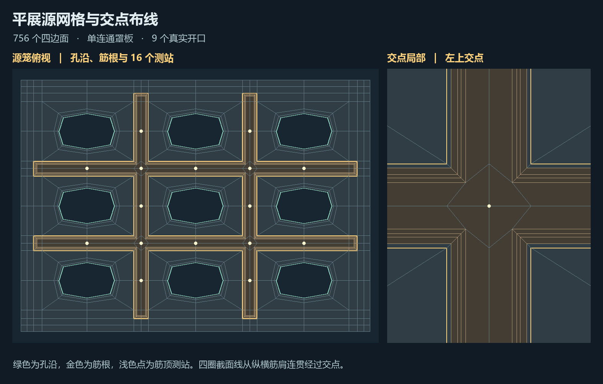
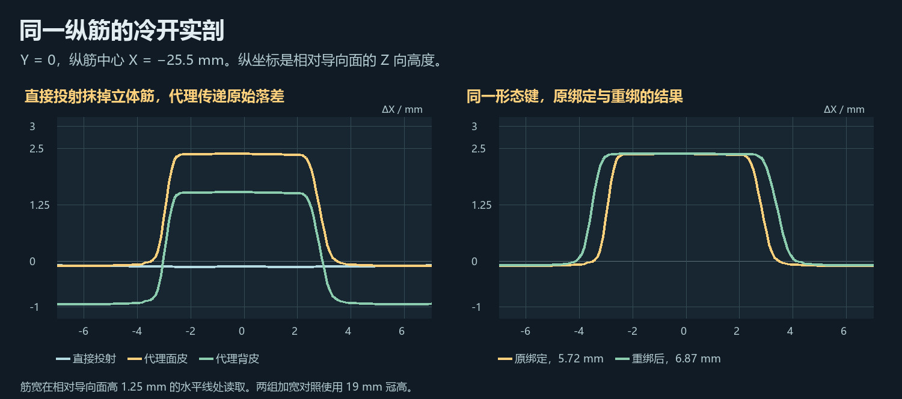
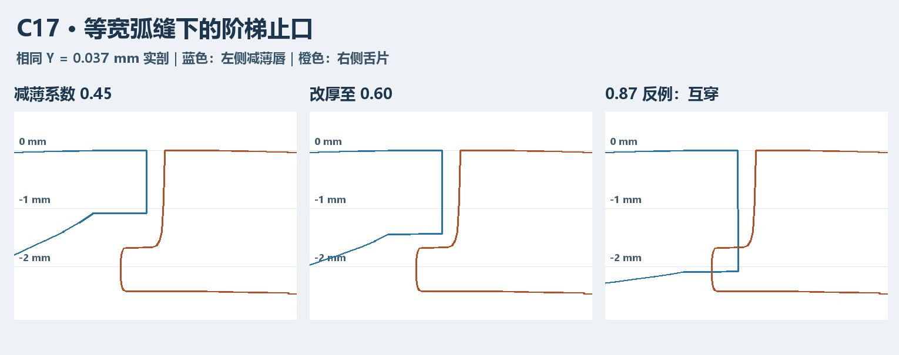

# 曲面同体多特征实证

看实物时保留源笼、一级完整栈和二级局部。改型前后固定相机、观察方向、尺度和裁切，沿孔环、肩线、转向点和接合边追线。关闭 Subdivision 的优化显示可检查新增边。对窄支撑面和内侧倒扣补实剖。据此定位哪一层改变了边流，面数及闭合计数用来交叉核对。

按需回读`案例台账`里的可编辑工程、真实线框与冷开记录。要找教程来源及其实际覆盖，查`来源对照`。这些实证使用 Blender 5.2.1 LTS。

C21–C25 的斜交鞍肩、扭转扇区、滚轮井、变导程和双层百叶集中在[高阶曲面相贯、闭合重复和分层接口](advanced-single-body-studies.md)。`第四波来源对照`

## C01 · 恒半径套筒上的径向孔与纵盲槽

**先定编辑对象和保护截面。** 在展开坯料上建两个独立周界。把决定净孔的三圈与决定槽肩、槽壁和槽底的面带分开。两条局部加密行从特征区穿过，在两侧用各一对三价、五价点收回。留出常规面带再转向。把展开缝放到背面，按同一站位保留两列待焊点。

**逐层验闭缝。** 对单轴恒半径件，先在平展笼上细分，再 Bend 卷圆、限组 Weld、向内 Solidify、限域 Bevel。先在 Weld 后数背缝配对边，再打开厚度切实际背缝。C01 的 All 和 Connected 在成品层都为零开边。Connected 保留了两条相互分离的端边，Solidify 随后把它们包成内墙，三个截面均跨 2.499 mm。All 在同样的三个截面未见该内墙。Weld 的阈值按真实待配对点距和非目标点距取值。

**按需要交付的孔截面来展开。** 径向穿孔的切向净宽受更小的内半径限制。以外半径 `R` 将角度换回展开弧长，以 `R−t` 估算向内起厚后的限制截面。内沿切向目标偏移为 `u` 时，可试 `s = R·asin(u/(R−t))`。再用最终求值的孔轴和两条中心线复测，细分、起厚、倒角会各自改变孔截面。R = 50 mm、t = 2.5 mm 的 C01 原型两轴差由 1.102 mm 降至 0.175 mm。用形态键只改孔的三个环，净孔由 25.512 × 25.337 mm 到 29.440 × 29.235 mm，盲槽三站深度和径向壁厚仍约 2.50 mm。

**用同源对照区分改栈和减线。** 把同一源笼弯好再细分，与先细分后弯比较。C01 的后者在同机位横向条光上减轻孔肩外和槽端附近的亮纹折返，18 站外皮径向 RMS 由 0.3193 降到 0.0106 mm。减线则另与保留全程密线的 D 比较。源面 536 → 500，完整 L2 面 17,728 → 16,576，所测孔槽尺寸保持，远区采样有小幅差异。

**实际查倒角影响范围。** 在下游开关 Bevel，分别量目标孔沿和应固定的邻槽。必要时临时给新生倒角面一个材质索引，用真实剖线与关闭 Bevel 时的原棱配对。C01 两剖面八个交点的最大切面退让为 0.344–0.349 mm，槽中站的内外半径保持。

此例验证 Blender 5.2.1 LTS 下的恒半径单轴套筒、指定光位与孔槽截面。异径管、双曲壳、整周圆度和制造公差需按用途复核。`可编辑工程、冷开报告和改型入口`

## C07 · 导向母面、斜视窗与沉入键坑

**先决定哪些位置跟随母面。** 在可编辑源笼上做完整的窗唇、坑壁和坑底。沿 Z 投射外皮可以保住 XY 开口位置。窗唇与外框整个退出 Shrinkwrap，贴合从外框以外开始衰减。首版只保护窗口的最内几圈，细分后的权重渐变仍改变窗缘剖面，向内起厚后出现穿插。外裙换成宽圆肩，窗唇放缓并隔离全框。终版在两档冠高下的完整求值网格均未检出严格相交。

**先核实几何，再传面角法线。** 同源做无校正、仅贴合、仅传法线、两者同开。C07 的限组贴合在 29 个共同外带点上把高度 RMS 从 0.1484 mm 降到 0.0177 mm，随后 Data Transfer 使同一几何的外带面角法线 RMS 从 0.450° 降到 0.050°。同机位条光中，传法线使窗外到坑外的反射带更顺。保留实际剖面辨别几何变化。全网投射反例的窗孔中心被堵，起厚后出现折叠与退化面。

**起厚后重查接收组。** 用 Solidify 输出的 Shell 组标记新内皮，再用 Vertex Weight Mix 从 Data Transfer 的外带接收组扣除内皮。倒角置于这一步之前，让接收范围在最终层生效。C07 单独关闭 Weight Mix 时，坐标与拓扑保持，11,156 个生成内皮角的法线变化 RMS 达 116.95°。单独把视窗内唇设为零权重只能保护窗唇。起厚以后仍要读生成内皮和共享边上的权重、实际面角法线。

**保护固定几何和保护相对深度是两项约束。** 只升导向面时，本例保护域的坑底留在原高，中心相对母面深度由 3.518 增为 6.007 mm。把窗框、窗唇和坑底的局部位移联动到同一冠高控件后，中心深度回到 3.518 mm，通窗保持约 30.832 × 15.586 mm。冠高变化也改变局部坡度，坑在 X 轴两侧的采样仍为 3.200–3.825 mm。按功能选择保护方向与测站，再用实剖测厚和整件交叉检查复验。`开关、整壳证据和可编辑工程`

## C08 · 共用折肩与 T 口改型

先在连续母面上确立跨缝肩线和支撑站。拆片后从接缝分别向两侧量出共同的近缝站距，T 角缺口在源笼局部用相邻行列渐进吸收，避免只拖角点和一整条边。C08 改后局部六个盖片面与六个小面板面的最小角分别为 81.8° 和 72.3°。旧扩盖版相同部位为 37.2° 和 31.3°，且纵缝被牵成 S 形。改后移动 T 口，保持纵缝曲线与外包轮廓。按同位 L0 与 L2 对照角边的走向和间距。

T 口保护域包括短回边和上方的支撑片。按实际角部需要设顶点组。开放源片在 Blender 5.2.1 可用 Subdivision 的 Keep Corners，RNA 为 `PRESERVE_CORNERS`。外观验收查共用母面、外皮面角和真实缝口，配合验收同时查剖线与整件。C08 的反例一处剖线仍有 0.222 mm 正间隙，完整 L2 检出 226 对片间相交。`纠正版工程与实证`

**检查每个实际使用的细分档。** 上轮 C08 的 L0 和 L2 无严格自交，L1 折肩回边有 10 对。对同一源片分别关闭贴合或起厚，交叉都消失。给回边前三站局部补足深度并向两端渐消，再用同位实剖确认折返消失。原型和扩盖版的 L0、L1、L2 都要重新检查。

## C10 · 一体井字筋与双曲多孔格栅

**先在平直休止态搭好筋肩、筋端和交点。** 本例九个通孔与两纵两横凸筋同属一张可编辑网格，756 个源面。四个交点的筋肩带连续，孔环独立。对同一源笼，直接 Z 向 Shrinkwrap 会抹平凸筋。把含筋的网格绑定到平直代理，绑定后再启用代理对双曲母面的贴合，能传递板面的弯曲与既有的高度差。C10 成形后、细分前，交点和筋臂共 16 个测站保高 2.500 mm 左右，完成细分与起厚后为 2.346–2.497 mm。按需另查筋端与孔口。

**分开验目标改型和绑定源改型。** 只改导向面的冠高 19 → 28 mm，原绑定可继续传递。只改饰件筋宽的形态键，尽管顶点数和连接不变，本例旧绑定下的最终网格位移为 0。把代理还原平直、保持新的源筋宽，解开并重新绑定，再打开贴合，才出现真实的宽度变化。同一个剖面的半高筋宽由 5.72 变为 6.87 mm，九孔仍贯通。保留原绑定和改型绑定的工作副本，冷开检查各自依赖和当前形态。

**把厚度方向写进交付条件。** 原生均匀起厚首版在筋肩、筋端或交点穿插，即使局部射线判孔通、背皮有厚度。已有片面检查无严格相交时，可按真实需求选择厚度构造。C10 用零厚度 Solidify 保留原片并生成背皮与孔壁，再只向背皮组沿 Z 位移 0.85 mm。两档冠高及已复验的加宽状态都未检出严格相交，陡肩法向实厚仍可低至约 0.266 mm。若用途要求指定的法向壁厚，需放缓肩部或建立匹配的内皮，再专门测最薄处。`原型、重绑改型和冷开量测`

## 周期结构先对位，再验证真实合缝

- **C02 · 卷圆后再定斜口。** 平展坯料的一扇区节距固定，孔环先在平面复制、加密与卷圆。斜口按卷成后的空间平面定高，同时留出到最近孔肩的缓冲。直接按展开长度线性斜剪会变成绕圆高度坡道。把开口窄边和背缝分开检验。该试件倒角翻倍至 0.16 mm 后，最短边被压到 0.0084 mm。Connected 焊缝在起厚后表面也已闭合，剖面仍显示内墙。`斜口实剖、六段与八段`
- **C04 · 镜像接边与倒角边分组。** 在单象限先配对中心孔、沉台和耳间 U 槽，Mirror 合缝后才修肩；大肩和孔唇用独立的具名边权。加宽肩部时保留孔唇宽度，同时回看槽根、耳下翻角与两轴合缝。`双立耳法兰`
- **C05 · 叶数与扇区角一起改。** 四叶与六叶分别用 90° 和 60° 的首末配对几何。源扇区形态、复制数和旋转参考同步切换。限组 Weld 先把复制片接成一张皮，再起厚、修孔口。关 Solidify 可查是一张共享边的皮，开回后沿法向实剖叶根、毂肩和叶梢。当前工程只存两档实测几何。`叶轮合缝与法向壁厚`
- **C06 · 变导程的端环与牙型各受其约束。** 固定两端接口站，给中段重新分配轴向升距，余量由两侧渐变段吸收。牙型随当地切向重定向，牙尾先渐消再回到同心环。原生 Screw 的单一 Offset 对照改导程后出现未对齐圈边，需重配截面才可焊。显式变导程件沿局部切向的正交剖面保持约 1.18 mm 牙高。`螺旋实剖和 Screw 对照`

## 密度退出与固定接口

- **C03 · 密线在安装框之前退出。** 在宽缓面带里用相邻三价、五价点的 4→2 四边面折返，按圈比较每一级段数。该例从 40 经 20 收到 12，仍固定四角。封闭两孔后继续核对其余孔沿与整个安装边，别只比较总面数。`穿孔弧板与减线对照`
- **C12 · 空间弯管先定每环相位和刚性端。** 保留可追踪的顶、右、底、左四条轨，在较平缓段对内外壁分别做 16→12 的四区过渡。中段改弯时，用端口全环坐标、端面法向和实切壁厚验收。Curve 路径变化会改变直料到达的站位。出口 Hook 移动选组并保住端环形状，仍需单查过渡段、端口定位与实际通路。`双急弯与 Curve/Hook 对照`
- **C18 · 异形与圆孔各有周界、支撑和退出路线。** 在可检查的投影方向上对准星角与中间站，各接一圈规则框，再将密线收在框外。只旋转异形孔的内三环，按不同方位量形状变化，同时将隔壁圆孔逐站比对。外带贴合要避开整个成形孔唇。本例以显式投影周界建笼，原生 Knife Project 的切入未跑。`星形孔改型与限组贴合`

## 多曲率交汇与渐消

- **C09 · 窄立边按两个角补片之间的余量验。** 三张侧面与三条圆角带围成六边，再接三张四边面；窄段的两头各留独立出口。缩短时一起比较源笼轴向净跨、L2 同位实剖和未编辑一侧的位置。侧棱用数个可编辑站下调边权，双向条光下可缩短骤停留下的长尖突，锐段仍需复核。`不等半径退让角`
- **C16 · 查斜接是否真的生成过渡面。** 锐利与圆弧斜接在原正交交点求值相同，小反角试片才显示 Arc 的额外六边过渡面。源棱高和边权分开渐消。尾带以 Shrinkwrap 回拉实际位置，再对尾带传面角法线。独立读坐标差和双向反射，避免把着色差误判成布线改善。`三叉鞍形源笼与斜接开关`

## 厚皮、返边与相邻特征

- **C11 · 压纹、晶格和收整都要排除新内皮。** 先比较多档细分能否解析纹样的窄肩，按实际生成组扣除内皮，给安装边保留渐隐带。依次打开 Displace、Lattice 与 Only Smooth，量受保护处是否位移以及深纹的实际残壁。名义壳厚 4 mm、压深 2.80 mm 时，实测最薄残壁为 1.209 mm。`两档纹深和局部抬冠`
- **C13 · 两层皮都要能沿开口走完一圈。** 双孔之间留可选的连续肩带，百叶分开唇边且在端部重接，内外皮桥接成真正厚壁。沿开口多个站扫通路，排除仅从外观能看到唇的情况。背筋局部改宽后逐点核对外皮的位置和法线。侧窗改型另量相邻顶孔。`罩壳、闭端百叶和背筋`
- **C14 · 同相站位、座态和插入态分别检查。** 非平密封唇先配对上下件的周向抬升站。扣臂与返边槽在源内皮上围成真实壁。抬升同一装配高度，分别验刚臂与指定让位量，检查工作挡面处的径向间隙及整件穿插。只转上盖的错相对照会在局部吃掉肩隙。静态两帧仍需另验完整装拆与耐久。`密封唇、释放槽和卡扣`

## C15 · 改多个配合尺寸时重新布置接口环

门口、门片和内翻边按同一前母面确定对应站位。单独加宽门口时同时重排回程边，逐剖检查狭窄内翻边。缩放外轮廓会改变起厚和局部回程，C15 首版的顶罩非等比缩放及左门翻边均检出自交。终版让九孔盖保留原比例、按实际求值重配屋檐四角，冠高变化交给已绑定顶盖的平代理。左门加宽时重设回程站宽，原型和改型的七件各自闭合，21 对组装关系也未检出严格穿插。C15 改型源笼的左门深返边在 L2 已无自交时仍检出三对相交。重排接收边把该面最小角从 2.59° 改到 55.09°，源笼相交清零。屋檐内返接带仍有 5.45° 的窄面。遇到双层线框遮挡，用同位单外皮图和真实源面绕序查清。`七件总成、掠射条光、实剖和逐层线框`

## C17 · 可见缝与隐藏错层止口

在弧线两侧按同相位取配对站，支撑行控制缝边形状。在可见层量水平法向宽度，在搭接处另取实际两实体的 Z 向间隔。左片保持原生起厚和减薄控制，右片的舌片、端盖与本体连续接成两层厚皮。C17 的左唇厚度系数由 0.45 增至 0.60，25 站舌片净空下界由 0.543 降到 0.174 mm，外观仍约 0.60 mm 缝。0.87 同样保住外观缝，但检出 621 对严格片间穿插。剖切点若碰到多边面接边，可略微错开测站，记录实际位置并结合全网检查。`两档净空及过厚对照`

## C19 · 双层面与立体饰件的两级绑定

主代理、两张二级代理都在平态完成绑定，再成形。外皮和浮雕共用外代理，内衬用独立的平态偏置。两级绑定后，把控孔径的节点放在其下游，再起厚和修口。C19 的上游源孔形态键移动了顶点，原绑定后的孔沿却未变。改成下游按孔中心距离驱动，移动控制件就能改变实体孔壁，内衬不动。主代理冠高从 8 增至 20 mm 后，二十孔仍通，采样壳间净距下界从 2.296 降到 2.171 mm。若只在已经成形时绑定二级代理，外皮相对内衬滞后，反例出现 826 对片间相交。分开复验冠高、孔径及休止态，并用真剖确认净空。`两级绑定、二十孔与实剖`

## C20 · 联动改壳时保护刚性部件和实际通路

先固定托盘开口、导管轴和刚性安装站，再让上盖的共用冠面与纵缝联动。把可见缝、隐藏舌片和出口作为三项独立检查。C20 的冠面高 5 mm、缝线横移 2 mm 后，七站可见缝仍为 0.606–0.620 mm，舌片净空下界从 0.565 降到 0.491 mm。出口用贯穿三个不同部件的同向探针复查，九条都通过。刚性件比较实际求值坐标，有装配路径要求时再查过程中的中间位置。三向窄脊首版在两档均有起厚自穿，放宽三臂坡度后两档片内和片间检查均为零。`两档总成、内部结构与逐层线框`
