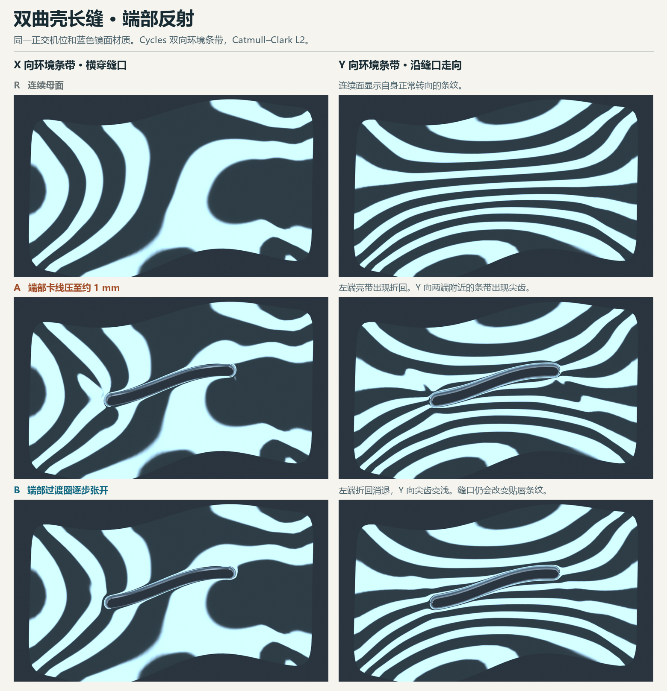
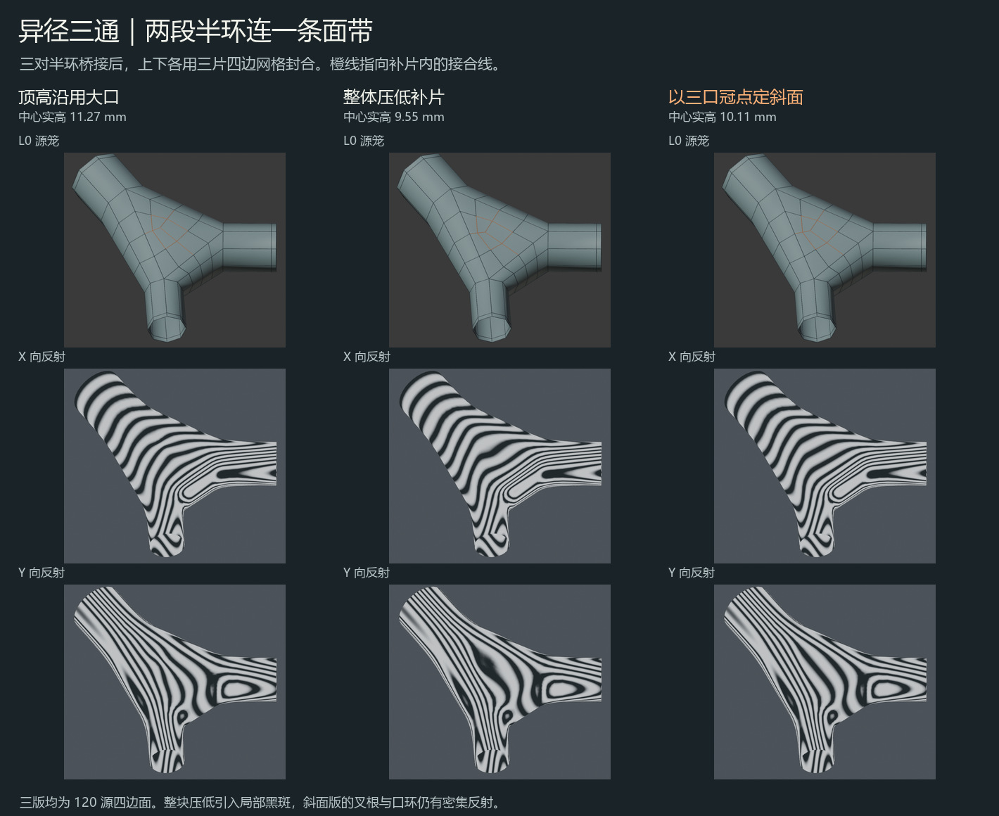
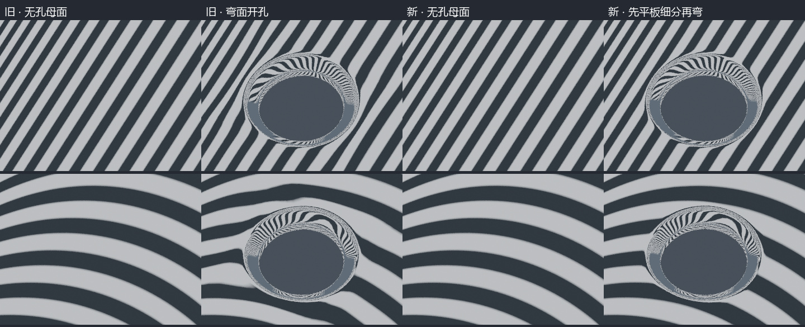
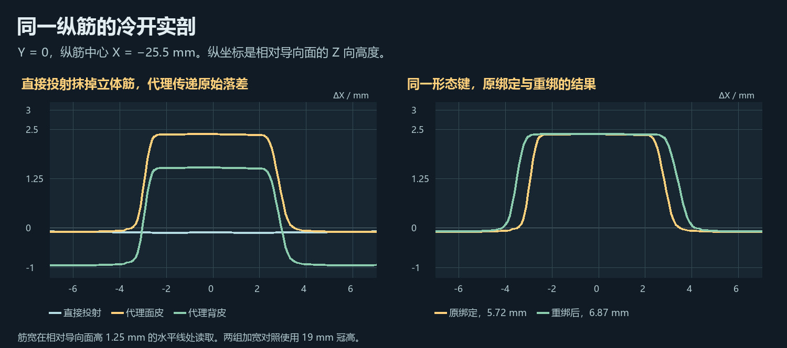
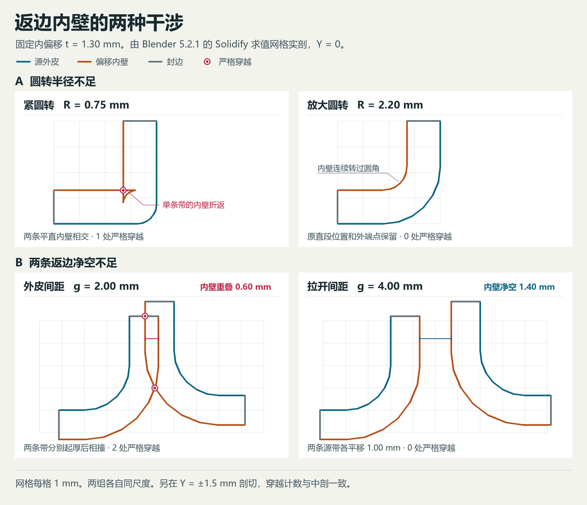

# 曲面开孔、相贯与翻边

在平面上挖洞很容易，真正的硬表面功力体现在曲面上开孔、斜交相贯，以及沿三维折线拉出不穿插的内翻边。核心原则只有一条：**先保住母面曲率，再用足够的四边缓冲圈把局部特征和主曲面隔开**。

## 一、曲面开孔的四条标准做法

开孔之前，先 `Shift+D → P` 复制一份完整、无孔、高光顺滑的母面，放进 `REF_` 集合隐藏并作为后续缩裹或法线传递基准。

### 1. 柱面与缓曲面径向开孔（低密等段法）

适用于管件 T 形相贯、吹风机/筋膜枪手柄对接、圆柱侧壁接口：

1. **先定主筒分段并贴合母面**：按光洁度定好主筒分段（常用 16 / 24 / 32 段）。如果主筒与支管对接，先数清主筒开洞口实际边界顶点数 `N`，建同顶点数 `N` 的支管圆环，必要时转半格（`360° ÷ N ÷ 2`）让角点对齐。
2. **孔环贴回母柱曲率**：把孔口圆环用 `Shrinkwrap (Project)` 投影贴回无孔母柱表面，或开 `SubD On Cage` 对照参考圆微调点位。跳过曲率贴合直接桥接平面圆环，会在柱面近孔区留下明显的平面扁台和外鼓。
3. **孔周留 2–3 圈均匀四边缓冲带**：围绕孔口内插出一圈连续的保护环（Containment Loop），再把外围转接的 3/5 价极点推离孔唇至少一圈，接回主筒纵横线。
4. **外唇 → 压线 → 孔壁 → 内沿逐圈挤出**：确认外皮条形高光顺滑后，再向内挤出孔壁、盲底或穿透接通内壁，最后给孔唇和墙脚加支撑卡线。

### 2. 窄框与密集多孔阵（正交投切 + 局域止线）

适用于手机边框扬声器孔、相机面板点阵、多孔装饰板：

- 在正交视图下用 **Knife Project** 投射等段多边形圆（常规孔 8–12 段，套孔内外同段数，极小指示灯孔可降至 6–8 段）。
- 围绕每个孔或整组孔阵建独立封闭保护框，用 `4 → 2` 菱形减线把多余边流在孔组两端就地收束，不让密线横穿整机外壳。
- 最外端孔靠近外壳大圆角时，在外角与孔之间补一条控制边，防止大圆角细分时把圆孔拉成椭圆。
- 密集孔阵做完后，同时量取**轴向投影净孔宽**和沿壁深剖面的**实体最窄桥宽**，确保两孔之间的材料桥不会在倒角或起厚后穿通。

### 3. 双曲壳长缝与不规则异形窗

- **长缝端圈渐开**：双曲壳上的圆端长缝（腰形孔/散热槽）如果外围过渡圈紧贴唇口，两端会被挤出细长三角感并拉出反射尖齿。让过渡圈从直边进入圆端时逐站放宽展开，为圆端留出均匀的扇形四边缓冲带。
- **斜交与方口转角**：固定在同一平面里的矩形直角口，两条相交直边已经锁死了角点切平面；如果口内要求立刻陡降，允许靠角处局部放缓入角，或在角部保留清晰折棱，避免细分在角点硬拉出褶皱。

### 4. 用布尔求交线，再用显式四边重排

遇到斜交圆管、双曲穹顶斜穿炮塔等难以手绘交线的相贯结构时，走「布尔定线 → 四边重排」两步走：

1. 在工作副本上用 `Boolean (Exact)` 求出真实空间相贯线，锁定交线足点与端口位置。
2. 沿相贯线逐站配对支管段数与母面周界（如 40 段主筒斜接 32 段支管，把 32 个支管足点配给主筒 32 段周界），外围布置两道四边过渡面带吸收段差。
3. **短侧保护**：斜交锐角侧（短侧）容易把主筒和支管两条支撑线挤撞在一起。保持远侧绕行，把受挤一侧的部分母线顺势转入支管根部，并为支管出口留足一整圈独立圆环。
4. **改倾角同步重排外裙**：调整斜交倾角或支管口径时，按每个方位从相贯足点到固定外边界的实际剩余宽度重新分配中间环距，防止锐角侧在细分或起厚时堆叠自穿。
5. **异径三通 / Wye 汇流**：给三个管口各画一对面向相邻支管的开放半环，逐对桥接三条四边面带，再用短跨中线把上下两处三边空缺各分成三张四边面，冠点按三口平滑斜率定高。

## 二、单轴恒曲率展开与双曲代理成形

遇到在弯曲面上排布大量孔、盲槽、滚花或立体加强筋时，先判断是否可以「在平面上做完再成形」，往往能省下大量手工贴曲面的精力，并获得远高于直接曲面开孔的 A 级高光。

### 1. 单轴恒曲率件：先平展、再细分、后弯曲

适用于圆筒套筒、镜头滚花对焦环、恒半径弧形护板：

1. 在平面控制笼上铺好全四边孔环、盲槽、滚花台面与首尾对齐的展开缝（展开缝放在背面或非主视区），孔口与边界留均匀缓冲带。
2. 若圆柱需要让固定世界轴线的销/管径向穿过，先按内半径 `R - t`（`R` 为外半径，`t` 为向内壁厚）换算平面横向展开弧长，预留弯曲后的切向收缩补偿。
3. 修改器栈严守 **`Subdivision(Keep Corners) → Simple Deform(Bend 360°) → Weld(ALL, VG_Seam) → Solidify(Offset=-1) → Bevel(Weight)`**。
4. 先关 `Solidify` 核对背缝确实焊为单一连通表面，再开厚度切剖面确认零内部夹墙。

### 2. 双曲壳立体筋格与百叶：平态代理绑定

在双曲率罩壳（如头盔整流罩、弧形网罩）上做带厚度的井字加强筋、立体百叶窗或浮雕饰件时，直接把饰件 `Shrinkwrap` 贴到双曲母面会把立体筋高彻底拍扁。正确做法走两步代理绑定：

1. 在 `Z = 0` 平态下建好全四边孔格与立体凸筋，同时建一张覆盖同范围的均匀平面代理网格 `Proxy_Quad`。
2. 在平态下给立体饰件挂 **`Surface Deform`** 并绑定（`Bind`）到平态 `Proxy_Quad`。
3. 给 `Proxy_Quad` 挂 `Shrinkwrap` 贴合双曲母面，平面饰件随代理平滑弯成双曲形态，同时完整保留 `98%+` 的凸筋法向高度。
4. 后期修改双曲母面冠高时，饰件自动跟随更新；若需修改饰件自身筋宽或拓扑，先临时关闭代理的 `Shrinkwrap` 退回平态，改完源网格并重新 `Bind` 后再恢复贴合（或把简单孔径缩放放在 `Surface Deform` 下游）。

## 三、沿开口续接翻边与跨折凹槽

工业外壳的接缝从来不是零厚度的纸片边缘，都会向里折出一道窄面带——即**翻边（Return Lip / Flange）**——用来承接邻件、藏缝遮光并呈现真实的圆润缝口高光。

### 1. 翻边向内起厚的两条几何净空底线

在薄壳翻边上加向内壁厚 `t`（`Solidify`）之前，先在源笼剖面上检查两个硬几何尺寸：

- **单角圆弧防折返**：内翻折角的实际圆弧半径 `R` 必须大于壁厚 `t`（即 `R - t > 0`）；`R ≤ t` 时内偏移曲线会在拐角处塌缩交叉，细分后爆出内折自穿。
- **面对面双墙防相撞**：两条相邻平行返边或窄槽双壁的外皮间距 `g` 必须大于两倍壁厚（即 `g - 2t > 0`），留出清晰的槽内净空。

### 2. 跨折开口与跨面周槽的分段挤出法则

当一道翻边或电池盖周槽跨越多个不同朝向的折面（例如从手柄腹面折向后桥顶面，或从翼子板折入前保）时，直接全选按平均法向整体内挤或缩放，会让转折侧的槽底反向上翘顶穿邻件。按下面四步分段接稳：

1. **辨认自由边与折根**：在斜视图高亮确认要挤出的开边确实只有一张邻面，分清外皮折根线和已有回边自由边。
2. **按曲面朝向分段定方向**：把整段开口拆成桥面、斜腿、凹底、回升等小段，每段沿各自局部向内法向挤出真实返边。
3. **段间共用一条连接横边**：相邻两段翻边在交界处共用同一条横边（该边恰被两张绕向一致的面共享），整圈新自由边连续顺畅、无断点无叠面。
4. **扁口与椭圆唇用均等内插**：给扁长集风嘴或椭圆口做内外双唇时，先 `F` 临时封口再用 `I` 内插（勾选 `Offset Even`），删掉临时盖面后再沿轴拉出深度台阶，避免直接 `E+S` 造成长短轴壁厚悬殊。
5. **先定轮廓、后加卡线**：先固定邻件姿态，验证返边在 L0、L1、L2 三档均零穿插且缝宽均匀，最后才沿折根和返边加支撑环。
