# 成形件与接合部位的带图案例

先用实际截面指出哪一部分保留连续材料、哪一部分需要开边、哪道面负责接触或允许变形。完成局部造型以后，用同一坐标的剖切和真实让位动作复核。以下实图来自项目的 Blender 5.2.1 LTS 试件。

| 装配或成形问题 | 优先读 |
|---|---|
| 多片返边在缝端或短侧碰撞 | [三片弧缝](#三片翻边的弧缝交会) · [盖端和防雨翻边](#盖端与固定防雨翻边共用短侧空间) |
| 外露面齐平，结合在内部 | [双反向弯搭接](#两道反向弯的齐平搭接) · [分段翻脚](#独立收口条的分段翻脚) · [非平闭环唇](#轴向套合的非平径向唇) |
| 判断成形区的连续材料与壁厚 | [闭端百叶](#压筋与闭端百叶) · [长筋背面渐薄](#长筋根从背面渐薄) · [折返的圆角释放缝](#折返后的圆角释放缝) |
| 核对安装、活动、限位 | [开槽扣臂](#两条槽怎样确定卡扣的根) · [活铰链](#薄壁活铰链的开止挡和闭锁) · [尖端防翘](#长饰条的斜插与尖端防翘) · [钥匙孔滑锁](#钥匙孔滑锁的圆口窄槽与楔唇) |
| 核对脱模方向或端部收尾 | [侧芯顺序](#侧芯与主抽的先后) · [闭合侧窗](#闭合侧窗的两片直抽模) · [螺旋牙收尾](#让螺旋牙接回圆柱端环) |

## 三片翻边的弧缝交会

先找到连续的主缝，以及相邻两片在哪个站位接入主缝。分别保留三片外皮和独立下翻边。近支缝的端角可能以更紧的卡线保住原位，主缝较长的面带则在细分后向其收弧。原件在源笼三对都无相交，L2 两个下角却都顶入上片。在端角预留退让量，按站位顺序把翻边和回脚整体接出，可避免法向内偏在短站位上翻折。

试件在 1.60 mm 双侧退让下未检出跨件相交。单独再退左角增加了左主缝的截面空隙，同时缩小旁边的支缝。另一个 0.55 mm 试版在两个取样截面都已有正净距，完整三角网格仍相交。用局部剖面定位后，再按实际使用的细分级别检查三对整件，随后只改一片复验邻缝。`三片工程、退让与冷开实测` · [Frank Polygon 的根角原例](https://polycount.com/discussion/comment/2769890/#Comment_2769890)

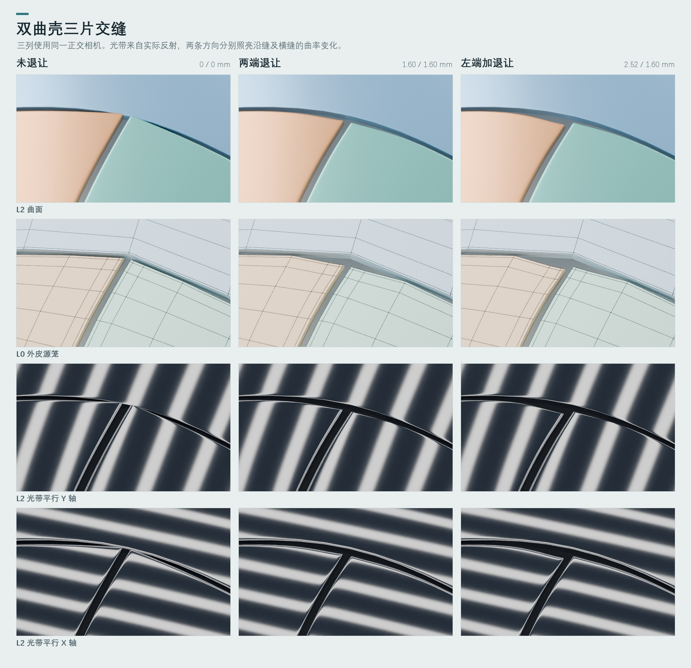

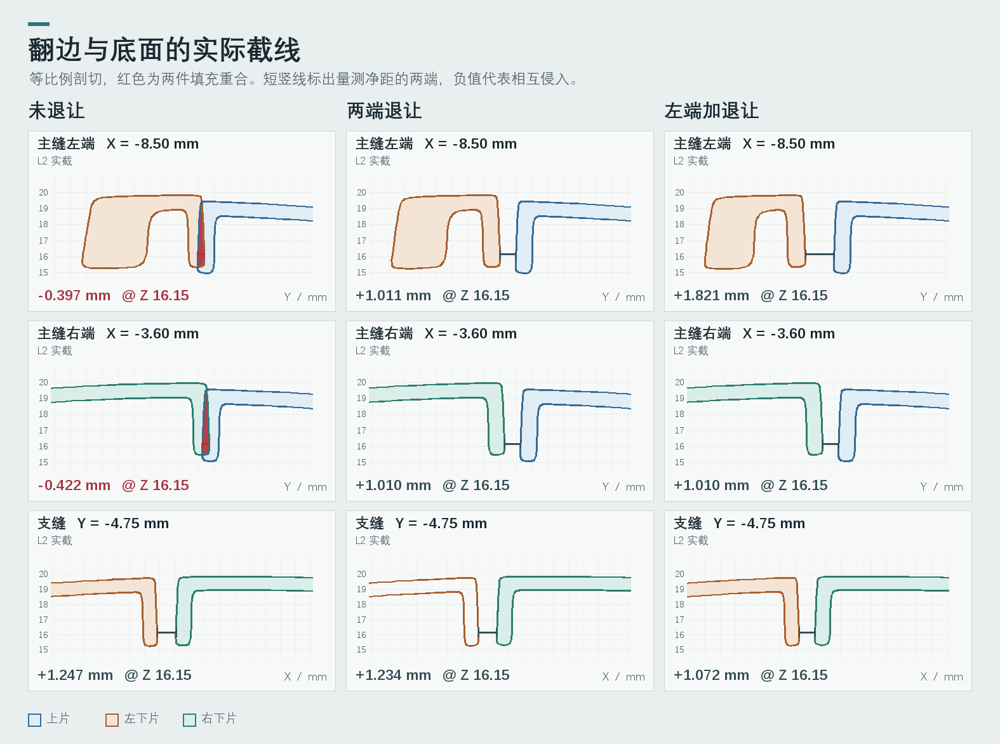

## 压筋与闭端百叶

对同一张板，压筋的板皮保持连续。闭端百叶在长边一侧分为抬起唇和平唇，背带不切，两条唇在两端接回同一对端点。先用控制笼找出真实开边，再起厚并沿中段、靠近端头和端外取截面。起厚后的板是封闭实体，切唇之间仍须用探针测通路。

同源 168 面的三版中，两份百叶的五条斜向探针均贯通，压筋全部拦住。上唇局部抬高后，中段净距由 4.414 变为 5.265 mm，细分缝尖保持位置。近端厚度用求值面法向抽测，冲压减薄、回弹和气流需另验。`可复做工程与通路数据` · [Mate 的闭端百叶工序](https://www.mate.com/news/forming-modern-punch-press-sheet-metal-fabrications-swiss-army-knife/)

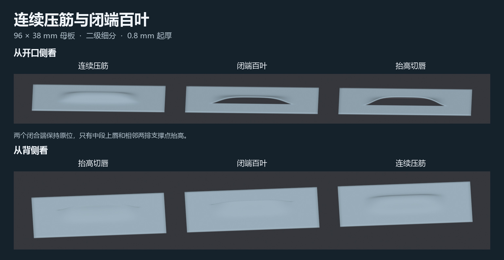

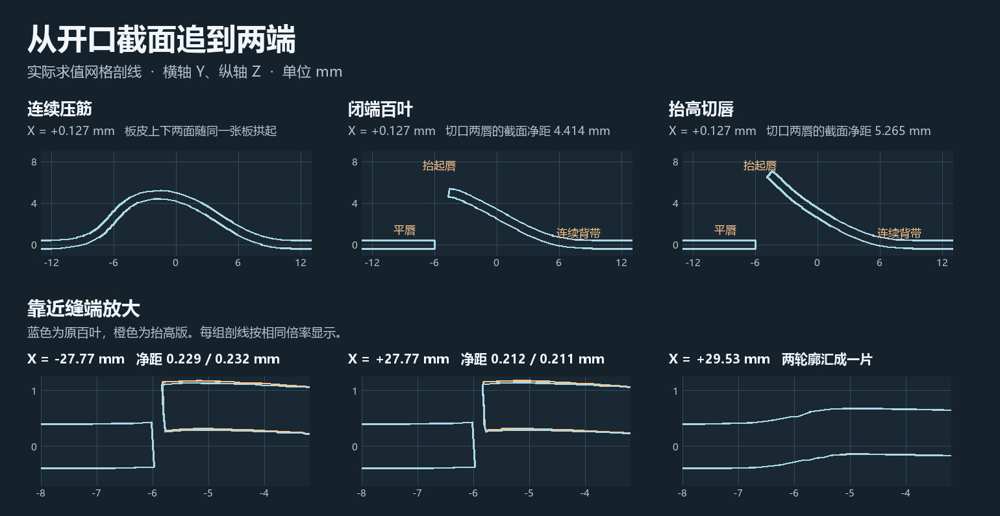

## 两条槽怎样确定卡扣的根

跟着板的材料走一遍。两条开放槽各从自由边切回固定根，槽后把中央板带与左右安装带分开。中央带先沿水平底板走，再以圆转接到竖臂和钩齿。保留真实槽壁和底面，截面才会显示哪里仍连着。把两槽根一起移动时，钩位和两侧安装带可以固定。

试件用同一 L 形钩，把细分后的两条槽从 19.875 mm 改到 31.875 mm。在 X＝27 mm 实切，短槽是一整块，长槽是三个闭合截面，中央才是可让位的舌。把形态键调到指定姿态后，钩齿对虚拟止挡面余量由 −2.826 mm 变为 +0.649 mm。此读数用于判断这一个几何姿态。完整装配行程或材料弹性需要另验。`工程、冷开、选区和形态键` · [BASF 的槽根和 L 形臂图](https://s3.amazonaws.com/gc-p/files/128687/Snap-Fit%20Design%20Manual.pdf#page=16)

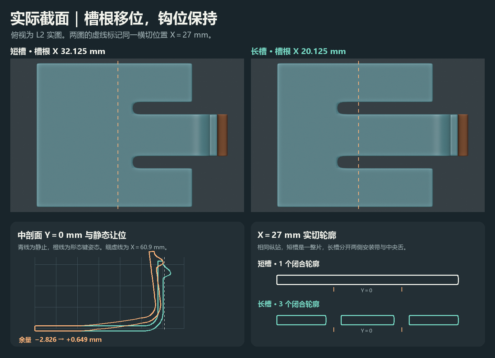

## 让螺旋牙接回圆柱端环

标出螺距、中段可编辑牙、起牙与出牙的位置。把螺旋带到圆环的末端配对单独画出，局部三角可用于调段。固定端环与芯径，对照牙高保持到截断和在一段轴向长度内逐渐降到芯径。

试件冻结 40 段端环，螺距为 2.00 mm。两端各用 1.90 mm 轴向渐消后，出牙处的薄突唇在两个机位消失，环附近仍可见浅亮带。用同一形态键改变中段牙高，L2 最大径向改变量为 0.248 mm，两端接口保持。每件 L0 / L1 / L2 为 1,882 / 7,582 / 30,328 面。截面属于造型样本。相配螺母、制造公差和啮合另验。`源笼、改型和冷开数据` · [Frank Polygon 的连续螺旋收口](https://polycount.com/discussion/comment/2713945/)

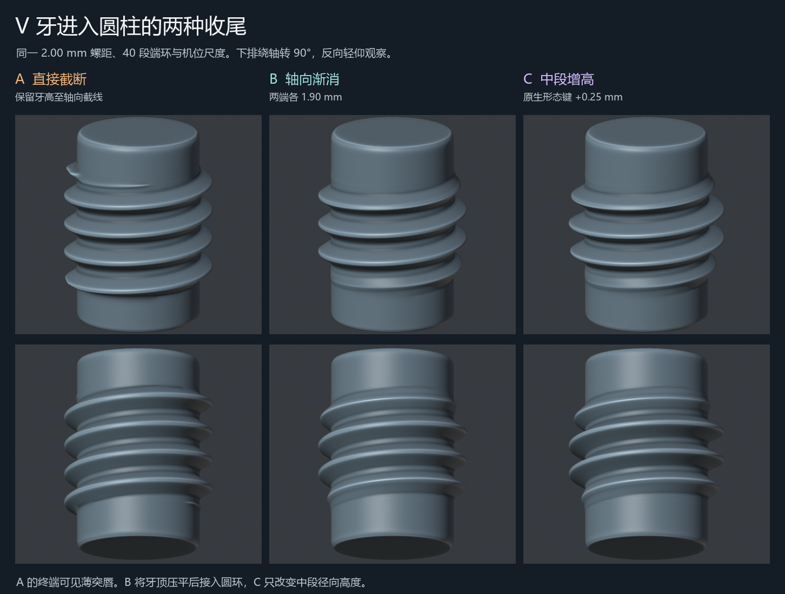

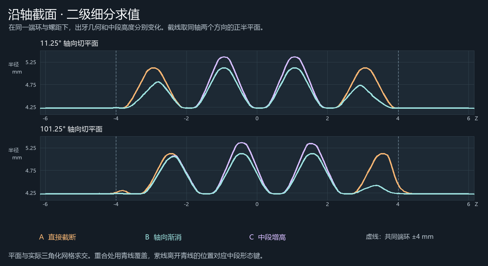

## 侧芯与主抽的先后

先画实际横向倒扣截面，给主轴和侧轴各一个变换。若保留侧腔底沿，先完成侧芯退出，再抬升壳体。运动只在首尾均分离时也可能中途碰撞。直线轴向试件从冷开实网格恢复占据体积，把三轴各自发生重叠的位置区间取交集。复杂曲面另选与实际路径相符的干涉检查。

教材侧腔深 14.00 mm 时，直接抬升在 0.25–8.75 mm 的开区间穿入芯体。侧芯先抽 14.25 mm，主抽通过。侧腔加深 1.50 mm 后仍沿用旧行程会再次挡住，增加侧抽至 15.75 mm 才重新留出 0.50 mm 侧向分离。若产品允许去掉底沿，另一个场景展示了让侧腔通向主轴的做法。试验用刚性直角试片和线性平移验证几何。`可播放工程、五种动作和冷开数据` · [NADCA 工程剖面原例](https://www.kineticdiecasting.com/NADCA-Product-Standards-for-Die-Casting.pdf#page=137)

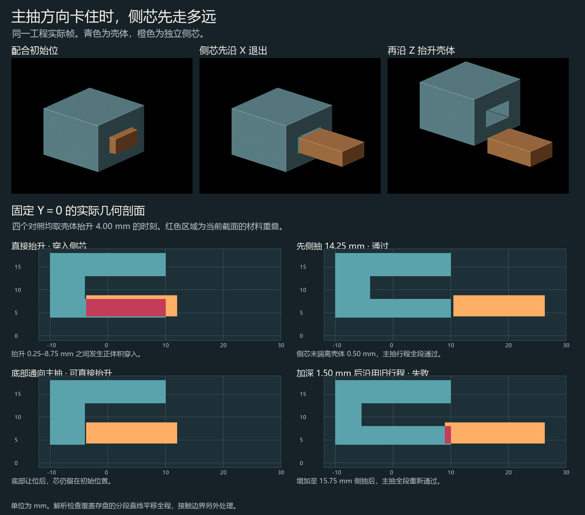

## 闭合侧窗的两片直抽模

如果窗口四条边都要保留，先在穿窗剖面画两半模的相反退出轴和互补的斜封胶面。此平面例中，侧壁斜率为 `s`，墙板沿横向宽度为 `t`，窗高为 `H`。跨内外口沿的封胶面斜率为 `s − t/H`。加厚墙板后即使侧壁角度固定，封胶斜率也可能变号。用工程的实际剖面确认符号及规格，再查沿退出方向的整个边界。

同样 22° 的侧壁在本例厚度为 3 mm 时允许两个主轴相反退出，改成 5 mm 后各移 2 mm 就有重叠。试件分别用边界单调性核对连续几何条件，并从保存的 Blender 网格切片复验。再加入其他壳特征或圆角后，重新验实际各段。`三块可编辑墙板和实际剖面测量` · [Protolabs 的封胶侧窗原例](https://www.protolabs.com/resources/design-tips/eliminating-side-actions-with-draft/)

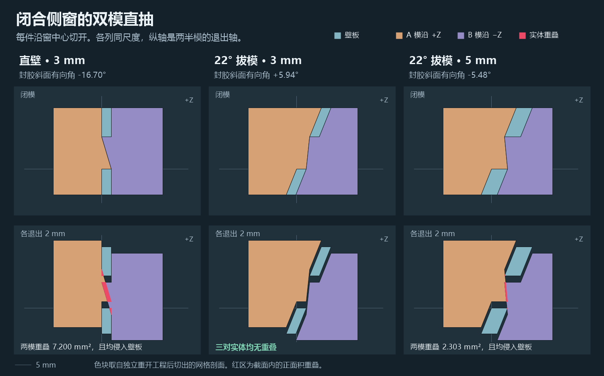

## 钥匙孔滑锁的圆口、窄槽与楔唇

大圆口按紧固件头部通过尺寸建，窄槽按杆尺寸建。两者的相接区优先查周界次序与间距，外扩时留意折回。按装入轴、横移轴和锁位分别标出各处控制点。静止锁位的头可以被平唇或楔唇挡住。楔唇的高度决定滑移中头底还余多少抬升空间。

试件三版的圆入口和槽宽保持。把楔唇末段从 2.05 抬至 2.30 mm 后，直线横移时头底的净空下界从 0.35 降至 0.10 mm。锁位试回抽时，头与槽肩干涉。复验先抬头、再回到圆口，最后沿装入轴退出。工程记录了直线段的包络检查和每版 187 个整数帧的网格检查，止挡只代表该几何动作。`可编辑工程、实剖与实际动画` · [Knuth 的原专利图](https://patents.google.com/patent/US2264243A/en)

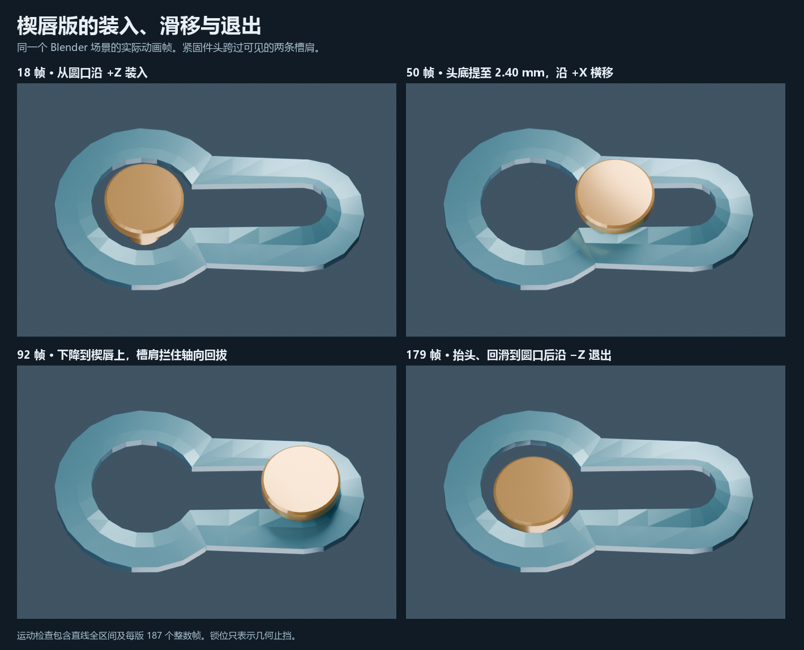

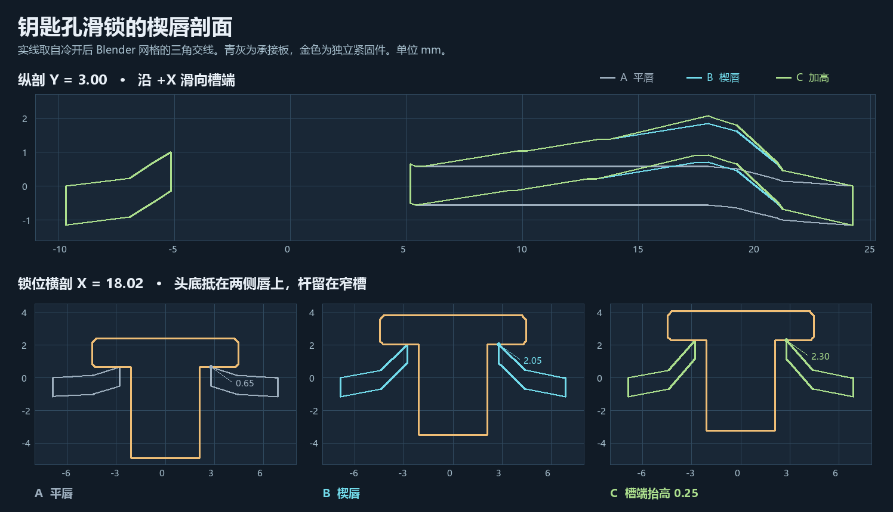

## 盖端与固定防雨翻边共用短侧空间

将盖底返边和固定雨沿放在同一道实截面。在共同高度上测侧向余量，遇到负值再用实际实体占据区间识别侵入。沿短侧扫过盖的两角与边中段，并补整件 L2 相交。读数盒在盖端配套加长 7 mm 时，两条实测射线与整件检查均通过。加长 15 mm 后，Y=-17.5 mm 的截面中，沿 Z=10 mm 的横线实体重叠 2.337 mm，完整盖与雨沿检出 123 对相交三角面。此处是静态几何，完整装配路径和防雨性能待验。`完整工程与改型说明` · [盖在两侧的实际走线](casebook.md#独立盖在两处跨过浅肩)

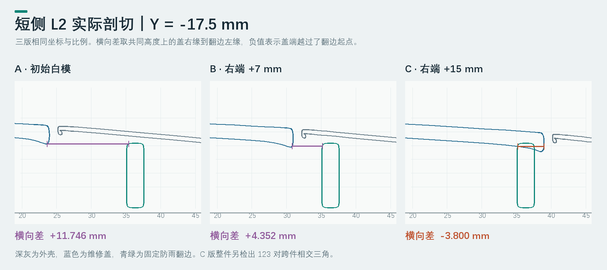

## 长筋根从背面渐薄

将外观面与外缘顶点组先锁定。筋从背面面带接出，两道卡线控制根圆转。让减薄从根部向两侧平壁恢复，纵向到两端也留面带淡出。用实际横剖分别量名义母板、根部附近局部壁厚和给定高度筋宽。需要评估筋根局部料厚时，以该剖面上与外观面、左右筋根轮廓相切的内接圆记录变化。

同为 638 源四边面，试件一侧实剖的内接圆直径由恒厚 3.912 mm 降到渐薄 3.113 mm。只收正 X 段筋根的 24 个源点后，指定截面筋宽由 1.611 降到 1.284 mm，近区壁厚近似保持，对侧整条剖线逐点相同。外观面与周边的 5,921 个对应 L2 顶点及法向均保持。此方法验证几何厚度，实际成型缩痕需要相应的材料与工艺证据。`可编辑试件、选区和实测` · [Kaneka 图 2 与中文说明](https://patents.google.com/patent/CN104582927B/zh)

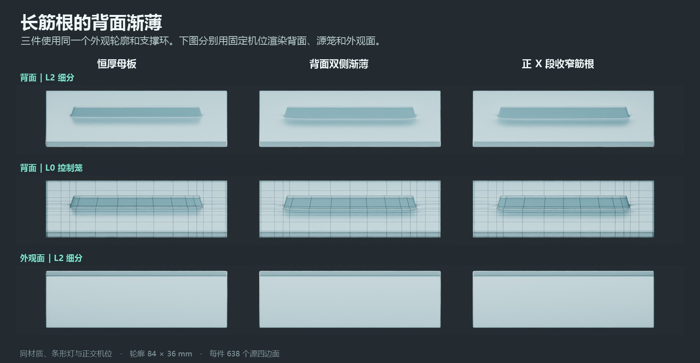

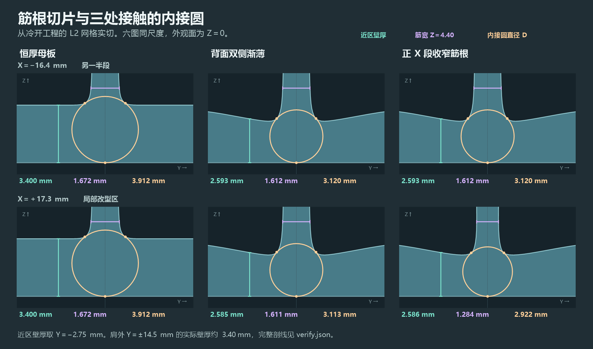

## 两道反向弯的齐平搭接

两道方向相反的弯把一侧板端降到邻板以下，外露平台仍共面。按实际板厚画上、下弧和斜腹，留出独立的下层搭边，再沿另一块板的平面移动其自由端。实截时分别读下层搭量、平段竖向间距和斜肩处的穿越。

100 面固定折台与 16 面邻板的试件中，端部只动六点。A 有 6.98 mm 总投影搭量及 0.229 mm 平段竖向空隙。B 仅多伸 0.85 mm，平段仍有余量，但端面已经顶入斜肩。C 无相交却因短了而完全失去搭接。把三种情况放在同机位与同一截面比较。实际钣金弯曲和连接强度另验。`工程与编辑步骤` · [Onshape 原搭接工序](https://cad.onshape.com/help/Content/PartStudio/sheet_metal_jog.htm#Examples)

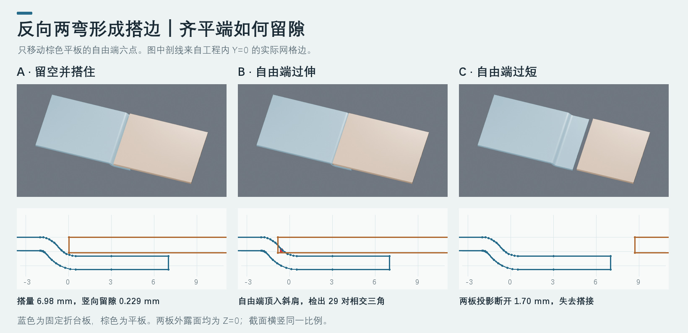

## 独立收口条的分段翻脚

把齐平的外露面、上段靠根定位的翻脚和下段留空的翻脚各画一个实际截面。沿纵向连接同组轮廓点，让转动从近根处开始，在连续的过渡段逐站变化。局部改型后要用实截确认上段仍定位，下段和过渡段都留空。整件检查要能区分名义相切和实体重合。

试件固定上段、折根定位线和外露面，形态键只调整下段的 112 个控制点。直腿的下段角度由 71.222° 改为 45.579°，过渡、下段槽唇横向净距分别成为 0.257 和 0.546 mm。整件相交体积由 24.692 降到 0 mm³，上段仍存在名义接触。全程装入、回弹和夹持性能另验。`形态键、整件复核和实际截面` · [Honda 原例 Fig. 7、10、14](https://patents.google.com/patent/US9434324B2/en)

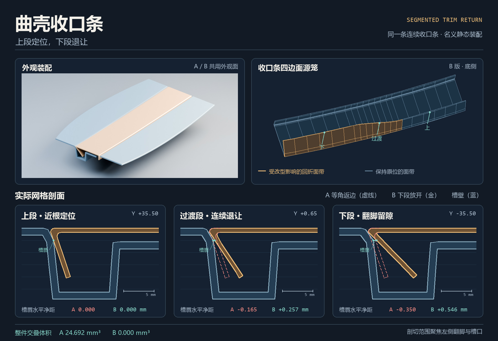

## 轴向套合的非平径向唇

先画一副径向剖面，分别定义刚壳的周壁、槽底和限位肩，以及密封唇的槽内根部和伸向配合壁的尖端。在升段、低段和坡段保留相同剖面项，沿各站位桥接成一圈。上壳沿轴套入时，径向贴合仍依赖上下高度路径同相。把一段整体抬高时保持开口投影，冷开检查全周肩隙、槽底剩余壁厚与唇尖目标壁在该处是否存在。

同相与局部加高 2 mm 的原型在每 3° 实切中都能找到目标壁，名义径向叠合约 0.0425 mm。槽底最薄约 3.973 mm。把上壳错相 135°，抬升侧先发生刚壳干涉，对侧 31/120 道剖面则失去配合壁。八个离散轴向姿态用于检查刚壳间的交叠。密封性能、分段基脚和连续装配路径另验。`可编辑工程、径向切线和改高` · [Harman 原例](https://patents.google.com/patent/EP4510787A1/en)

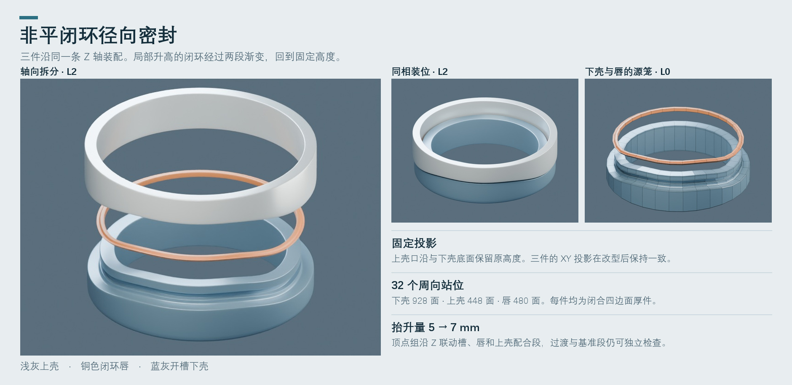

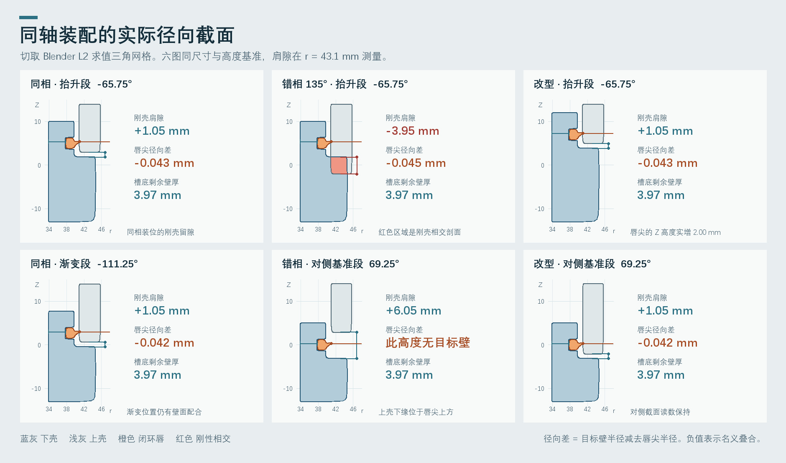

## 折返后的圆角释放缝

给展平板带一条纵向材料坐标，先按未来弧段的入口、出口安排释放缝。该缝沿折返线开在未来圆角的跨度内。先做横截面的折返，再沿纵向改走向。固定厚度、入口和折返截面，只改大圆角半径后，量实际弧段与缝端的先后。槽的径向实剖在有缝区域分开，在超出槽尾的区域重新连成一个 U 形。

1.20 mm 试件在 R22、90° 时，槽尾超出出弧 3.44 mm。保持缝端而改成 R30 后，弧末 9.12 mm 落到缝外。五个可编辑工序能检查板厚和几何连通，成形皱折需实物或成型分析。`工序白模、真实剖线及改型` · [原作者的工序与样件图](https://patentimages.storage.googleapis.com/fb/53/46/8b690006d23a27/JP2024058788A.pdf#page=6)

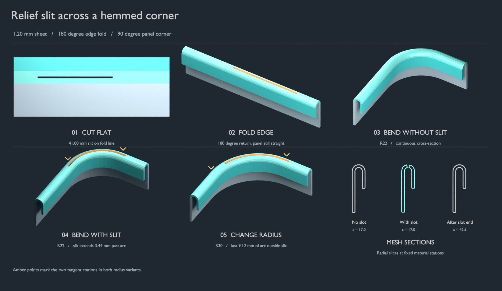

## 薄壁活铰链的开止挡和闭锁

把薄壁、两端安装区和硬件止挡画入同一剖面。开端用另一组剖面和闭锁让位配合复验。42 个四边面组成带安装区的连续试片，薄处为 0.45 mm。在 90° 降低固定开止挡 0.65 mm，原接触变成 0.65 mm 间隙。2° 临闭锁舌的名义净空仍为 0.278 mm，0° 锁位搭接保持 0.900 mm。临闭让位采用预置形态，运动全程、止挡新角度、力和疲劳未验。`三姿态的实际网格与复做方法` · [三菱原例](https://patents.google.com/patent/JP5541209B2/en)

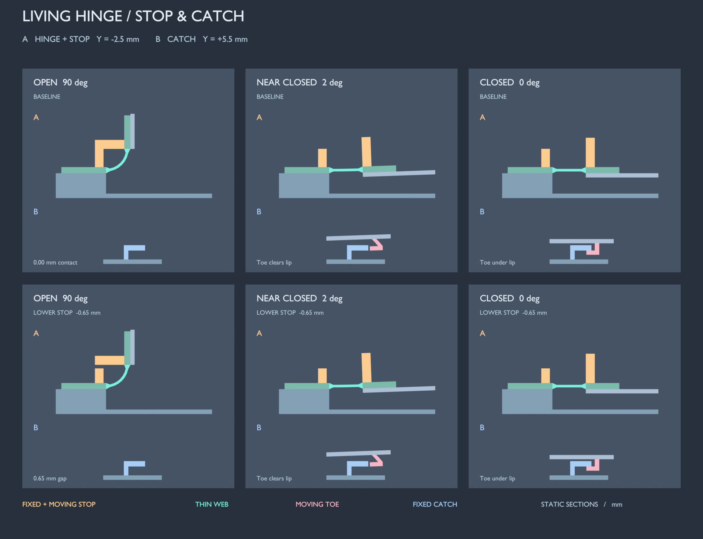

## 长饰条的斜插与尖端防翘

把尖端插片、主扣落座和第三件的反台阶分别建出。先按插入方向给尖端让位，后以主扣定位齐外观。第三件在最终姿态挡住独立的上抬方向。在同一剖面检查在位搭量、首触高度和规定抬升后的碰撞。改尖端时冻结主扣界面和外露面。

完整片有 4.00 mm 搭接，抬升 0.60 mm 首触。只退尖端四点 5.50 mm 后，搭接消失。同为 +0.90 mm 的上抬探针，完整片有 0.30 mm 垂向干涉，短片仍留 1.50 mm 横向距离。试件用刚性主扣和离散动作检查名义几何，弹性扣合与连续行程另验。`可编辑试件、动作与实切` · [铃木原例](https://patents.google.com/patent/JP2009274607A/ja)

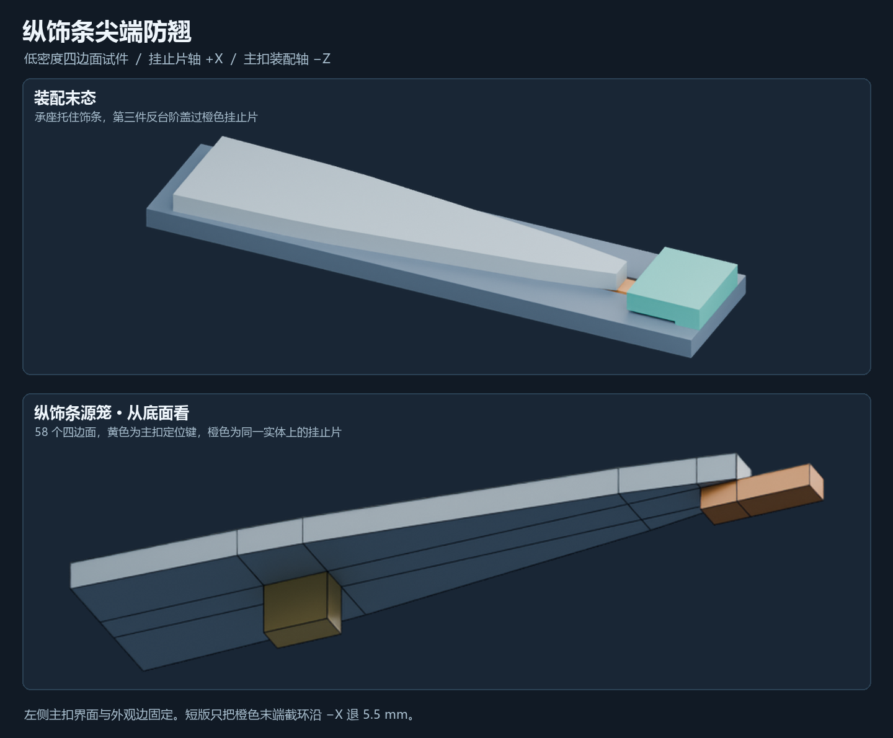

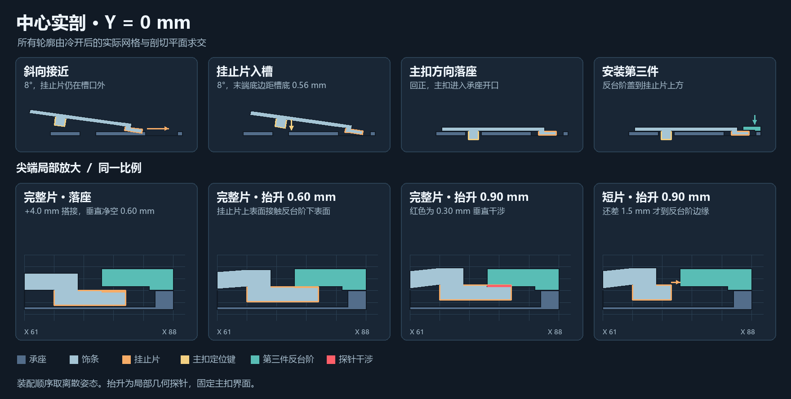

## 变宽弧缝验外观、净距和搭接

在同一母面分别布两片的实厚翻边。写清哪一侧动、宽度如何沿缝衰减，以及从多少站以后保护外围和安装区。沿实际弧缝逐站读三个量。可见缝按约定观察方向投影。卷边最窄距从同一真实剖面上取两轮廓间距离。搭接查看隐藏舌片是否仍伸到对面。变宽试件的 L2 可见缝最大 1.141 mm，舌片最小仍搭 0.386 mm。过宽状态在三网格档都无严格相交，隐藏舌片最大脱开约 0.711 mm。`三态弧缝和真实宽端剖面`

## 接壳螺柱、折返端角和双向拔模

配对螺柱先锁共同轴，给纵筋、导孔环与背部卸料各留编辑行。沿筋或孔轴检查实际剩余实体，并在独立改孔后重查相邻件。试件轴线上余料 9.710 → 1.160 mm 的几何改变由背侧盲腔承担。材料工艺判定另验。`配对柱和十字筋实剖`

双复折先在横截面定两道反向回折、料厚和层间隙，再处理两长边交角。先在实剖区分实体层数和空隙，再按两边同一斜面收口。方端见证在同样开放截面下有 216 对严格相交，斜接后为零。近贴合状态的两层间隙均为 0.100 mm，属于带正余量的几何状态。`双复折全层及端角图`

双向拔模先锁分型环，从那里上下分别接锥形面带。用实际脱模轴与各侧面法向量出每一侧最低角度。源笼分型轮廓不动时，抬高侧壁也可能让角度低于指定阈值。试片上壁最低角从 7.240° 变到 5.082°，仍为正，已低于其 6° 设计值。局部角度通过后再按实际装配和模具形态查行程。`拔模着色与上下壁实线框`

## 异厚耳位、独立收口与压垫坡段

多耳同轴先锁中心和外支承，再按每个耳的壁厚布轴向站。改厚后沿轴检查孔通，同时在耳面所在剖面量轴向净空。失败件的九条轴向射线全通，耳面重叠 0.468 mm。`异厚双耳与静态轴向余量`

异形罩端先从邻件继承三处物理边界，再按截面把外皮分带接起。转动一个自由端时，将变化向共同缝或隔框收为零。独立收口可使用不同站数，轮廓仍跟真实缝边。改后分别核对隔框、对侧、近缝与收口条的实剖。`罩端单侧开口改型`

压垫的平座、斜座和过渡带应从各自真实截面共同确定。固定压盖闭合高度和止挡，缩短垫片坡段后重新扫过全坡。只查两端平区会错过上下两侧各约 1.136 mm 的交叠。试件将三层坡段同步重排后才恢复正间隙。尺寸只代表给定的静态预成形，材料变形、压缩率和开裂另验。`上下座和垫片的剖切证据`
