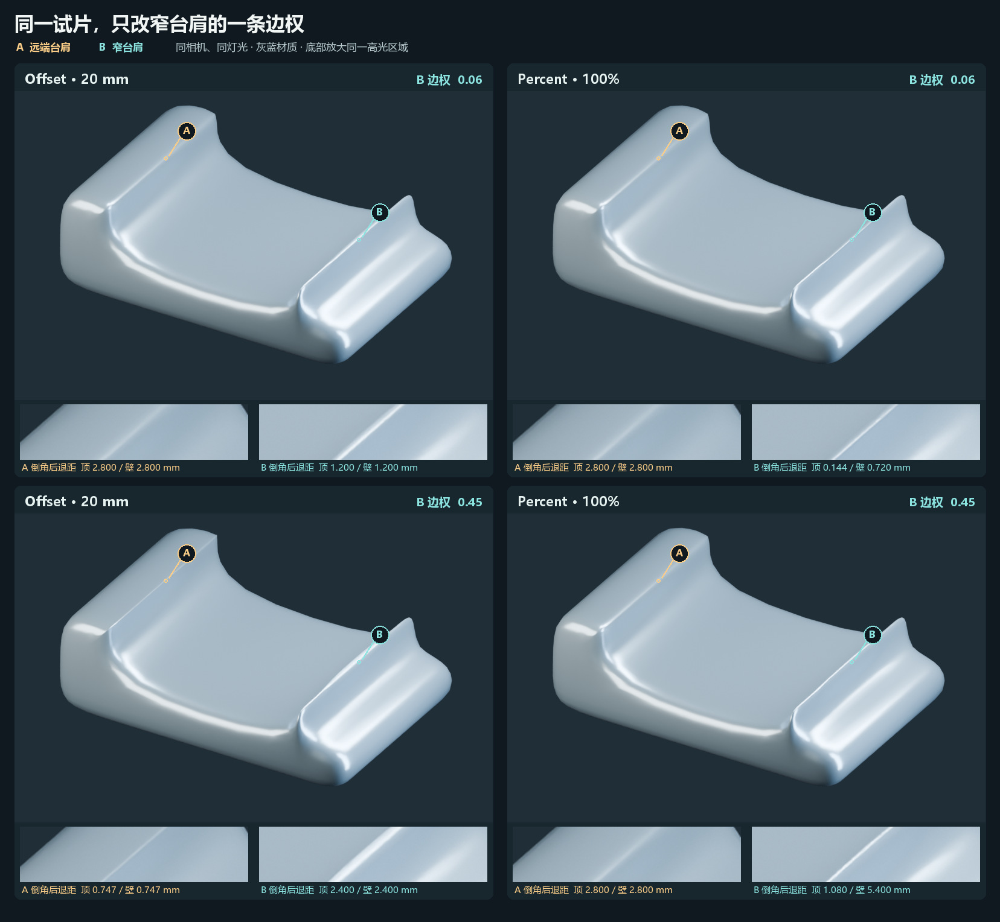
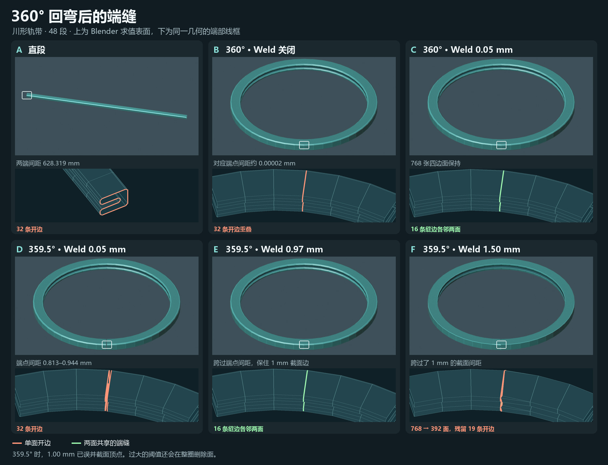
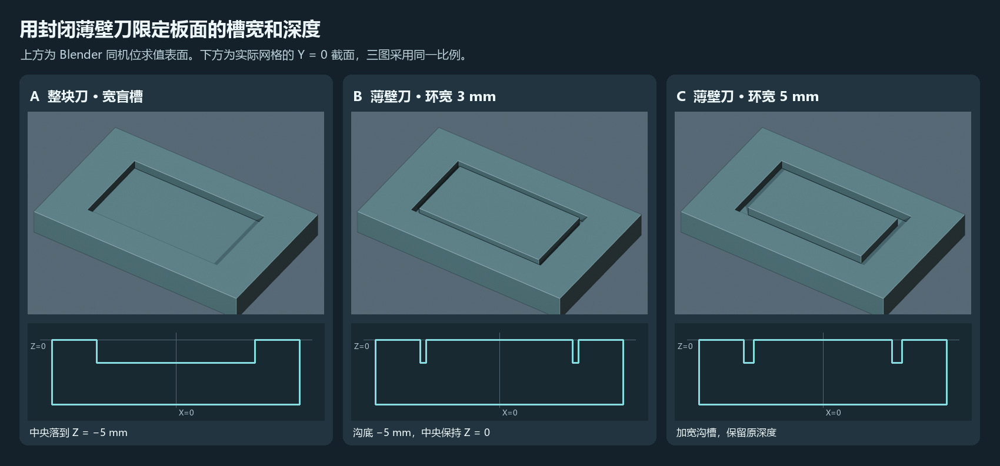

# 进阶修改器的作用范围、计算空间与下游数据

Blender 5.2.1 LTS 实证。遇到非预期联动，先选一处会动的位置和一处该保持的位置，再回看各层实际求值。下文数值用于识别机制。改网格、单位、顺序或参照物后重新量测。每个案例的可编辑工程、前后图和改型读数集中在逐例实证索引。

## 卡线、薄片轮廓和着色

- **窄台肩改变了远处卡线。** 在短边接近 Clamp Overlap 限制时，给两处各取一个剖面，先测 Bevel 层，再看 SubD 的实线和高光。此试片只增加窄肩一条边权，固定 Offset 使远肩退距 2.800→0.747 mm，改用 Percent 后保持 2.800 mm。关闭 Clamp 的单独对照定位了联动。Percent 在这里用横跨原棱的邻边长度定退距，同一棱两侧的长度可以不同。遇共享邻边或交点仍需核对。
- **平片的选角要贯穿厚度。** 用顶点组限定 Vertex Bevel，在 Solidify 前得到稳定的平面轮廓。若改用先起厚再边倒角，就只选对应竖棱。同一个平板两种顺序在盖面和中层得到了相同轮廓。选择全边时，上下盖边也会变，原直壁可能失去。
- **加权法线由哪一面主导。** 在最后一层 Bevel 写 Face Strength，再在 Weighted Normal 开 Face Influence。固定求值网格对照法线与真实反射。3 段试片的顶面偏斜从 0.624° 降到 0.003°，外角偏斜仍约 21°。需要改善外角时单查圆弧分段、交角或轮廓。此件的 3→6 段对照统一修改了目标边的段数。
- **细分格孔要同时量孔宽和孔角。** Wireframe 可生成带 Crease 的边，再由 SubD 读取。满权重保持了本件的方角，中心孔宽却从细分前 17 mm 到细分后 18 mm。权重 0.35 时孔宽仍 18 mm，角部退让 1.883 mm。测厚度时也要看最终 Z 向尺寸。
- **Arc Miter 在什么交点生成新面，要看 Bevel 本层。** 同源圆壳的两个安装耳上根角各增加一个六边过渡面，细分后上根角的亮带端变化可见。下三角脚的直接 Bevel 点位相同，其小幅形差来自后续细分。比较两种斜接后，仍要单查远端配合截面。本件在同宽的两种 Miter 下，外半径都由 43.000 收到约 41.899 mm。
- **同边界换铺面时，同时量单面形状与整盖轮廓。** 保留同样的侧环和支撑环，依次检查 Bend、SubD。单张三角面天然平整，整片三角扇盖仍可偏离拟合平面。这个 90° 试件二级细分后，中心剖面对连续目标弧线的最大差为大多边形 12.680 mm、三角扇 6.242 mm、四边栅格 2.372 mm。调整弯角后重查实际亮带及使用截面。
- **Normal Edit 的径向中心要和保护边一起验。** 在罩面上用顶点组限制 Radial / Copy，移动 Empty 后读取同一个面角，并用两处光位看过渡。此件中心移动后局部角法线最大变化 28.515°，52 个组外角保持。中心移到罩面另一侧时会出现反向角法线，允许自动修正绕向后还可能翻实际面。

## 圈缝、螺旋和壁厚

- **整圈回弯先证实焊合，再改阈值。** Bend 后检查端缝边是否由首尾各一面共用，并保住截面和远处面数。本件 360° 闭合到不足 0.00002 mm 仍有 32 条开边。359.5° 时端点差 0.813–0.944 mm，最小非目标距离 1.00 mm，0.97 mm 能接缝，1.00 mm 已误合且仍显示 0 条开边。若两个距离没有可用间隔，先改弯角、源跨距或限制焊接点。全跨距形变可用 `R = L / θ` 做初值，再反求实半径。
- **Screw 分开检查首尾、圈间和轴心。** 每圈进给 × 圈数给出同名首尾测点的轴向差。检查端面与中间圈的边邻接，再判断是否要另外封端。离轴重合边按实际配对检查。本试件的 Screw Merge 没有合并离轴圈边，追加 Weld 后 129 对近重合点归零，仍有两条开放的周向边界。改圈距以后同相点可能退出焊接阈值。
- **用垂直于切向的平面量螺旋截面。** 定半径时让源剖面的法线对齐局部切向。倾角大小为 `atan((P / 2π) / R)`，`R` 是中心线半径，方向跟随手性。此处半圈的两径由 8.000 × 5.712 mm 恢复到 8.000 × 8.000 mm。改螺距时同步改倾角并重新切片，检查不同站位的离散误差。
- **内皮固定后仍需量最薄残壁。** 将空组指定给 Solidify 的 Output Vertex Groups 中的 Shell，再在下游 Displace 反选该组。用实剖和安装边位置确认真正保护的是哪层。4 mm 平盖压纹时，不限组的两皮各移 1.50 mm，残壁 1.00 mm。内皮固定后残壁为 2.50 mm，槽深提到 2.25 mm 时降到 1.75 mm。曲面应按配合方向和局部厚度重新量。
- **Complex 起厚后的槽深和折返分开量。** 固定源壳、厚度和 Offset，切同一个受影响剖面。分别记录槽深、折返出现的范围和最大径向跨度，再量远处基准。8 mm 厚的桶样中，0.75 mm 阈值使折返采样从 206 降到 104，最大跨度却从 0.881 增到 1.055 mm。2.40 mm 时槽深由 0.896 变为 0.597 mm，折返仍在。拉宽源槽后再测，能判断问题对特征宽度是否敏感。
- **按权重起厚后再做整体形变，要重新量厚。** 先量 Solidify 三站，保住每个权重对应的厚度。Bevel 与 Lattice 逐层打开后都查中心及边缘。试件起厚为 2、4、6 mm，晶格改型后中站竖直间距保持 3.740 mm，沿实际顶面法向的量厚从 3.532 降到 3.278 mm。量测方向应匹配配合或最薄区用途。

## 独立物件与变形参照

- **晶格角点变动后检查原来应直的边。** 把输入面和晶格站位对准，拉同一控制点，分别量端点、对边漂移和整条边到端点直线的距离。2×2×2 的试件用 Linear 达到 22 mm 指定角升，对边固定且所测边保持直。四角单独变动时仍需检查整面扭曲。
- **纹理取样和位移空间各自设定。** 相邻件要共享纹理取样，可共用作为 Object 坐标参照的 Empty。显式轴向位移再核对 Direction 和 Space。此处两片同站取样相同，Local Z 最大错边 5.429 mm，Global Z 恢复对齐。再把一侧参考物移 12 mm，Global Z 仍出现 1.714 mm 台阶。移动共用参考物后应重测相同站位。
- **阵列首尾用各自的接合面定偏移。** 旧版 Array 的非等厚端帽可在编辑模式单独移动源几何，让装配面落到节距要求的位置。本件 20 mm 节距，内接面分别放在端帽的局部 X=+10、−10 mm。Count 加一后只移动尾帽一节。几何接触后按用途复查内面及是否应焊。
- **杯口尺寸和体积补偿用两组对照。** Laplacian Smooth 先固定内区系数，关 Preserve Volume，比较迭代与 Boundary 对杯身和杯口的各自影响，再单独开体积保持。本件 Boundary = 0 时，增加迭代保住 91.60 mm 口径并减少杯身波纹，单开 Preserve Volume 后口径涨到 92.47 mm。开放杯面用指定口环封面算参考体积，同时报告实际开边。
- **曲管弯曲时，接头用自己的刚性几何。** 用端件控制物 Hook 曲线末端和两柄，量管端的位置、切向和直径，再查套口与圆管实际重叠。此件移动并转动右端后，管口保持 Ø12 mm，端面法向与套筒轴夹角小于 0.001°。试件保留开放管面和独立套筒。
- **走线贴面时，先投射中心线再沿线生截面。** 逐站核对投射命中与线路高度，在贴合线下游用 Curve to Mesh 等节点扫掠。直接投射已有圆管的试件压成 0.280–0.300 mm 窄幅，先投射的 49 个截面仍约 Ø9 mm。目标表面改高后重新查净空和截面，遇急弯还要查内弯重叠。
- **距离权重移动时，要量源站位上的渐变区。** Vertex Weight Proximity 按 Edge 距离生成梯度，再把组交给 Curve。只移参考线 16 mm，源渐变区从 X=44–92 移到 60–108 mm，固定连接端仍不动。同时量实际点位和权重，避免把修改器存在当成限区生效。
- **Corrective Smooth 的局部软化要与整件收缩一起看。** 用 Only Smooth 对照相同拓扑上的峰差、远端截面和外长，先压低影响量，再限在峰附近的渐变组。本件全局 0.85、12 次使外长 136→88.482 mm。局部组用 4 次得到 0.244 mm 的峰差，两端保持。
- **Cast 保住预排缝边，整段净距仍需重测。** 先在源笼给两侧缝唇安排连续边，随后用 Cast 改半径。70 mm 档的顶点接近目标球面，实际面片最深仍内缩 0.566 mm。对应站位最小距为 3.338 mm，两条实际边的最小净距是 2.692 mm。改半径后分别核对径向误差、面片近似和两条缝的最近处。
- **轴向贴合先为目标层选择方向，再限住组。** 只让需要贴合的外环进入 Shrinkwrap Project。从两方向分别截取头次命中，再量保护口与腔体净空。双层模拟扫描靶中，−Z 加限组使 40 个外环点命中下层。不限组时即使外环相同，内腔和管口仍会移动。投射距离、目标高度和边段中点要各自复验。
- **Warp 抬正面时，背面需要有合适的取样站。** 两 Empty 的球形衰减可以配合渐变组固定挂耳和外边。试件正面都升高 3 mm，稀疏背面保持平坦，匹配网格背面升至约 2.930 mm。两种方案的中心 Z 残壁为 6.600 和 3.670 mm，须按设计分别量背面、字峰和残壁。

## 集合实例与重复件

- **Collection Info 空输出时先查宿主成员关系。** 如果源集合直接包含自己，先解除宿主与源集合的链接，并保留宿主在场景中的其它链接。本件节点顺序一直保留 Realize 和 Set Material。修复成员关系使空输出恢复为 3 件、162 个统一材质的面。用实际几何和材质读回验证，间接依赖另查。
- **改变件数，区分新 Array 的 Line / Offset、Line / Endpoint 和 Transform。** Line / Offset 按基准步进累加，Line / Endpoint 在指定始末之间分配。给 Endpoint 与 Offset 相配的终点，两种步进可在 6 件时重合。增至 8 件后，此件 Offset 尾站从 200 走到 280 mm，Endpoint 尾站仍在 200 mm。Transform 让前一项的局部变换参与递推，尾站沿渐缩转向的轨迹移动。使用中检查首尾及中间站，并检查线性缩放何时越过零。
- **按面角放置细节时，面尺寸改动会改变实际退距。** Instance on Elements 的 Corners 模式以面法线与该角的局部边向确定姿态。在 Face Center 模式保持同一比例时，实际内移距离会随源面尺寸改变。用实体轮廓测最小净距。本件源面为 1 个四边面，内收后净距从 −4.750 变为 +2.950 mm，缩窄后同一比例仅余 1.517 mm。
- **新 Array 下游需要直接网格时检查 Realize Instances。** 本件关闭 Realize 时仍渲染四块板，实际只有四个实例、零个直接网格顶点，Bevel 与 Exact Difference 都未作用。开启后分别得到四块倒角板与指定板的 Ø10 mm 通孔。只移刀具后孔可迁到下一块，源编辑网格仍为单块。用最终求值面、闭合分量和实际切口验证使用方拿到的数据。

## 简单平板的布尔刀、接缝与材质

- **用刀的实体范围定槽宽和槽深。** 在同一刀位对照宽实刀和一圈可封闭的刀壁，量沟底及保留的中央台、背面。开口套先在刀具上 Solidify 并填边。此例 3→5 mm 只使环槽加宽。下移刀端 3 mm，使槽深 5→8 mm，残壁 9→6 mm。
- **让 Bevel 读到并集新棱，再复查移动。** 先 Union，后 Bevel，才能选中实际生成的接合棱。此件凸台平移 8 mm 后，右根向外 0.5 mm 处的高度从 1.007 变为 0.983 mm。关 Clamp 时读数相同，单独关 Loop Slide 后，两位置恢复同读数。遇到小幅联动时，用相同相对站位测试，再看远处平板和底面。
- **用母件副本取交集，量清每张面的来源。** 围框在副本上限定侧壁和底面，原台阶提供上表面。移动围框时同时核对是否跨过台阶和底面是否固定。需要装回母件时，另外查实际净空。
- **切面着色要读面的实际索引。** Exact 的 Index Based 按主体槽号分配，本件缺槽 2 时第三带落回槽 0。Transfer 将切面分配给刀具的材质。两种模式返回的求值槽列表可以相同，实际面索引却分别为 0、1、0 和 2、3、4。检查指定新面的槽号与材质名，再回查原外表面。
- **孔对称而板件有非对称接口时，把 Mirror 放到刀具上。** 用独立 Empty 把切刀的镜像面定位到装配基准，再让板件 Difference 读取双刀。以镜像面量两孔中心对称性，核对入口、出口和固定边。原刀在平面平移时同时检查两孔径向尺寸和原定位凸耳。
- **平面刻标要确认刀具底盖真正焊合。** 同一闭合外形里，坐标重合的独立底盖仍可让 Float 留下 40 条开边。Exact 在本件切出了闭合凹槽，Manifold 拒绝未焊刀。按距离合并原刀并复测后，三者均切出 3 mm 槽深且开边归零。把沟底实测与实际邻接一起看。

## 减面、图集与属性

- **几何边界、UV 岛界和材质界各自选择。** Planar Decimate 的 Seam 保护标记边分区。试件由 128 面变 2 面并保留标记接线，原 3 个 UV 岛只剩 2 个，材质界也改变。联合启用 Seam、UV 和 Material 后保住 3 岛与材质分区。迁移到有贴图的平板时再量轮廓、读面角 UV 并用多色检查材质归属。
- **反细分后用站位和截面复验。** 反细分前先确认网格来自规则细分。此件两次反细分将 96 面恢复为 24 面且边面连接回到低笼。在 Catmull–Clark 先改点位的弧面中，冠高由原 19 mm 变为 17 mm，两个反细分步骤没有恢复原高度。改冠后仍要比中段截面与固定边。
- **镜像字样和阵列取样读实际面角 UV。** Mirror U 令镜像侧取样按 `1−U` 移到不同图集区域。再试普通 U Offset，并回查原侧及 V。对 Legacy Array，可以每件把 U 增加 1，在岛严格落在单个整数区间时用 `floor(U)` 建稳定采样键。改变 Count 后检查旧件键值，图集越界和导出按实际消费方再验。
- **程序 UV 交接要读真实 UV 层。** 在 Geometry Nodes 写 Face Corner 域的 2D Vector，应用后从目标网格复查 UV 层列表和面角值。此实证普通 Vector 也能被 Cycles 的 UV Map 节点画出相同棋盘格，几何和画面相同仍可能缺少目标 UV 层。改 UV 时锁定网格、原层和源缝，再根据目标格式决定是否重导验证。
- **投影 UV、有效取样和深度范围是三步。** 相机后的负 UV 在 Repeat 中仍有图，Clip 在本例可屏蔽它。要限制投影纵深，材质以相机本地 `−Z` 判断前向及区间，再与图像 Alpha 合并。分别用三块板复验后向、近处、远处，遮挡本身另查。
- **UV Warp 阶梯换格时检查跳变前一帧。** 使用明确的输入、输出 Empty 和 UV 层。此件 To 的 X 步进每次 −0.25，令 U 增加 0.25。用 Constant 插值并复查每档 UV 岛仍在对应格，同时固定窗框、网格和备用 UV。
- **异拓扑传 UV 前，给目标网格提供可对应的岛界边。** 把最近面插值的源面角取样与目标面连通一起查。本件有两个目标面跨源缝时，24 角中 4 角采错，断边沿到 X=17 mm。沿 X=0 补边后，32 个角正确，断边回到原位置。再偏移一侧源岛，只量对应侧 UV 的变化。
- **线架无面时，先确认修改器需要的输入。** Skin 可按节点两轴半径给边架起形，Wireframe 在本件的无面输入上为空。保留扇区面后，Wireframe 的 6 mm 跨宽形成菱形截面。Skin 前杆从 6.000 增至 9.994 mm，左杆保持，局部汇聚和面数随节点改变。
- **位图镂空先让线网采到最窄结构。** Vertex Weight Edit 把灰度变成组混合量，再由 Mask 截去低于阈值的区域。只看图会漏掉实际孔连通。试件 3 mm 密度错过 2 mm 窄筋，两个孔变一个，0.75 mm 网格恢复两孔。换图后逐环检查边界、台阶和外缘。
- **倒角降段后要同时查接口切点、UV 和目标视距高光。** 已确认 6 mm Offset 的试件从 4 段降至 2 段时切点及 45° 采样位置保持，76→44 三角，高光峰值仍有变化。已应用的四段副本可有条件溶解交替的纵边，再回查整段面角 UV 和截面。

## 烘焙、轮廓和实体输出

- **固定实际三角线后烘焙，并用目标格式重导。** 在非共面低面上保留相同 UV，对比原线、换线沿用旧图和换线重烘。关闭 Keep Normals 的试件中，沿用旧图的 400 点解码平均差 26.67°，按新线重烘后与原档平均差 2.12°。Keep Normals 另测，GLB 重导确认两张三角面、同一条对角线和四角 UV。
- **反向轮廓壳要量两侧在凹区占的空间。** 对外扩 Solidify 核查两层法线、专用材质和 EEVEE 的背面剔除。6 mm U 槽用 1 mm 壳留下 4 mm，4 mm 壳使两侧壁交叉 2 mm。关闭剔除时同几何的外壳也会覆盖正面。分别看近法向和掠视下的原开口。
- **凸字并集前确认挤出底面闭合，再量实际共体。** 字符串先转曲线并填面，挤出后如果底面开放，可补反向底帽并焊合。按字形和板坯的包围盒统一缩放和居中，再给字底在板顶留可量的重叠。此件凸出 1.40 mm、重叠 0.42 mm，换字和改板宽后保持单连通。用底板、重叠和凸字三个高度的实际切片检查轮廓，打印的耗材和工艺可行性需实体另验。
