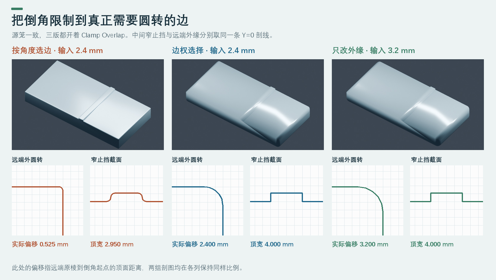
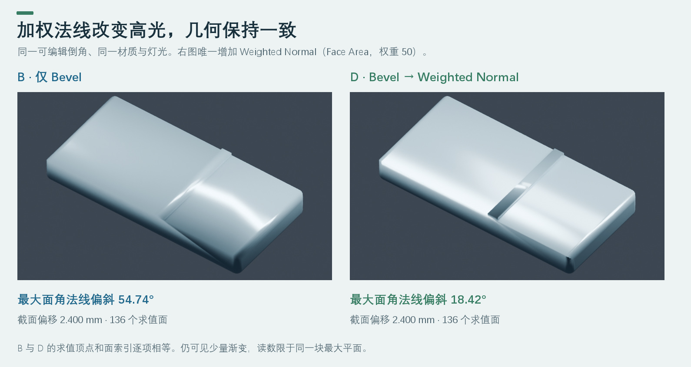
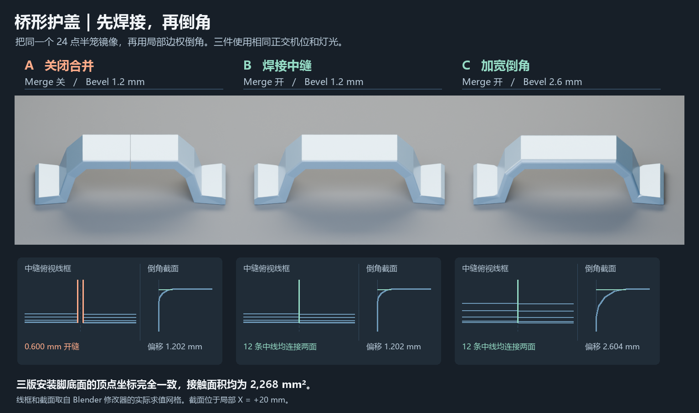
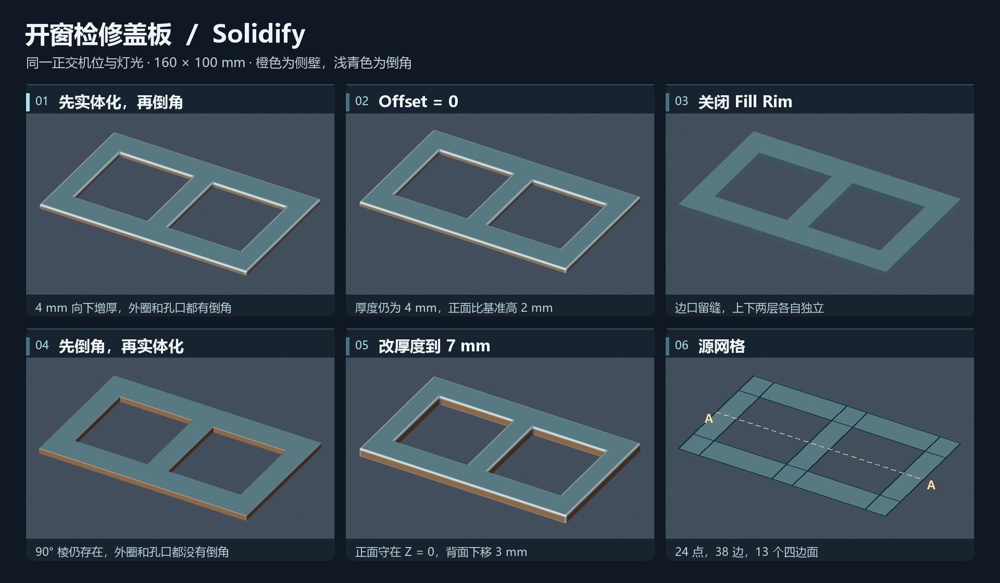
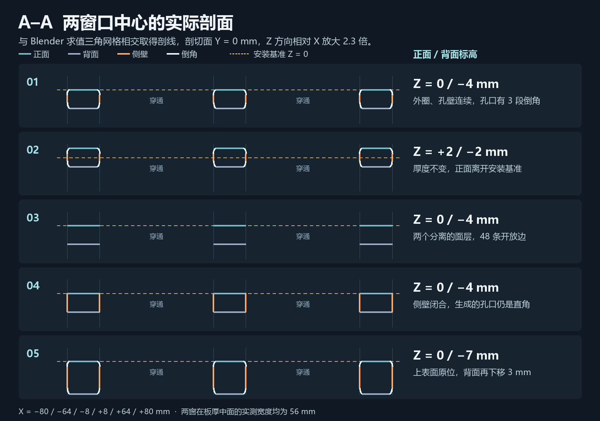
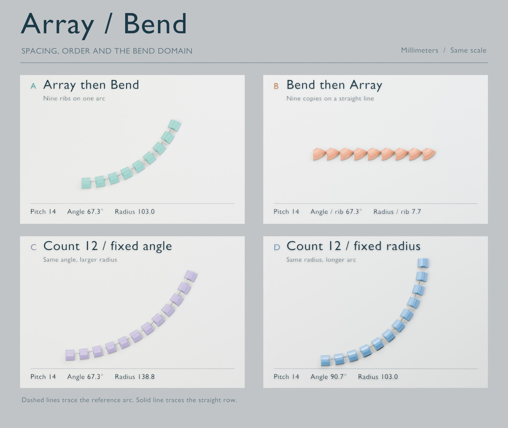

# 基础修改器的顺序、作用范围与实剖

每个修改器接收上一步的网格。在属性面板从上往下读，先确认这一步会收到哪些面、边和坐标。用源笼、关键一步之后和整栈求值三种状态追同一个部位。复制一版只改顺序、作用范围或尺寸中的一项，再对同一个测点取剖线。示例基于原生 Blender 5.2.1 LTS，尺寸为试件专用。

| 模型现象 | 先看什么 |
|---|---|
| 倒角参数变大，远端高光仍很窄 | [窄特征牵制远端倒角](#窄特征牵制远端倒角) |
| 大平面看起来鼓起 | [独立检查加权法线](#独立检查加权法线) |
| 镜像两半中间出现线缝 | [先焊合镜像缝，再倒角](#先焊合镜像缝再倒角) |
| 板厚吃进正面基准，或窗口没有侧壁 | [先生成侧壁，再处理孔沿](#先生成侧壁再处理孔沿) |
| 重复片变弯了，位置仍在一条直线上 | [阵列先铺开，再弯整列](#阵列先铺开再弯整列) |

先定单位、局部轴和原点。涉及镜像、阵列与弯曲时尤其要检查参照物的实际变换。输入数值同时记录它代表的量，例如 Bevel 的 Offset 或 Width、Solidify 的厚度方向、Array 的节距、Bend 的角度或半径。检查应用对象缩放前后的尺寸含义。完成主体、接口与实际连通后再扫光，细分过的外壳回到[源笼案例](casebook.md)逐圈追线。

需要选实战题时，从修改器功能案例库按问题和难度查找。先做单一差异明显的基础题，再进入依赖多个对象或需要保护其他几何的题。每个候选都附可复做动作和来源，做过本机对照的试件附工程或实证。

要核对对象尺度、端环圆度、切口贯通、变形参考物或目标三角预算时，查[基础修改器实证对照](modifier-foundation-studies.md)中的原生做法和适用范围。

已能完成单项修改器对照时，尝试用[进阶修改器实证](modifier-advanced-studies.md)诊断跨件变形、阈值误焊、远端卡线和数据交接。每次变更时同时记录目标位置与应保持的位置。

## 窄特征牵制远端倒角

在同一实剖中同时查看最近的窄处和远端工作边。Angle 会把符合阈值的窄止挡转角也送入 Bevel，Clamp Overlap 便可能限制整个可见效果。把明确需要圆转的源边标为 `bevel_weight_edge`，切用 Limit Method → Weight，再查目标边的实际尺寸及未标边。

同一 10 面止挡块输入 Offset 2.4 mm 时，Angle 版的远端实际偏移 0.525 mm，止挡顶宽 2.950 mm。单独关闭 Clamp，冷开检出 82 对不共享顶点的三角面相交。仅按 10 条外缘权重限制范围、继续保留 Clamp 后，实测变为 2.400 mm，止挡恢复 4.000 mm。外缘改到 3.2 mm 后止挡仍保持。偏移是该直角实际剖面上到倒角起点的距离，换用 Width、Depth 或非直角边时按对应几何重测。 [Bevel 官方手册](https://docs.blender.org/manual/en/5.1/modeling/modifiers/generate/bevel.html)

## 独立检查加权法线

当同一平面看起来随高光鼓起，先看轮廓和截面，再比较它的面角法线。确认几何到位后，把 Weighted Normal 放在本例的 Bevel 后，保证它读取最终产生的面角。在 136 个求值面完全相同的两版中，最大平面面角偏斜从 54.74° 降为 18.42°。大面渐变减弱，角部仍须目视核对。法线读数限于本试件，不作为所有硬表面的通用阈值。 [Weighted Normal 官方手册](https://docs.blender.org/manual/en/5.1/modeling/modifiers/normals/weighted_normal.html)

## 先焊合镜像缝，再倒角

先定实际镜像平面，令待接半笼截口落到该平面上。检查局部轴、对象原点或 Mirror Object，再用 Merge Distance 控制焊接。中心坐标相同也可能留下两套顶点，须看接缝边是否双面邻接、全件连通分量是否正确。Clipping 用于限制编辑时穿过镜像平面的移动。

桥形护盖试件刻意保留 0.600 mm 中缝。关闭 Merge 时是 2 个分量、24 条开边。开启后 12 条中心边各接两面，只剩 1 个分量。倒角从 1.2 改到 2.6 mm 时，两只安装脚的接触面坐标保持。临时关闭 Merge 后即使把源截口移到 X=0，仍有 12 对重合顶点及 24 条开边。此例临时对调 Bevel 和 Mirror 依然能焊合，接缝验收要按实际几何与作用边判断。 [Mirror 官方手册](https://docs.blender.org/manual/en/5.1/modeling/modifiers/generate/mirror.html)

## 先生成侧壁，再处理孔沿

开放平面先确定正面法向与哪个面是安装基准。用 Solidify 生成双层与外圈、孔圈的连接侧壁。按刀具或装配实际穿过的高度量开口。需要倒圆新生成的棱时，把按角度的 Bevel 放到 Solidify 后，再核对前后口部及板厚中面。

检修盖片以 Z=0 为正面、法向朝 +Z。厚度 4 mm 时，Offset 为 -1 得到 Z=0/-4 mm，Offset 为 0 得到 +2/-2 mm。维持 -1 加厚至 7 mm 后正面仍在 Z=0。关闭 Fill 时上下皮层分开，共 48 条开边。Bevel 前置只接收平面与开放边，本件生成 0 个倒角面。后置能处理新生棱，生成 348 个倒角面。两处窗口中面净尺寸仍为 56×60 mm；正面同一 X 向剖宽因倒角增至 58.4 mm。剖图沿 Z 放大了 2.3 倍，读图时按坐标。 [Solidify 官方手册](https://docs.blender.org/manual/en/5.1/modeling/modifiers/generate/solidify.html)

## 阵列先铺开，再弯整列

直线站位用 Array 的 Constant Offset 定节距，关闭 Relative Offset 以免单元尺寸改变时节距跟着变。给 Simple Deform Bend 明确局部轴和 Origin，在视口临时关掉 Bend，先核对它收到的是一片还是整列。本试件使用完整形变区间。对固定角度的比较，沿弯曲前基准线量实际总跨距，弯后分别核对站位弧距、弦距和内侧最小净隙。

9 片先 Array 后 Bend 的输入跨距为 121 mm，设 67.309° 得到半径 103 mm。反过来只把 9 mm 宽的单片弯成半径 7.661 mm，再沿直线复制，最小净隙由 4.805 mm 降至 0.474 mm。在这个完整形变域内，基准半径等于跨距除以弧度角。改成 12 片后，固定 67.309° 得到半径 138.752 mm。若固定半径 103 mm，将角调到 90.672°，14 mm 基准弧距和最小净隙复测保持。改动形变区间或参照轴后，重新确认求值位置。 [Array 官方手册](https://docs.blender.org/manual/en/5.1/modeling/modifiers/generate/array.html) · [Simple Deform 官方手册](https://docs.blender.org/manual/en/5.1/modeling/modifiers/deform/simple_deform.html)

