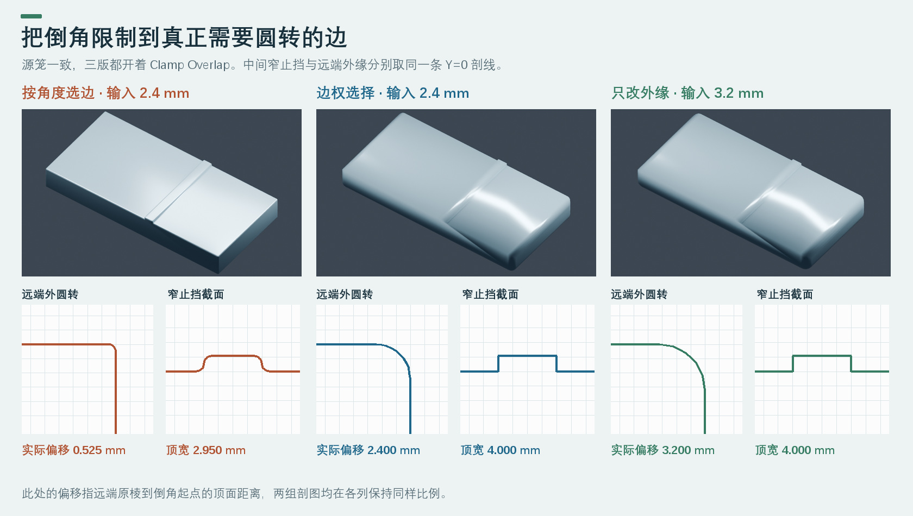
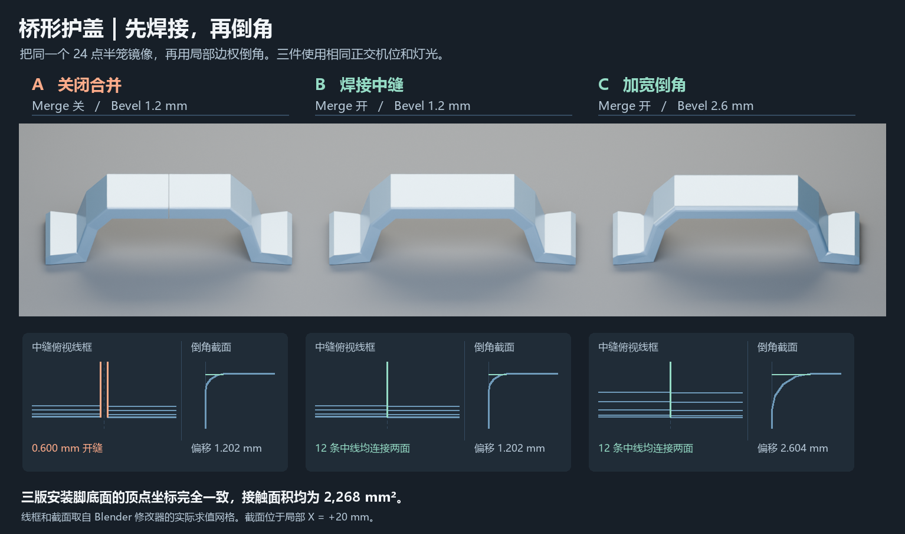
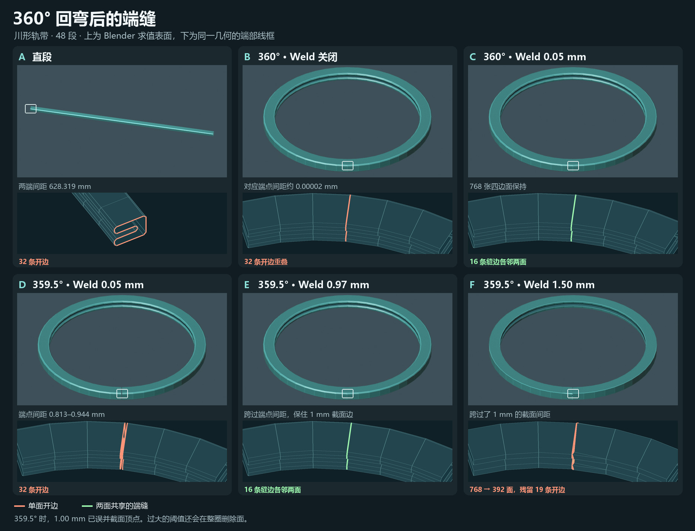
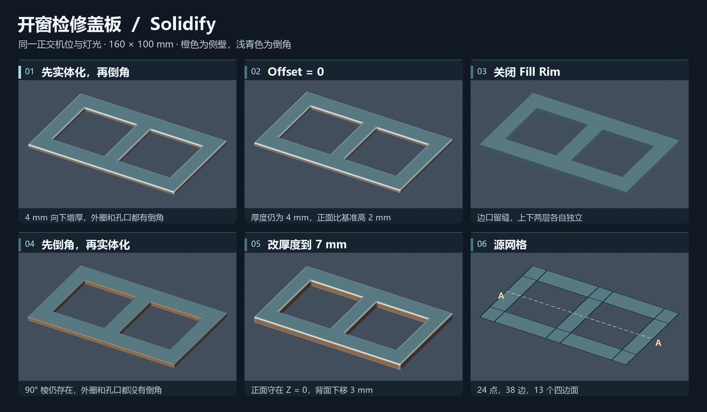
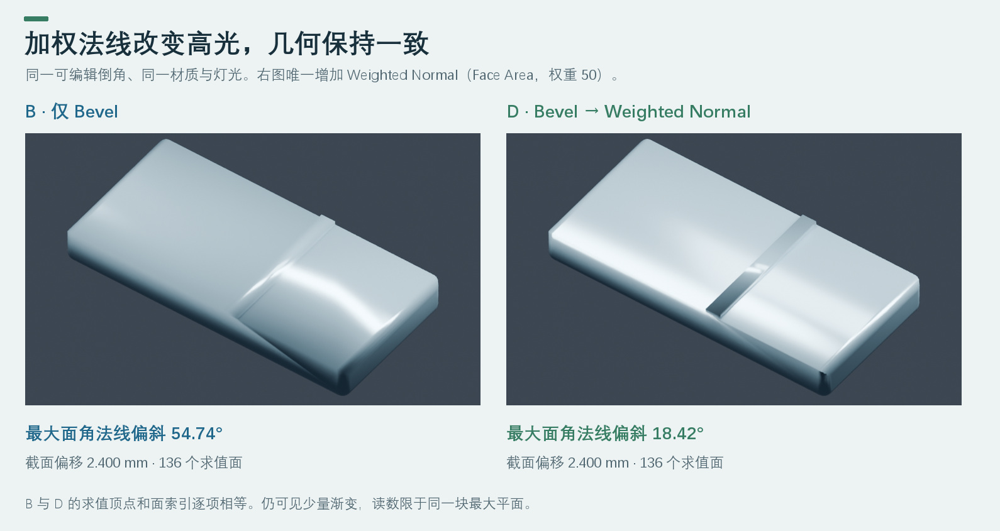
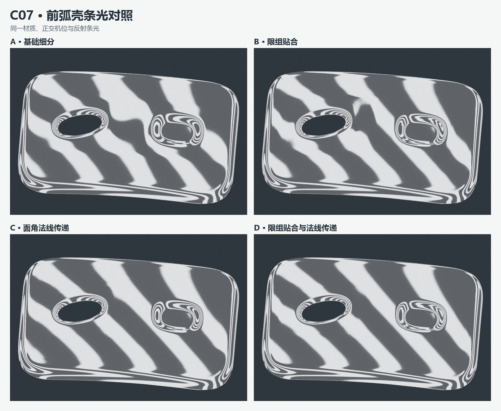

# 修改器栈规范

修改器按属性面板从上到下依次传递网格，每一层都吃上一层的求值输出。把顺序摆对、作用范围锁准，一套清爽的非破坏堆栈既能保住 A 级高光，又能在改型时牵一发而不动全身。

## 一、挂修改器前的四步网格体检

给任何硬表面零件挂修改器（尤其是布尔、倒角、实体化和阵列）之前，先做四步常规清理：

1. **应用变换归零**：`Ctrl+A → Scale`（必要时含 `Rotation`），把对象缩放归 `(1,1,1)`。含负缩放镜像拷贝时勾选 `Corrective Flip Normals`，避免整件法线翻红；非均匀缩放会让 `Bevel` 偏移和 `Solidify` 壁厚在三轴上宽窄失真。
2. **统一外表面法线**：打开 `Face Orientation` 确认外露表面纯蓝，全选 `Shift+N` 统一朝外；开放单层薄片手动核对正面朝向，局部翻红用 `Alt+N → Flip`。法线混乱会让 `Subdivision` 在翻面交界退化为平直块，让 `Solidify` 反向爆穿，还会把 `Manifold` 布尔差集静默变成并集。
3. **清理重顶点与零面积废面**：`M → By Distance` 焊清重合点，执行 `Degenerate Dissolve` 清掉零长度边和零面积面。
4. **进 Sub-D 前清零锐边**：准备挂 `Subdivision` 的网格先 `Clear Sharp`（删掉残留 `sharp_edge` 属性），既防止 GPU 细分退回 CPU，又避免着色出现割裂分面感。

## 二、硬表面黄金修改器栈序

按零件所走路线直接照下表排栈，从上到下按序堆叠：

### 1. Sub-D 曲壳与导向母面流（主壳、汽车/飞机外板、流线家电）

```text
1. Mirror (X, Clipping ✓, Merge)                  ← 先焊合对称中缝
2. Bevel (Limit=Weight, Miter Outer=Arc) [可选]   ← 需要非破坏控圆角时用具名边权
3. Subdivision (Catmull-Clark, Keep Corners)      ← 细分必在缩裹与弯曲之前
4. Shrinkwrap (Target=无孔母面, VG=外皮组) [按需]  ← 限定外皮，顶点组排除孔壁与凹槽
5. Solidify (Complex, Offset=-1, Even ✓, Shell VG)← 外皮定型后再向内生长均匀壁厚
6. VertexWeightMix (A=传法线组, B=Shell VG, SUB)  ← 从法线接收组扣除生成内壁
7. Smooth by Angle (关 Pin to Last) [按需]        ← 有硬折边界时按需添加
8. Data Transfer (Custom Normals, POLYINTERP_LNORPROJ, VG) ← 永远居法线栈最底端
```

### 2. 非细分中模流（机械支架、起落架、工业箱体）

```text
1. Mirror (Clipping ✓, Merge)
2. Solidify (开放片先实体化再进布尔)
3. Boolean (默认 Exact；严格水密高密件选 Manifold)
4. Bevel (Limit=Weight 或 Angle, 3 段, Miter Outer=Arc) → 若 Clamp 产重合点接 Weld(0.001)
5. Smooth by Angle (30°, Ignore Sharpness=False, 关 Pin to Last)
6. Weighted Normal (Face Area, Weight=50, Keep Sharp ✓, Face Influence ✓)
```

### 3. 单轴恒曲率展开 / 周期扇区流（多孔圆筒、滚花环、多辐轮毂）

```text
1. Mirror / SimpleDeform(Twist, VG)               ← 单扇区对称或局部扭转
2. Array (Line/Circle 或 Object Offset)           ← 铺开整列或合圆（新版 GN Array 开 Realize Instances）
3. Weld (Mode=ALL, VG=首尾接缝组)                  ← 先真正焊通闭缝，再进入起厚与细分
4. Subdivision (Keep Corners) → SimpleDeform(Bend 360°) ← 单轴平板卷圆时先分后弯，再接 Weld(ALL)
5. Shrinkwrap (VG=外圈) → Solidify (Shell VG) → VWM(SUB) → Bevel → Data Transfer
```

> **应用修改器固化顺序**：对 `Array → Curve`（如轮胎胎纹）固化为静态网格时，先应用上面的 `Array`，再应用下面的 `Curve`；反序应用会把整圈胎纹甩成直线平移复制。

## 三、高频修改器实战要点与避坑

### 1. Bevel：具名边权与防全局钳制

- **用权重代替全局角度**：同一零件同时存在大主棱和微窄止口时，全局 `Angle` 加上 `Clamp Overlap` 会让窄特征把远处主棱的倒角一起锁死。给需要圆转的源边赋边权属性 `bevel_weight_edge`，设为 `Limit Method = Weight`。需要多组独立半径时，拆成各自命名的 `EDGE/FLOAT` 边权属性，分别挂独立的 `Bevel` 层。
- **外斜接选 `Arc`，平面开孔关 `Loop Slide`**：三棱交角选 `Miter Outer = Arc` 消除尖刺碎片；平面布尔孔或窄肩旁倒角如出现宽窄不均，关闭 `Loop Slide` 或在外侧补一圈引导环；开启 `Clamp Overlap` 后如出现压平重合点，在下方追加 `Weld` 合并。
- **宽窄比例用 `Percent`**：相邻跨距不等又希望保持等比例支撑带时，把 `Offset Type` 切为 `Percent`（按邻边跨长比例定位退距），防止短边锁死远端倒角。



### 2. Mirror 与 Weld：真焊合与防内墙

- **Mirror 始终在 Subdivision 之上**：先焊合中缝再细分，防止引擎盖、机顶中线塌出一条尖沟；开启 `Clipping` 锁住中线顶点，把 `Merge Distance` 设到与零件尺度匹配的值（避免过大吞掉邻近细缝，或过小留下双层开边）。跨中线切半的网格勾选对应轴的 `Bisect` 并确认保留侧方向，清理冗余内部闭壳。
- **卷圆与阵列闭缝用 `Weld (Mode = ALL)` 配接缝顶点组**：`Weld (Mode = CONNECTED)` 只合并本来就相连的短边，对 `Bend 360°` 或 `Array` 形成的首尾分离边完全不起作用；随后接上 `Solidify` 时，外表看似零开边，实剖里面暗藏一整圈垂直内部夹墙。用 `Mode = ALL` 并限定 `Vertex Group = VG_Seam`，既焊死目标接缝又保护邻近细缝。





### 3. Solidify：基准面偏移与内壁隔离

- **锁定安装基准面**：外表面已经按参考定死时，设为 `Offset = -1.0`（从外皮向内生长厚度）并勾选 `Even Thickness`；修改壁厚时，外皮和装配基准面位置稳丝不动。
- **开孔后再起厚，起厚后再倒孔沿**：平面盖板先在单层面上开完窗口、理顺四边，再挂 `Solidify` 自动生成外圈和孔壁侧壁，最后在下方挂 `Bevel` 统一倒圆新生口棱。
- **Y 形三面共边用 `Complex`**：普通 `Simple` 模式在三片共边处容易错位，切换 `Mode = Complex`（`Thickness Mode = Constraints`）保持三臂等厚。
- **用 `Shell` 顶点组隔离内壁**：如果下方有 `Displace` 压纹或 `Data Transfer` 传母面法线，在 `Solidify → Output Vertex Groups` 填入 `Shell = VG_InnerShell`，紧跟一层 **`VertexWeightMix`**（`Mix Mode = Subtract`，`Mix Set = VGroup A & B`）从外皮接收组里减去 `VG_InnerShell`。保留 `Rim` 组不减，让外唇共用边继续平滑衔接外皮高光。



### 4. 法线黄金栈：Weighted Normal 与 Data Transfer

- **中模法线三件套**：`Bevel` 开启 `Harden Normals` 或写 `Face Strength` → `Smooth by Angle`（`Ignore Sharpness = False`，取消 `Pin to Last`）→ `Weighted Normal`（`Face Area`，`Weight = 50`，勾选 `Keep Sharp` 与 `Face Influence`）。把 `Weighted Normal` 放在 `Smooth by Angle` 下方，颠倒顺序会把大平面法线拉偏，关掉 `Keep Sharp` 会让光滑柱面退化成硬折面。
- **曲面开孔/跨缝高光修复**：先以 `Subdivision → Shrinkwrap(VG_OuterSkin)` 把外皮几何拉回无孔母面，再在栈底挂 **`Data Transfer`**（`Face Corner Data → Custom Normals`，映射选 `Projected Face Interpolated`），只对受影响的外圈过渡带顶点组生效。`Data Transfer` 下方不再叠放 `Weighted Normal` 或钉底的 `Smooth by Angle`，保住传进来的自定义法线。





### 5. Boolean 与 Array / Screw 实战规则

- **Boolean 三求解器选型**：日常默认 **`Exact`**（共面贴齐也能产出零非流形净几何）；水密闭壳且多切刀阵列追求高帧率时选 **`Manifold`**（先确保切刀和主体完全闭合、零反法线）；简单无共面草稿才用 `Float`。开放薄片先加 `Solidify` 闭合再进布尔；多件共享同一把切刀需要单改一件时，先查消费者列表再独立换刀。
- **新版 GN Array 与传统 Array**：使用新版节点资产 `Array` 时，下方接 `Bevel`、`Boolean` 或 `Weld` 务必勾选 **`Realize Instances`**；径向圆环直接用 `Shape = Circle` 省去手算空物体角度。使用传统 `Array + Empty Object Offset` 时，源物体与空物体双归同原点并应用缩放，改数量时同步更新空物体旋转步角（`360° / Count`），闭环合并同步勾选 `First and Last Copies`。
- **Array 与 Bend 次序**：沿弧线排布一排零件时，先 `Array (Constant Offset)` 铺开整列，再 `Simple Deform (Bend)` 整体弯圆；反序会只把单片弯成小半径再直线复制。需要刚性零件沿弯轨排布且自身不变形时，用代理面跑 `Array → Curve` 后开 `Instancing → Faces` 挂载刚性子件。
- **Screw 回转与螺旋**：制作螺纹或盘形件时，同步设置 `Steps Viewport` 与 `Steps Render` 保持一致；高导程螺旋若要求圆截面不变扁，将源剖面按切向倾角 `atan(P / (2πR))` 摆正，端头逐站降牙高收尾。
