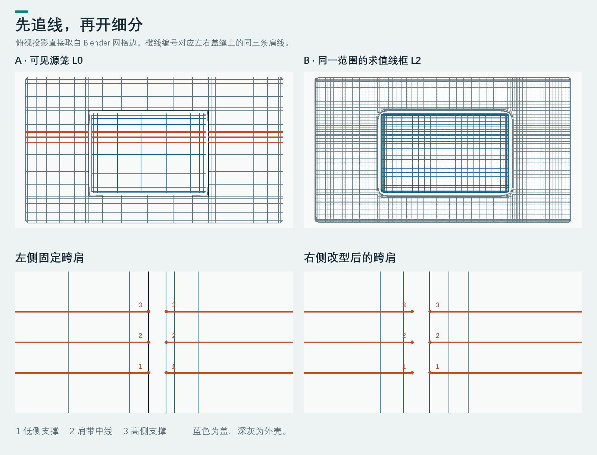

# 建模计划与资产分件

硬表面模型最贵的返工，几乎都来自开工前没想清「怎么拆件、从哪起坯、几段对齐」。把计划和分件压在动第一条边之前，用十分钟画清蓝图，后面布线、加修改器、展 UV 和改型会顺滑得多。

## 一、分级规划门槛与开工节奏

按资产复杂度决定计划的轻重，小件轻快推进，大件先落书面蓝图：

| 复杂度档位 | 典型资产 | 零件量级与装配深度 | 开工计划形式 | 确认时机 |
|---|---|---|---|---|
| **一至二级**<br>消费小件 / 常规家电 | 鼠标、耳机、手机、相机、电吹风、小风扇、搅拌机、机械键盘 | 5–25 件；1–2 层子集合 | 开工汇报里附**短清单**：零件表、每件路线（Sub-D / 中模）与起坯方式 | 按既有参考图或教程直接开工；原创造型先确认短清单 |
| **三级**<br>手持电动工具 / 精密道具 | 筋膜枪、冲击钻、老虎钳、武器瞄具、监听控制器 | 15–40 件；2 层子集合 + 1–3 个活动副 | 写一页 **`plan.md`**（含零件表、装配树、枢轴、分段数与高风险小样） | 陌生机构或原创设计先请用户确认 `plan.md`；有明确参考直接开工 |
| **四至六级**<br>工业装备 / 汽车 / 航空器 | 手轮阀、云台球机、扁线电机、量产车、公务机/双翼机 | 30–250+ 件；2–3 层总成树 + 多轴联动 | 必须先落 **`plan.md`**，分阶段切出里程碑与高风险局部小样 | 陌生结构与原创方案先签认 `plan.md`，再按阶段推进 |

**触发书面 `plan.md` 的四个条件**（满足任意一条即写）：① 三级及以上资产；② 零件总数超过 10 件；③ 包含需要验证行程的活动机构；④ 存在多个零件跨可见分缝共享同一条高光母面。

## 二、参考配准与真实尺度基准

动网格之前先把所有视图钉死在同一把物理尺子上：

1. **统一世界坐标与单位**：采用公制 `1 unit = 1 m`、Z 轴向上、资产正面朝 `-Y`。落地道具底面落 `Z = 0`、对称中面落 `X = 0`。凡参考图给英寸、英尺或厘米（如 `30.7 ft`、`4312 mm`），建一个精确真实尺寸的外包立方体校准所有视图，彻底杜绝 10 倍或千倍错尺导致后续缝宽、倒角和光照全部失真。
2. **多视图地标对齐**：至少配齐两张正交视图（正视 + 侧视，复杂产品补齐正、背、侧、顶四视图）外加一张无遮挡斜视图。用轴距、轮心、总长宽高或核心圆心锁死正交投影比例，用斜视图判断曲面冠高、折角深浅和遮挡层次。
3. **视图防误选管理**：参考图统一放进根集合外的 `REF_`（或 `Blueprints`）集合，设为 `Depth = Back`、`Show In: Orthographic Only`、透明度 `0.1–0.3` 并关闭视图可选；遇侧视图与顶视图手绘略微错位时，平面外廓优先以顶视图为准，并记下口径。

## 三、资产分件五级方法论

真实工业产品极少是一整块铁疙瘩。拆分零件严格按下面五级优先级逐层落刀：**前三级决定物理世界里的真实零件归属，后两级只在不违背真实结构的前提下优化布线与效率**。

### 1. 制造工艺与分型边界（第一优先级）

先像结构工程师一样看这件东西在工厂里是怎么造出来的：

- **注塑塑料壳**：沿模具开合方向找出**分型线（Parting Line）**，按真实合模方式拆分上下壳、左右壳或前框后壳。常见四大壳体架构：
  - **上下合盖（Clamshell）**：如鼠标、手柄、电动工具机身，沿周界合模线拆上下两壳或左右两半。
  - **筒体加端盖（Cup-and-Cap）**：如吹风机、保温杯、镜头筒、筋膜枪，主筒保持无纵向合模缝的完整圆弧，前后封端盖。
  - **骨架配蒙皮（Chassis-and-Skin）**：如相机、汽车、笔记本电脑，内部承力中框/底盘固定机构，外部装饰面壳或钣金件逐块扣合覆盖。
  - **模块总成（Modular Assembly）**：如咖啡机、工业阀门、飞机起落架，由独立加工件通过法兰、螺栓、销轴拼装。
- **钣金与冲压件**：每块独立冲压外板（机盖、翼子板、车门、后尾门）各自成件，边沿带冲压内翻边。
- **异类工艺独立拆件**：金属铸件、CNC 机加工件、二次包胶软胶握套、透明玻璃/亚克力镜片、滤网织物，一律拆成独立对象。

### 2. 运动关系与装配自由度（第二优先级）

凡是会转、会滑、会掀开、会拆装的零件，从第一天就拆成独立对象：

- 旋钮、按键、扳机、开关滑键、翻盖、车门、舵面、轮组各自独立，**原点直接落到真实转轴中心或滑轨基准面**。
- 在计划里写清每个动件的父级归属、单一允许自由度（如门盖绕局部 `X` 轴转 `0°–85°`，前轮空物体控转向 `Z`、轮毂子件控滚动 `X`）与极限行程净空。

### 3. 材质与表面处理边界（第三优先级）

高光烤漆、哑光磨砂塑胶、阳极氧化铝、镀铬饰条、防滑橡胶、透明罩片，在真实产品上往往对应不同的物理件或独立饰件，按真实结构缝分开建模，既方便后续独立展 UV 与赋材质，又能自然形成真实接缝暗影。只有丝印字样、贴纸、双色喷涂界线这类无物理缝的图案留在同一网格交给材质与贴图。

### 4. 可见分缝与拆装方向（第四优先级）

对每一道分缝问清三个问题并记入计划：

1. 缝的两侧分别属于哪两个零件？
2. 拿掉外盖或活动件之后，底下露出的是承台止口、独立内壁还是贯通空腔？
3. 零件沿哪个方向装入或取出（拔模方向 / 拆装轴向），沿这条路线有没有倒扣或邻件挡路？

### 5. 建模效率与拓扑复用（第五优先级）

在前四级真实分件确定之后，再做两类工程提效拆分：

- **高密细节隔离**：把扬声器多孔网罩、密集散热百叶、键盘键帽阵列、外贴车标拆为独立件，不把密线硬切进大面积高光外壳。
- **对称与周期复用**：左右对称壳只建半边（`Mirror`）；四向对称或圆周重复结构（如 4 槽握柄、8 瓣手轮、5 辐轮毂、48 槽电机铁芯）只建 `1/4` 或单扇区，再靠镜像/阵列拼出整件。

## 四、三条建模路线与三大起坯策略

### 1. 按零件特点选路线（同一整机自由混用）

| 路线 | 适用零件 | 建模特征 |
|---|---|---|
| **Sub-D 全四边控制笼**（主力） | 汽车/飞机流线外皮、人体工学手柄、圆润家电外壳、特写主角件 | 稀疏四边面控制笼 + 支撑卡线/边权倒角 + `Subdivision (Catmull-Clark)`；高光连贯、随时可调软硬圆角 |
| **非细分中模（倒角 + 加权法线）** | 承力机架、起落架液压筒、工业阀座、方正机箱、光学仪内部件 | 准确分段全四边源笼 + 实倒角（`Bevel` 3 段 `Arc`）+ `Smooth by Angle → Weighted Normal`；面数省、硬棱锐利、整机帧率高 |
| **混合装配** | 中大型整机（汽车、飞机、相机、电动工具、工业设备） | 外露流线壳走 Sub-D，内部骨架、紧固件、机械机构走中模；绝不把不同细分级别的件强行 `Ctrl+J` 合并 |

> **布尔定位边界**：平面板材的规整开孔可用实时 `Boolean (Exact)`；曲壳上的斜交相贯只用布尔在副本上求交线定位，正式白模一律按交线足点重排全四边面带。

### 2. 三大起坯策略与首次装配检查

| 起坯方式 | 何时选用 | 标准做法 | 首次装配检查 |
|---|---|---|---|
| **同源母面切分** | 多个外板跨缝共享同一连续曲面高光（汽车 9 块钣金、飞机蒙皮、鼠标/手柄上下壳） | 先建光顺无孔连续母面并备份入 `REF_`。<br>• **高频改型/流线蒙皮流**：`Details` 单对象用 `Y` 键沿缝拆边，配 `Mirror → SubD(Keep Corners) → Shrinkwrap(母面) → Solidify → Bevel(Weight)` 统一控缝。<br>• **汽车特写实翻边流**：按缝 `P` 分离各板，各板向内挤真实翻边后统一倒角收唇。 | 隐藏母面后同机位扫双方向条形高光查跨缝连续度；切剖面核对外缝宽、隐藏止口与内翻边净空 |
| **独立起坯装配** | 独立加工件、刚性机构、活动件、模块化总成（阀门、夹爪、键盘、灯组内构、电机定子） | 锁定共同世界基准面与中心轴；各件独立定分段与控制笼密度，先做配合面、轴孔、承座和限位止挡，再雕饰外观细节 | 沿装配主轴或配合面切剖面，核对同轴度、贴座接触、侧隙与活动件全行程无穿插 |
| **平面展开或代理成形** | 单轴恒曲率多孔圆筒/滚花环；双曲外壳上的凸筋格栅与百叶 | • **恒曲率件**：平面铺全四边孔环与背缝，按 `SubD → Bend 360° → Weld(ALL, VG_Seam) → Solidify` 卷圆。<br>• **双曲立体筋格**：平态建饰件与平面代理 `Proxy_Quad`，先 `Surface Deform Bind`，再由代理 `Shrinkwrap` 贴合双曲母面。 | 核对卷圆背缝无内部夹墙、孔道沿安装轴贯通、立体筋高度无压扁 |



## 五、大纲装配树、命名与枢轴规范

从新建工程第一分钟就按商业交付标准组织大纲（直接对齐 `blender-modeling-review` 的 G2 门禁），避免做到收尾再重构层级：

```text
<AssetName>（单一根集合，如 Hairdryer_Pro / Electric_SUV）
├── Housing / Body（主外壳与覆盖件总成）
│   ├── Body_Shell_Upper
│   ├── Body_Shell_Lower
│   └── Side_Trim_L / Side_Trim_R
├── Mechanism / Controls（机构、灯组、按键与活动件总成）
│   ├── Trigger_Pivot（原点落真实转轴，标明 Rot X 0°–25°）
│   └── Switch_Slider
├── Hardware（紧固件、装饰件、标准件）
│   └── Screw_M3_Array
└── [辅助集合，默认隐藏且全部关闭 hide_render]
    ├── REF_<AssetName>（正交三视图、无孔引导母面）
    └── CUTTER_<AssetName>（实时布尔切刀、投影代理）
```

- **语义命名**：采用「部位 + 角色」的清晰可读名称（如 `Front_Bumper`、`Lens_Housing`、`Handle_Grip_L`），清零 `Cube.001`、`Cylinder.003` 等默认名。
- **枢轴与变换**：静态壳体原点放在底面中心 `[0, 0, 0]` 或总成公共基准点，静态网格应用缩放 `(1, 1, 1)`；活动件原点对齐真实铰链或旋转轴，并用父级空物体把整机移动、机身姿态与单件运动拆开（如载具按 `CAR → ALL_BODY + 4 WHEEL` 分轴控制）。

## 六、关键截面、公倍数分段与推进顺序

### 1. 用最小公倍数提前配平段数（Segment Matching）

动刀前先算清相交或同轴部件的周向分段，让所有交界天然 `1:1` 或整数倍对接：

| 结构场景 | 推荐起始分段 | 配平逻辑 |
|---|---|---|
| 低密 T 形相贯筒柄 | 主筒 `8` 或 `24` 段 | 先实数主筒开洞口边界顶点数 `N`（如 8 边筒开半周口得 10 点），支管即建 `N` 段并按需转半步角对齐 |
| 通用漆面圆柱径向开孔 | 主筒 `32` 段配 `16` 边孔 | 柱面主体法线平滑与孔周四边缓冲圈兼得；近景大径件可升至 `48` 段 |
| 异重对称同轴件（如 6 棱杆接 4 槽头） | `24` 段 | 取最小公倍数 `lcm(6, 4) = 12` 的 2 倍，每面保留均匀四边分段 |
| 径向阵列 / 多瓣零件（如 8 瓣手轮、5 辐轮毂、7 槽格栅） | `24` / `40` / `49` 段 | 每瓣/每辐分配 `3–8` 段（`8×3=24`、`5×8=40`、`7×7=49`），单扇区建完直接闭环 |
| 球冠端盖接圆筒 | 四边球每面 `4` 或 `6` 段（赤道 `16` 或 `24` 段） | 用 `Roundcube` 取半球直连圆筒，彻底消除极点三角扇 |

### 2. 从大形到细节的四阶段推进顺序

严格按「大形体量 → 主母面与分件 → 次级特征与卡线 → 局部微细件」逐级落锁，每一级过关再进下一级：

1. **体量占位（Blockout）**：用极简基本体摆出全部主件、总长宽高和活动件行程包络，锁死多视角剪影比例。
2. **主形与母面（Primary Forms）**：把主壳细化为低密度连续四边母面，只放最宽点、拐点、肩线和端部控制站；调顺主曲面条形高光并备份母面，再执行分件、翻边与止口。
3. **次级结构（Secondary Forms）**：开真孔、做凹槽、装承座、加加强筋，理清全四边面流并布置支撑卡线与修改器栈；先做高风险局部小样（如三片弧缝交汇、斜交相贯、密集孔阵）验证通过再铺开整机。
4. **微细件与贴图分流（Tertiary Forms）**：影响轮廓剪影、需要单独反光或参与特写拆装的螺丝、扣件、散热孔建实几何；纯平面铭牌文字、浅咬花、远景微孔点阵交给法线/凹凸贴图（如高烘低平面法线图），省下多余面数。

## 七、一页《建模与分件计划》（`plan.md`）标准模板

三级及以上资产开工前，在工作目录新建 `plan.md`，十分钟填齐以下六块内容即可开工：

```markdown
# <资产名称> 建模与分件计划

## 1. 目标、尺度与参考口径
- 目标用途与等级：L2 商业白模 / 特写主角 L3 / 游戏资产
- 真实物理尺寸：长 × 宽 × 高（单位 mm / m），正面朝 -Y，底面 Z=0
- 参考图口径：正/背/侧/顶 + 斜视路径，冲突仲裁原则（以哪张为准）

## 2. 零件清单（BOM）与路线分配
| 零件名 | 所属子集合 | 制造工艺/材质 | 路线（Sub-D/中模） | 起坯方式 | 对称/阵列 | 关键分段 |
|---|---|---|---|---|---|---|
| Body_Shell_Upper | Housing | 注塑外壳 | Sub-D | 同源母面切分 | Mirror X | 主筒 32 段 |

## 3. 大纲装配树与运动枢轴
- 根集合与子集合结构（含 REF_ / CUTTER_ 辅助集合）
- 活动件清单：零件名 | 父级 | 枢轴位置 | 自由度与行程 | 净空要求

## 4. 关键截面、分缝与交接结构
- 主要分缝列表：缝两侧零件 | 缝宽 | 翻边深度 | 隐藏止口/承台做法

## 5. 高风险局部小样（优先验证）
- 列出 1–3 处最难部位（如斜交相贯、三片弧缝、密集孔阵）及小样验证标准

## 6. 白模停点与改型验证题
- 白模交付边界（保留哪些非破坏修改器、哪些微细纹理交贴图）
- 预定的 1–2 项局部改型测试（改什么尺寸、保护哪些邻件）
```
