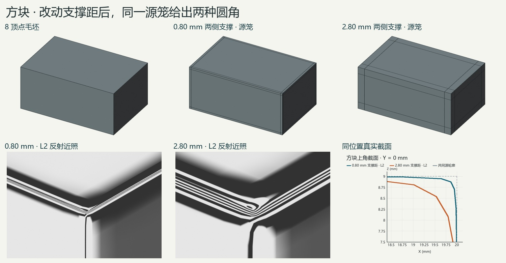
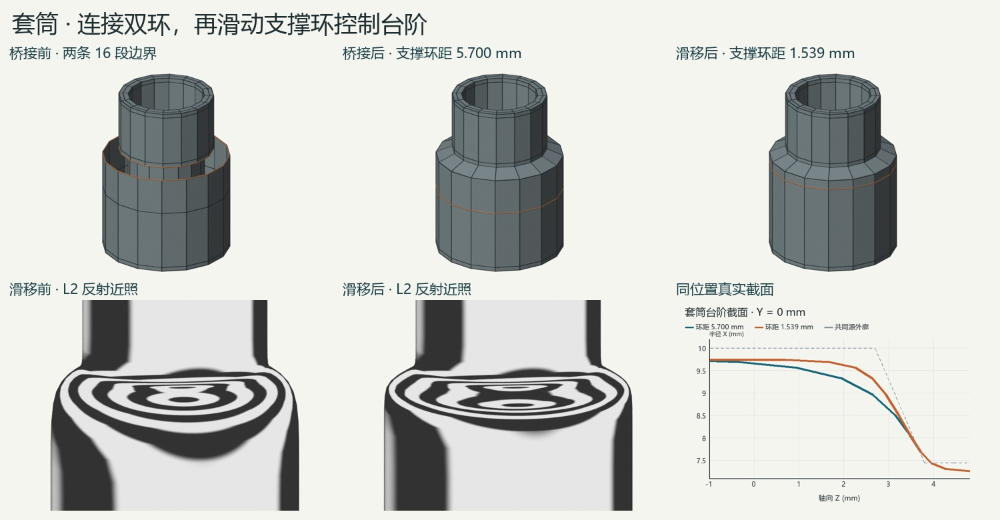
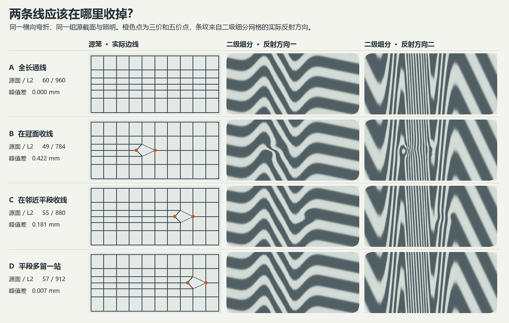
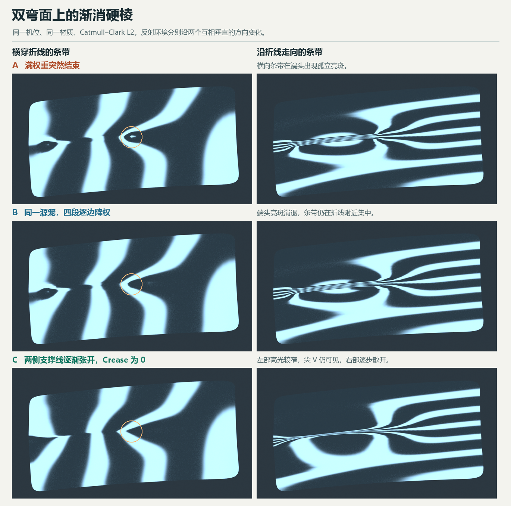
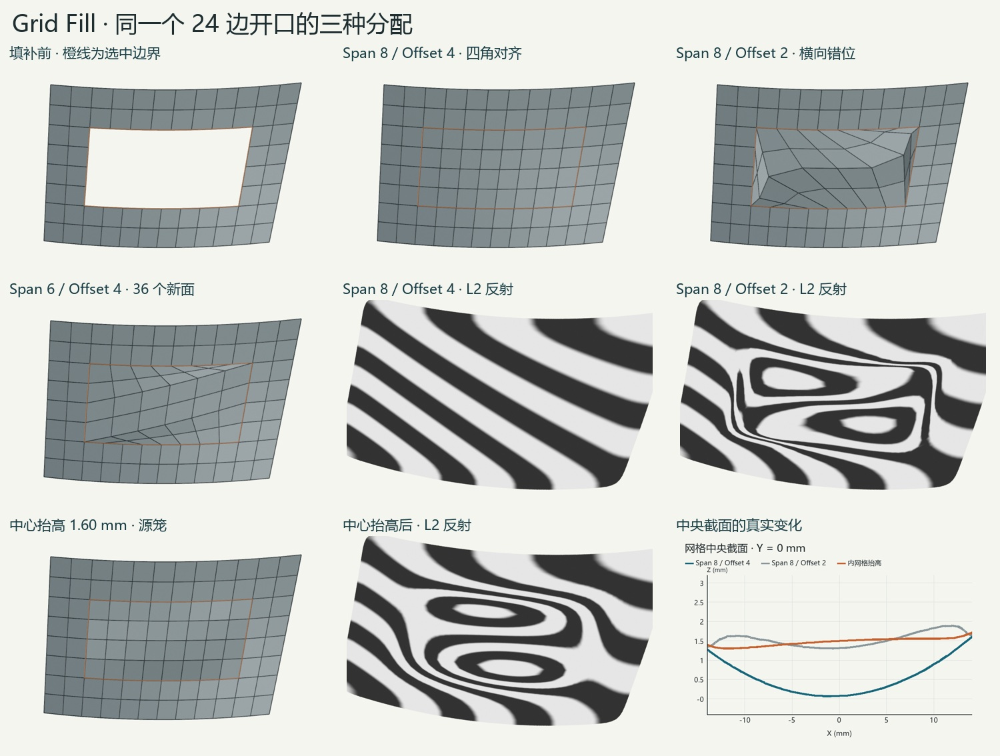
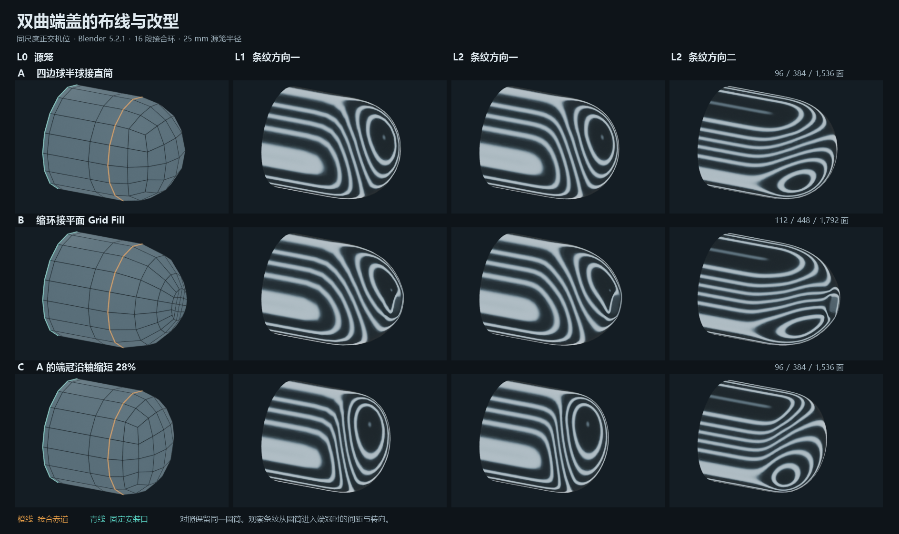
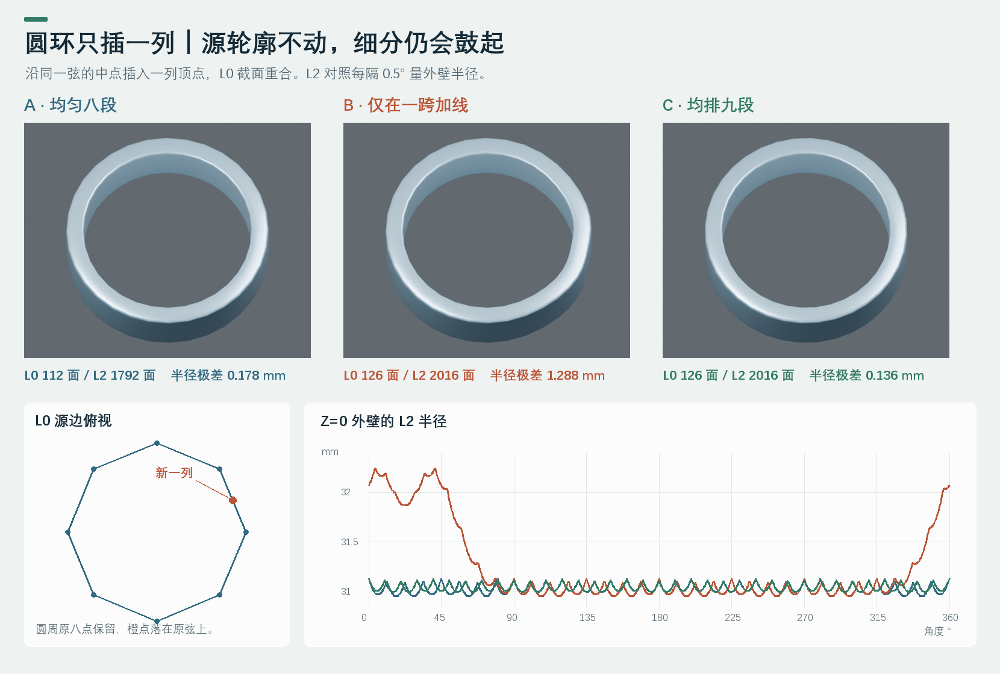

# 控制笼布线与卡线

好布线做两件事：在细分后撑出干净连续的高光曲面，在改型时让建模师顺着一两条边环就能精准改尺寸。布线质量由**连接关系**（谁和谁共边、循环怎么走、极点落哪里）和**空间排布**（点位、跨距、支撑宽度、密度过渡）共同决定。

## 一、全场景全四边面基准

所有硬表面模型——无论是 Sub-D 曲壳还是静态中模的纯平面封口——都统一保持全四边面，清零 N-gon：

- **连续曲面与变形区**：纯四边面带保证 Catmull–Clark 细分均匀插值、高光无星形捏痕，也保证倒角滑移、环切和后续绑定/弯曲变形不塌面。
- **静态中模与纯平面封口**：圆柱端盖、矩形底板和布尔后的平面区域同样收成规整四边面（平口优先 `Grid Fill`、同心内插四边环或对称放射四边格），彻底消除导出或二次倒角时的长瘦隐形三角。
- **边流可读性**：每一条循环边都有清晰职责——要么定义造型转折，要么承托圆角半径，要么负责密度过渡。跨过大块平滑区域时保持四边形接近正方形、间距均匀，让细分张力自然传递。

## 二、两族互相约束的控制线

以带台阶的圆柱套筒为例：沿轴向的**纵线（母线）**管外轮廓怎么跨过台阶，绕轴一圈的**横环（截面环）**管每个站位的截面形状。搭控制笼时先把这两族线的分工划清：

1. **造型环（Shape Loops）**：放在截面真正发生变化的位置——最宽点、主冠高、肩折、台肩、唇口与端部。先用尽量少的站位撑出准确的轮廓，再考虑加线。
2. **支撑环 / 卡线（Support / Holding Loops）**：贴在目标折棱两侧，专门控制细分后的倒圆半径。卡线离折棱越近，细分圆角越锐；离得越远，圆角越柔和。
3. **过渡环（Transition Loops）**：只在需要增减密度或引导孔周走向时插入，在低曲率平缓区收束，让高密局部不会污染整片大面。

### 快速生成均距支撑环

在硬棱两侧需要均匀双支撑线时，选目标棱执行 `Ctrl+B`（`Segments = 2`，`Profile Shape = 1.000`），倒角面保持平直，生成的两条外边直接充当等距支撑环，再按需用 `G+G`（Edge Slide）微调单侧圆角软硬。

## 三、卡线间距、变宽圆角与短棱净跨

### 1. 同一条棱从宽圆角过渡到窄圆角

圆角宽窄变化时，在宽窄两端分别定好「圆角中线 + 两侧切线行 + 两侧支撑行」共五行控制线，沿棱长让五行同步、平顺地收宽或收窄。把宽度变化分摊到足够的过渡长度上；只改一端圆角时，锁定保护界线外的旧宽与切向，从界线重新顺滑接到新端宽，避免中段先收窄再鼓出二次高光斑。

### 2. 直边插环要避开圆角切点

在已有圆角的框体上补一圈环切时，先追到离目标最近的圆弧切点，把新环插在两侧都是平直段的跨距中部。紧贴切点的最后一跨看似直边，插环后仍会拉动细分在邻跨的插值，使圆角半径偏移。需要重定圆角半径时，同步移动切点并重排整段弧线。

### 3. 相邻圆角先算短棱净跨

两个圆角共用同一条短棱时，先在源笼上量清两端退让长度之和是否小于短棱总长：

- **有正余量**：中段保留两个独立的切点截面，两端圆角可各自独立调宽。
- **余量刚好为零**：两端共享一个中央截面，避免两圈卡线重叠。
- **退让之和超出短棱**：调小一端半径或取消独立中段重接，防止控制笼看似正常、细分 L2 后两圈交叉穿模。

## 四、极点退让与密度收束

极点是四边面网格内部连接 3 条边（N-pole）或 5 条边（E-pole）的顶点。在复杂曲面上转向和减线离不开 3/5 价极点，核心法则是**把极点推到平坦安全区，并在可见曲面上清零 6 边及以上的星形极点**。

### 1. 极点放对地方，高光立顺

- **避开高光脊线与圆角带**：把成对的 3 价与 5 价极点从主曲率肩脊、孔角或反曲带往外多留至少一圈常规四边面，退让到平坦侧裙或平缓大面中。把同组极点从肩脊移至平缓侧裙，肩部法线误差能直接降下三成。
- **保持极点守恒迁移**：向安全区外推一格时，同步吸收并重导对应边流，不要靠删边制造三角或 N-gon。

### 2. 标准全四边减线模板

密度从细节端向大面退出时，统一用全四边 U 形回折补片，把 `(N+2)` 条线缩成 `N` 条线（最常用 `3 → 1` 与 `4 → 2` 菱形折返）：

- 在平缓区留出一圈缓冲面带后再收线。
- 两条相邻密线向内聚成一颗 3 价点与菱形四边面，外侧自然配对 5 价点，使多余边流在局部闭合回路内结束，不穿透整件壳体。
- 如果一条主线未来需要随时一键环选调大形，优先保留全长通线；确认是局部细节密线再做减线收束。

## 五、渐消棱（Fade-Out Character Line）

汽车车身、家电外壳上常见的「锐棱逐渐消失进光顺大面」，切忌把满折痕突然归零（会在终点形成孤立亮斑）。推荐两种可编辑全四边做法：

1. **支撑线渐开法（全四边主流）**：沿锐段让双侧支撑线紧贴主棱，进入渐消区后逐站向外扇形张开，使曲率过渡半径自然拉大；终端需要彻底收束入大面时，用 `J` 斜连成双三角再融并中短边化为 1 个全四边菱形渐消面，两侧点微向外放松，高光零捏皱溶入主曲面。
2. **逐级降权法**：若使用 `crease_edge` 或局部边权倒角，在渐消段分 3–4 站逐边下调权重（如 `1.0 → 0.65 → 0.35 → 0.10 → 0`），消除骤停尖突。

## 六、补洞、桥接、端盖与圆环保圆

### 1. 补洞先配偶数周界与角点相位

- **原生 Grid Fill**：适用于单个可配对的偶数边缺口。操作时锁定准确的活动角点，调整 `Span` 与 `Offset`，让新生成的两族四边线顺着外围既有面带直穿出去。同一 24 边开口，错位 2 格的 Offset 虽然面数相同，会把内角挤尖并在细分下生出回折亮斑。
- **异段转接先数分区周界**：当两端安装口段数不同（如 16 段接 12 段）且四条主棱角点锁定，把转接拆成四个分区。全四边补片的周界总边数必须为**偶数**；遇奇数分区时调整共享纵界分段数（如 `2/3/2/3` 相间）凑齐偶数边后再铺全四边。

### 2. 桥接与空间弯管相位对齐

- **Bridge Edge Loops**：先确认两环段数一致、物理起点对应（如都从 12 点钟方向起算），调 `Twist` 消除螺旋扭转，再用 `Number of Cuts` 补中段截面。
- **空间急弯管**：沿中心线连多道截面时，逐站按装配顶向固定每环的顶/左/右四条纵轨。避免依赖默认最小转动一路累积到出口突然复位，否则出口前一跨会被拧出收腰。

### 3. 球冠端盖与圆环加线保圆

- **半球端盖用四边球**：直筒接半球冠时，用四边球（Roundcube / 立方体细分球化）取等段赤道半球桥接直筒，端顶零高阶极点，比「缩环 + 栅格填充」的端冠高光顺滑得多。
- **低密圆环补线必须均排**：在 8 段或 12 段低密圆环的单跨弦中点插一条纵线，虽然源笼轮廓看着没变，细分权重的非对称会让 L2 截面严重鼓包。确需在圆环上加线时，将整圈或该段弧重新等角均排，并按细分的径向收缩量微调外径。

## 七、理线与微调工具的边界

- 局部改卡线宽度首选原生 **Edge Slide**（`G+G`）；需要按外侧弧度保形滑移时切换 `Even (E)` 与 `Flipped (F)`。
- 整理平面圆口用原生 **Circularize** 或 `LoopTools → Circle`（在曲面上整圆务必关闭 `Flatten`，防止把曲面拍平）；匀化长边链间距用原生 **Space Evenly** 或 `LoopTools → Space`。
- 用 **EdgeFlow（Set Flow / Set Curve）** 或 `LoopTools → Relax` 理顺弧面时，只选中拓扑正确的一小段，固定两端与保护孔口，避免整片拉塌圆径或压薄壁厚。
- 补洞面片略微凹凸不平时，用 `LoopTools → Flatten (Best Fit)` 拍平，不用 `Smooth` 导致边界缩水。
